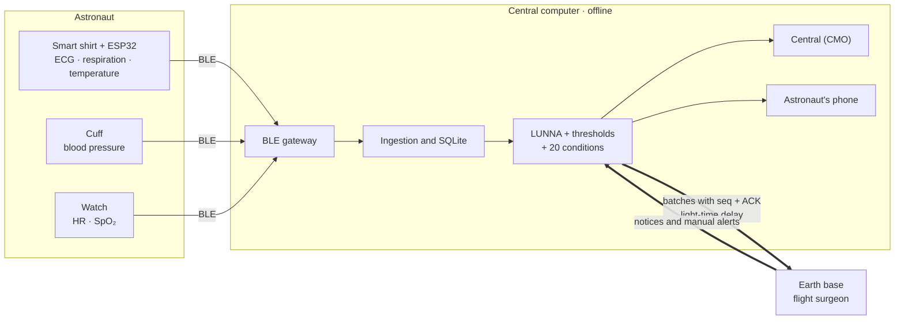

> 🌐 [Español](README.md) · **English**

# Lunna

[](https://github.com/DinDevJ/lunna/actions/workflows/pruebas.yml)

**Health monitoring for astronauts on long-duration missions** · Team Monarcas · NASA Space Apps Challenge 2026 ·
challenge *Create Health Monitoring Software for Astronauts on Space Missions*

> Lunna learns each astronaut's own normal, compares every reading against what is expected *for that
> person in that environment* (a Bayesian model called LUNNA, plus clinical thresholds), and warns the crew medical
> officer before a problem grows. Sensors (an ESP32 smart shirt, a cuff, a
> watch) stream over Bluetooth to an on-board computer that works fully offline and syncs with Earth over a
> delay-tolerant link with no data loss. The interfaces are in Spanish with an English switch.
> **Start here:** [ONBOARDING.en.md](ONBOARDING.en.md).

In the mock-up scenario, the light-time delay is 18 min each way (at Mars the physical delay ranges from
minutes to more than 20 min). The demo backend defaults to 20 s. Lunna runs **on board and offline**:
it learns each crew member's normal, explains what changed and warns the crew medical officer (CMO), so that the spacecraft
can decide on its own. Earth receives the same information, with that delay, and responds with notices.

> ⚠️ Hackathon prototype. **It is not a medical device and it does not diagnose.** The demo crew is fictional and
> their data are synthetic and labeled as such. The solar events from **NASA DONKI**, the limits from
> **NASA-STD-3001** and the open laboratory data from **Inspiration4** (NASA OSDR) are real.

---

## What the software includes

| Capability | What it does | Where it is |
|---|---|---|
| **Sensors and ESP32 firmware** | The smart shirt reads ECG (heart rate), respiration and temperature; it builds 17-byte binary frames and sends them over Bluetooth LE with a custom GATT service. When disconnected it stores about 1,800 readings (≈ 30 min) and sends them later with their actual time | [`Sistema/esp32/`](Sistema/esp32/playera_eva/playera_eva.ino) |
| **EVA frame profile** | 13-byte header (device, schema, sequence, time) and a payload defined by an editable schema. Firmware (C++), gateway (Python) and backend (TypeScript) produce **the same bytes**, verified with test vectors | [`esquema.ts`](Sistema/backend/src/esquema.ts) · [`trama_eva.h`](Sistema/esp32/playera_eva/trama_eva.h) |
| **Bluetooth gateway** | Connects to all EVA devices at once, gives them the time, detects lost frames by sequence number and stores up to 50,000 frames if the central computer does not respond | [`Sistema/pasarela/`](Sistema/pasarela/pasarela_ble.py) |
| **Central computer** | Node 22 with built-in SQLite, no dependencies. Attributes each frame to whoever is wearing the device, stores it with the time at which it occurred and ignores duplicates | [`Sistema/backend/`](Sistema/backend/src/servidor.ts) |
| **LUNNA: Bayesian updating** | Predicts the expected value of each vital sign **for that person in that environment**, combining three layers weighted by their precision: literature, previous missions and their first 14 days of flight (the calibration is frozen so that a slow drift does not become "normal"). Every prediction comes with its 95% band and every alert with the probability that it is noise | [`lunna.ts`](Sistema/backend/src/lunna.ts) |
| **Two alert criteria** | The personal criterion (median versus expected) detects slow drifts; the clinical threshold detects acute events (an SpO₂ of 87% is serious even if it is "normal for you"). The worse of the two prevails and the alert says why | [`ingesta.ts`](Sistema/backend/src/ingesta.ts) · [`medibles.json`](Sistema/backend/semillas/medibles.json) |
| **20-condition engine** | Per-person pre-flight baseline, protected in-flight updating (EWMA) and CUSUM for slow changes; traffic light with weights editable by the flight surgeon | [`prototipo-salud/motor/`](prototipo-salud/motor) · [`semaforo.ts`](Sistema/backend/src/semaforo.ts) |
| **ECG and echocardiography models** | ECG processing and five echo models (PanEcho, EchoNet-Dynamic, EchoCLIP, EchoPrime, MedSAM2) launched from the central computer | [`prototipo-salud/adapters/`](prototipo-salud/adapters) · [`modelos.ts`](Sistema/backend/src/modelos.ts) |
| **Offline operation and synchronization with Earth** | Store and forward: nothing is lost if Bluetooth, the network or the communication window drops. With Earth: batches with sequence number, sha256, cumulative ACK and retries; the receiver applies each message exactly once (**zero losses and zero duplicates** in the tests). Priorities: red alerts first, raw data last | [`enlace.ts`](Sistema/backend/src/enlace.ts) · [`sincro.ts`](Sistema/backend/src/sincro.ts) · [`enlace-https.ts`](Sistema/backend/src/enlace-https.ts) |
| **Four interfaces** | Phone (each astronaut), watch, central computer (CMO) and Earth base (flight surgeon), in Spanish and English | [`Sistema/interfaces/`](Sistema/interfaces) |
| **Spacecraft simulation** | Interactive mock-up with the crew transmitting, one terminal per device, the ESP32 serial monitor and clinical scenarios (`hypoxia`, `infection`, `fatigue`, `hypertension`) | [`Simulacion/`](Simulacion) |
| **Landing page and deployment** | Page that shows each device with its real interface; one-command installation on a VPS (nginx, systemd, HTTPS) | [`landing/`](landing) · [`despliegue/`](despliegue/README.en.md) |

## How it connects



## Try it in 2 minutes

Requires **Node.js 22.6 or later**. No `npm install` needed.

```bash
cd Simulacion
npm start
```

Open **http://localhost:8787/simulador** (in English), press **Prepare mission** and then **▶ Live**. In the terminal
of the central PC, type `scenario hypoxia` (it also accepts `escenario hipoxia`) and watch how LUNNA raises the alert, how it
reaches Earth and how Earth responds.

| Screen | Address |
|---|---|
| Spacecraft simulator | http://localhost:8787/simulador |
| Astronaut's phone | http://localhost:8787/app/ |
| Central computer | http://localhost:8787/app/central.html |
| Earth base | http://localhost:8787/app/base.html |
| Watch | http://localhost:8787/reloj/ |
| Landing page | see [`landing/README.en.md`](landing/README.en.md) |

The full walkthrough for judges and developers is in **[ONBOARDING.en.md](ONBOARDING.en.md)**.

## What is verified

| Check | Result |
|---|---|
| Backend (`npm test` in `Sistema/backend`) | On Nov 15, 2026, on Linux: 97 passed, 0 failed, 0 skipped. On Windows, 85 passed and 12 skipped had been documented (openssl and Python environments). Details in [testing and validation](documentacion/README_08_PRUEBAS_VALIDACION.en.md) |
| Simulation (`npm test` in `Simulacion`) | 4 / 4 |
| **Automated tests** ([GitHub Actions](.github/workflows/pruebas.yml), on every change) | Backend 93/93 with **89.8% line and 82.7% branch coverage** of the source code · simulation 4/4 · interfaces 25/25 (91.4% of lines) · firmware and gateway · condition engine 109/109 |
| Engine and interfaces (`node --test *.test.mjs` in `Sistema/interfaces/eva`) | 25 / 25 |
| ESP32 firmware and gateway against the backend | Same bytes in all 4 vectors |
| Spacecraft ↔ Earth synchronization with injected faults | 0 losses, 0 duplicates |
| Clinical scenarios in the simulator | All 4 raise an alert and return to green; 0 false alarms in 3 min without anomalies |
| Health prototype (pytest) | In a clean environment (numpy and pandas only): 109 passed, 0 failed. The ECG suites need NeuroKit2, wfdb and sample videos: see [testing and validation](documentacion/README_08_PRUEBAS_VALIDACION.en.md) |
| External validation with Inspiration4 | Honest and limited (n = 4, partially simulated baseline): see [§4.4](documentacion/README_08_PRUEBAS_VALIDACION.en.md) |

**What is not verified:** the firmware has not been tested on a physical board, there are no data from real astronauts
in flight and no threshold is clinically validated in microgravity. Details in
[security, reliability and risks](documentacion/README_10_SEGURIDAD_CONFIABILIDAD_RIESGOS.en.md).

## Structure

```
Sistema/            The software that would run on the spacecraft and on Earth (operational mode)
  backend/            Central computer: ingestion, LUNNA, conditions, link with Earth, API
  interfaces/         Phone, central computer, Earth base (eva/) and watch (reloj/)
  esp32/              Smart shirt firmware and test vectors
  pasarela/           Bluetooth gateway to the central computer
Simulacion/         Everything synthetic: spacecraft simulator, generator, scenario and DONKI events
prototipo-salud/    20-condition engine, ECG and echo models, validation with Inspiration4
documentacion/      Ten technical documents (architecture, algorithms, data, testing, risks…)
landing/            Presentation page
despliegue/         Installation on a VPS
Planeacion/         Research catalogs (variables and conditions) and weight model
video/              30 s video and its generator
```

## Documentation

| | Document |
|---|---|
| 🚀 | **[ONBOARDING](ONBOARDING.en.md)**: walkthrough for judges and developers |
| 01 | [General planning](documentacion/README_01_PLANEACION.en.md) |
| 02 | [Research protocol](documentacion/README_02_PROTOCOLO_INVESTIGACION.en.md) |
| 03 | [User manual](documentacion/README_03_MANUAL_USUARIO.en.md) |
| 04 | [System architecture](documentacion/README_04_ARQUITECTURA_SISTEMA.en.md) |
| 05 | [Integration and interoperability](documentacion/README_05_INTEGRACION_INTEROPERABILIDAD.en.md): frames, BLE, API, link with Earth |
| 06 | [Computational models and algorithms](documentacion/README_06_MODELOS_COMPUTACIONALES_ALGORITMOS.en.md): LUNNA and the condition engine |
| 07 | [Data and variable dictionary](documentacion/README_07_DICCIONARIO_DATOS_VARIABLES.en.md) |
| 08 | [Testing and validation](documentacion/README_08_PRUEBAS_VALIDACION.en.md) |
| 09 | [Installation, configuration and deployment](documentacion/README_09_INSTALACION_CONFIGURACION_DESPLIEGUE.en.md) |
| 10 | [Security, reliability and risks](documentacion/README_10_SEGURIDAD_CONFIABILIDAD_RIESGOS.en.md) |
| | [Clinical thresholds and their source, item by item](Sistema/backend/semillas/medibles.en.md) |

## Team Monarcas

Julio · Iker · Leo · Diana · Katy · Fani

## License

[MIT](LICENSE).
