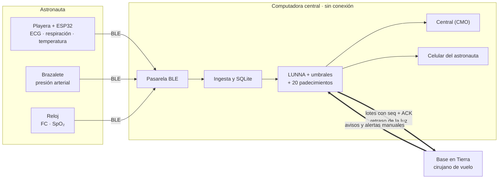

# Lunna

**Monitoreo de salud para astronautas en misiones largas** · Equipo Monarcas · NASA Space Apps Challenge 2026 ·
reto *Create Health Monitoring Software for Astronauts on Space Missions*

> **EN.** Lunna learns each astronaut's own normal, compares every reading against what is expected *for that
> person in that environment* (a Bayesian model called LUNNA, plus clinical thresholds), and warns the crew medical
> officer before a problem grows, while Earth is 18 minutes away by light in the mission scenario (the demo backend defaults to a 20 s delay). Sensors (an ESP32 smart shirt, a cuff, a
> watch) stream over Bluetooth to an on-board computer that works fully offline and syncs with Earth over a
> delay-tolerant link with no data loss. The interfaces are in Spanish with an English switch.
> **Start here:** [ONBOARDING.md](ONBOARDING.md).

En el escenario de la maqueta, el retraso de la luz es de 18 min por trayecto (en Marte el retraso físico va de
minutos a más de 20 min). El backend de la demo usa 20 s por defecto. Lunna corre **a bordo y sin conexión**:
aprende el normal de cada tripulante, explica qué cambió y avisa a la médica de a bordo (CMO), para que la nave
pueda decidir sola. Tierra recibe lo mismo, con ese retraso, y responde con avisos.

> ⚠️ Prototipo de hackatón. **No es un dispositivo médico ni diagnostica.** La tripulación de la demo es ficticia y
> sus datos son sintéticos y así se rotulan. Son reales los eventos solares de **NASA DONKI**, los límites de
> **NASA-STD-3001** y los laboratorios abiertos de **Inspiration4** (NASA OSDR).

---

## Qué tiene el software

| Capacidad | Qué hace | Dónde está |
|---|---|---|
| **Sensores y firmware ESP32** | La playera lee ECG (frecuencia cardiaca), respiración y temperatura; arma tramas binarias de 17 bytes y las envía por Bluetooth LE con un servicio GATT propio. Sin conexión guarda unas 1 800 lecturas (≈ 30 min) y las manda después con su hora real | [`Sistema/esp32/`](Sistema/esp32/playera_eva/playera_eva.ino) |
| **Perfil EVA de tramas** | Cabecera de 13 bytes (dispositivo, esquema, secuencia, hora) y carga definida por un esquema editable. Firmware (C++), pasarela (Python) y backend (TypeScript) producen **los mismos bytes**, verificado con vectores de prueba | [`esquema.ts`](Sistema/backend/src/esquema.ts) · [`trama_eva.h`](Sistema/esp32/playera_eva/trama_eva.h) |
| **Pasarela Bluetooth** | Se conecta a todos los dispositivos EVA a la vez, les da la hora, detecta tramas perdidas por número de secuencia y guarda hasta 50 000 tramas si la central no responde | [`Sistema/pasarela/`](Sistema/pasarela/pasarela_ble.py) |
| **Computadora central** | Node 22 con SQLite integrado, sin dependencias. Atribuye cada trama a quien lleva el dispositivo, la guarda con la hora en que ocurrió e ignora duplicados | [`Sistema/backend/`](Sistema/backend/src/servidor.ts) |
| **LUNNA: actualización bayesiana** | Predice el valor esperado de cada signo vital **para esa persona en ese entorno**, combinando tres capas por su precisión: literatura, misiones previas y sus primeros 14 días de vuelo (la calibración se congela para que una deriva lenta no se vuelva «normal»). Toda predicción trae su banda del 95 % y cada alerta la probabilidad de que sea ruido | [`lunna.ts`](Sistema/backend/src/lunna.ts) |
| **Dos criterios de alerta** | El personal (mediana contra lo esperado) detecta derivas lentas; el umbral clínico detecta lo agudo (una SpO₂ de 87 % es grave aunque sea «normal para ti»). Manda el peor y la alerta dice por qué | [`ingesta.ts`](Sistema/backend/src/ingesta.ts) · [`medibles.json`](Sistema/backend/semillas/medibles.json) |
| **Motor de 20 padecimientos** | Base prevuelo por persona, actualización protegida en vuelo (EWMA) y CUSUM para cambios lentos; semáforo con pesos editables por el cirujano de vuelo | [`prototipo-salud/motor/`](prototipo-salud/motor) · [`semaforo.ts`](Sistema/backend/src/semaforo.ts) |
| **Modelos de ECG y ecocardiografía** | Procesamiento de ECG y cinco modelos de eco (PanEcho, EchoNet-Dynamic, EchoCLIP, EchoPrime, MedSAM2) que se lanzan desde la central | [`prototipo-salud/adapters/`](prototipo-salud/adapters) · [`modelos.ts`](Sistema/backend/src/modelos.ts) |
| **Operación sin conexión y sincronización con Tierra** | Almacenar y reenviar: nada se pierde si se corta el Bluetooth, la red o la ventana de comunicación. Con Tierra, lotes con número de secuencia, sha256, ACK acumulado y reintentos; el receptor aplica cada mensaje una sola vez (**cero pérdidas y cero duplicados** en las pruebas). Prioridades: alertas rojas primero, datos crudos al final | [`enlace.ts`](Sistema/backend/src/enlace.ts) · [`sincro.ts`](Sistema/backend/src/sincro.ts) · [`enlace-https.ts`](Sistema/backend/src/enlace-https.ts) |
| **Cuatro interfaces** | Celular (cada astronauta), reloj, computadora central (CMO) y base en Tierra (cirujano de vuelo), en español e inglés | [`Sistema/interfaces/`](Sistema/interfaces) |
| **Simulación de la nave** | Maqueta interactiva con la tripulación transmitiendo, terminales por equipo, monitor serie del ESP32 y escenarios clínicos (`hypoxia`, `infection`, `fatigue`, `hypertension`) | [`Simulacion/`](Simulacion) |
| **Landing y despliegue** | Página que muestra cada dispositivo con su interfaz real; instalación en un VPS con un comando (nginx, systemd, HTTPS) | [`landing/`](landing) · [`despliegue/`](despliegue/README.md) |

## Cómo se conecta



## Probarlo en 2 minutos

Requiere **Node.js 22.6 o superior**. No hace falta `npm install`.

```bash
cd Simulacion
npm start
```

Abre **http://localhost:8787/simulador** (en inglés), pulsa **Prepare mission** y luego **▶ Live**. En la terminal
de la PC central escribe `scenario hypoxia` (también acepta `escenario hipoxia`) y mira cómo LUNNA alerta, cómo
llega a Tierra y cómo responde Tierra.

| Pantalla | Dirección |
|---|---|
| Simulador de la nave | http://localhost:8787/simulador |
| Celular del astronauta | http://localhost:8787/app/ |
| Computadora central | http://localhost:8787/app/central.html |
| Base en Tierra | http://localhost:8787/app/base.html |
| Reloj | http://localhost:8787/reloj/ |
| Landing | ver [`landing/README.md`](landing/README.md) |

El recorrido completo para jueces y para quien desarrolle está en **[ONBOARDING.md](ONBOARDING.md)**.

## Qué está verificado

| Comprobación | Resultado |
|---|---|
| Backend (`npm test` en `Sistema/backend`) | El 15 nov 2026, en Linux: 97 aprobadas, 0 fallidas, 0 omitidas. En Windows se había documentado 85 aprobadas y 12 omitidas (openssl y entornos Python). Detalle en [pruebas y validación](documentacion/README_08_PRUEBAS_VALIDACION.md) |
| Simulación (`npm test` en `Simulacion`) | 4 / 4 |
| Motor e interfaces (`node --test *.test.mjs` en `Sistema/interfaces/eva`) | 25 / 25 |
| Firmware ESP32 y pasarela contra el backend | Mismos bytes en los 4 vectores |
| Sincronización nave ↔ Tierra con fallas inyectadas | 0 pérdidas, 0 duplicados |
| Escenarios clínicos en el simulador | Los 4 alertan y vuelven a verde; 0 falsas alarmas en 3 min sin anomalías |
| Prototipo de salud (pytest) | Ver [pruebas y validación](documentacion/README_08_PRUEBAS_VALIDACION.md) |
| Validación externa con Inspiration4 | Honesta y limitada (n = 4, base parcialmente simulada): ver [§4.4](documentacion/README_08_PRUEBAS_VALIDACION.md) |

**Lo que no está verificado:** el firmware no se ha probado en una placa física, no hay datos de astronautas reales
en vuelo y ningún umbral está validado clínicamente en microgravedad. Detalle en
[seguridad, confiabilidad y riesgos](documentacion/README_10_SEGURIDAD_CONFIABILIDAD_RIESGOS.md).

## Estructura

```
Sistema/            El software que correría en la nave y en Tierra (modo operativo)
  backend/            Computadora central: ingesta, LUNNA, padecimientos, enlace con Tierra, API
  interfaces/         Celular, central, base en Tierra (eva/) y reloj (reloj/)
  esp32/              Firmware de la playera y vectores de prueba
  pasarela/           Pasarela Bluetooth hacia la central
Simulacion/         Todo lo sintético: simulador de la nave, generador, escenario y eventos DONKI
prototipo-salud/    Motor de 20 padecimientos, modelos de ECG y eco, validación con Inspiration4
documentacion/      Diez documentos técnicos (arquitectura, algoritmos, datos, pruebas, riesgos…)
landing/            Página de presentación
despliegue/         Instalación en un VPS
Planeacion/         Catálogos de investigación (variables y padecimientos) y modelo de pesos
video/              Video de 30 s y su generador
```

## Documentación

| | Documento |
|---|---|
| 🚀 | **[ONBOARDING](ONBOARDING.md)**: recorrido para jueces y para quien desarrolle |
| 01 | [Planeación general](documentacion/README_01_PLANEACION.md) |
| 02 | [Protocolo de investigación](documentacion/README_02_PROTOCOLO_INVESTIGACION.md) |
| 03 | [Manual de usuario](documentacion/README_03_MANUAL_USUARIO.md) |
| 04 | [Arquitectura del sistema](documentacion/README_04_ARQUITECTURA_SISTEMA.md) |
| 05 | [Integración e interoperabilidad](documentacion/README_05_INTEGRACION_INTEROPERABILIDAD.md): tramas, BLE, API, enlace con Tierra |
| 06 | [Modelos computacionales y algoritmos](documentacion/README_06_MODELOS_COMPUTACIONALES_ALGORITMOS.md): LUNNA y el motor de padecimientos |
| 07 | [Diccionario de datos y variables](documentacion/README_07_DICCIONARIO_DATOS_VARIABLES.md) |
| 08 | [Pruebas y validación](documentacion/README_08_PRUEBAS_VALIDACION.md) |
| 09 | [Instalación, configuración y despliegue](documentacion/README_09_INSTALACION_CONFIGURACION_DESPLIEGUE.md) |
| 10 | [Seguridad, confiabilidad y riesgos](documentacion/README_10_SEGURIDAD_CONFIABILIDAD_RIESGOS.md) |
| | [Umbrales clínicos y su fuente, dato por dato](Sistema/backend/semillas/medibles.md) |

## Equipo Monarcas

Julio · Iker · Leo · Diana · Katy · Fani

## Licencia

[MIT](LICENSE).
