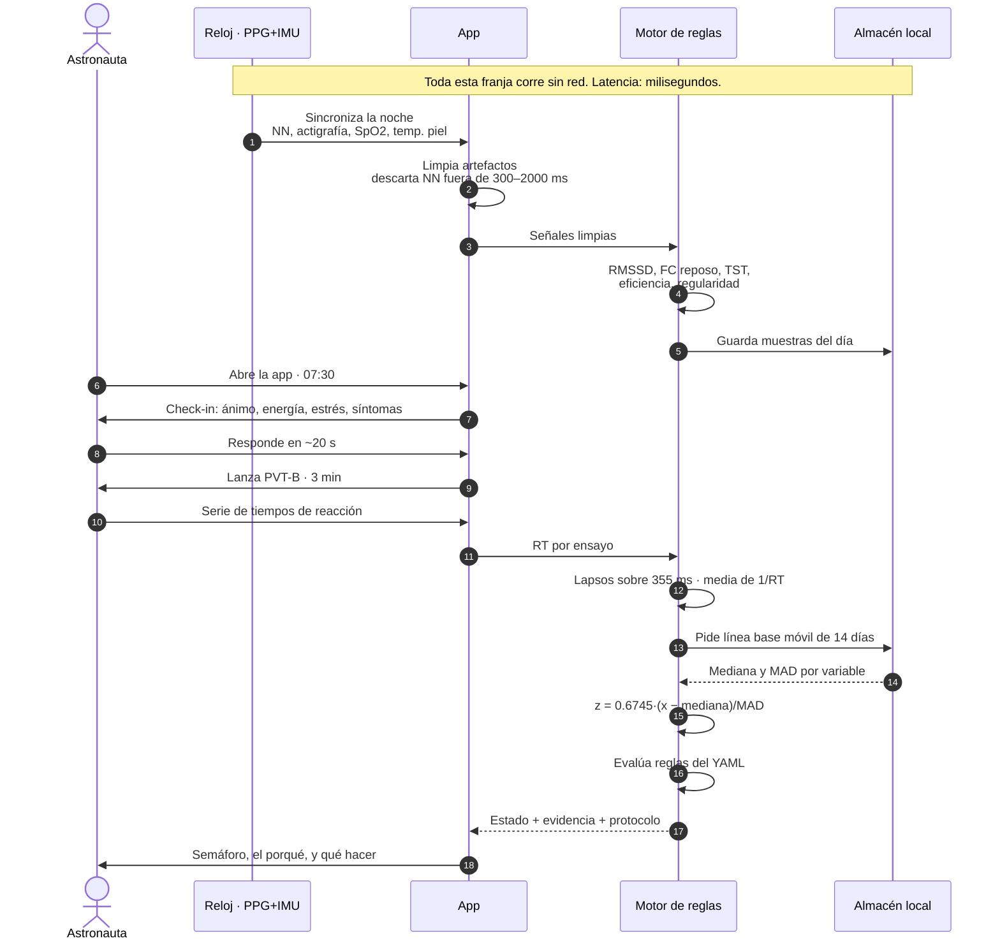
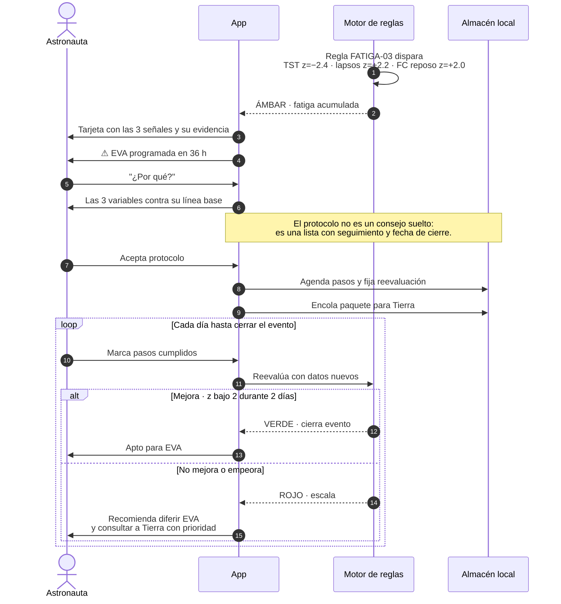
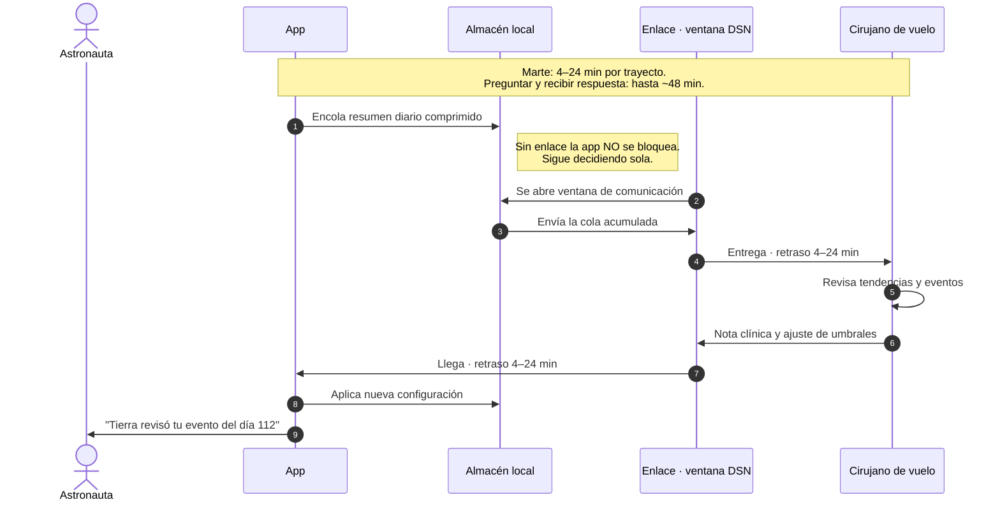

# Comportamiento del software — diagramas de secuencia y escenario

Documento de diseño. Define qué hace el sistema, en qué orden, y con qué números.
Sirve de tres cosas a la vez: especificación para quien programa, guion para la demo,
y spec del generador de datos sintéticos.

Convención heredada del diccionario de datos: ✅ verificado · ⚠️ verificar · 🔶 decisión nuestra.

---

## 1. Actores del sistema

| Actor | Qué es | ¿Necesita red? |
|---|---|---|
| **Astronauta** | Usuario principal. Decide y actúa. | — |
| **Reloj** | PPG + acelerómetro + termistor | No |
| **App** | UI local en el teléfono | No |
| **Motor** | Reglas deterministas sobre archivo YAML | **No. Nunca.** |
| **Almacén** | Base local cifrada + cola de salida | No |
| **Tierra** | Cirujano de vuelo | Sí, cuando hay ventana |

El punto de arquitectura: **las primeras cinco filas cierran el ciclo completo sin
Tierra.** Tierra es un observador diferido, no un eslabón de la decisión.

---

## 2. Diagrama 1 — Ciclo diario nominal



**Duración real del ciclo para el astronauta: ~4 minutos.** Si pasa de eso, no lo hace
todos los días, y un monitor que no se usa no monitorea nada.

---

## 3. Diagrama 2 — Escalamiento, protocolo y cierre

Este es el diferenciador. Nótese que **no termina en la alerta**: hay seguimiento,
reevaluación y cierre del evento.



🔶 El criterio de cierre (`z < 2` durante 2 días) es decisión nuestra. Hay que decirlo.

---

## 4. Diagrama 3 — Sincronización diferida con Tierra



Esto responde de inmediato a la pregunta obvia del jurado: *"¿entonces el médico no
sirve?"*. Sí sirve — **pero como supervisor asíncrono, no como cuello de botella.**

---

## 5. Escenario corrido — Día 112, fatiga antes de una EVA

Misión de tránsito a Marte. Tripulante MS-2. EVA de mantenimiento el día 114.

### Línea base móvil (14 días, construida en vuelo)

| Variable | Mediana | MAD |
|---|---|---|
| FC en reposo | 58 lpm | 2.0 |
| RMSSD nocturno | 42 ms | 6.0 |
| TST | 7 h 05 (425 min) | 24 min |
| Lapsos PVT-B | 2 | 1.2 |
| Eficiencia de sueño | 88 % | 3.0 |

### Los días previos

| Día | TST | RMSSD | FC reposo | Lapsos | Estado |
|---|---|---|---|---|---|
| 109 | 6 h 10 | 38 | 59 | 2 | Verde |
| 110 | 5 h 50 | 34 | 61 | 3 | Verde |
| 111 | 5 h 35 | 30 | 63 | 4 | Verde · nota interna |
| **112** | **5 h 40** | **28** | **64** | **6** | **ÁMBAR** |

Contexto narrativo: una anomalía de equipo el día 109 alargó las jornadas. Nadie se
reportó enfermo. Nada se sintió como una emergencia.

### El cálculo del día 112

    TST:        z = 0.6745 × (340 − 425) / 24  = −2.4
    Lapsos:     z = 0.6745 × (6 − 2)   / 1.2   = +2.2
    FC reposo:  z = 0.6745 × (64 − 58) / 2.0   = +2.0
    RMSSD:      z = 0.6745 × (28 − 42) / 6.0   = −1.6   (bajo umbral)

Regla disparada:

```yaml
- id: FATIGA-03
  severidad: ambar
  riesgo_nasa: "Inadequate Sleep and Irregular Schedules"
  requiere_todas:
    - { var: tst,          z_menor_que: -2.0, dias_consecutivos: 3 }
    - { var: lapsos_pvtb,  z_mayor_que:  2.0 }
    - { var: fc_reposo,    z_mayor_que:  2.0 }
  protocolo: FATIGA-03
  escala_si: "sin mejora en 48 h"
```

**Por qué el YAML importa en la demo:** se abre el archivo frente al jurado y se ve que
la lógica es auditable. Ese es el argumento contra *"¿y si la IA alucina?"*.

### Lo que ve el astronauta

```
┌────────────────────────────────────────────┐
│  ÁMBAR · Fatiga acumulada                  │
│  Día 112 · detectado 07:42, a bordo        │
├────────────────────────────────────────────┤
│  Tres señales se movieron juntas:          │
│                                            │
│   Sueño          5 h 40   z −2.4   ↓ 3 días│
│   Lapsos PVT-B        6   z +2.2   ↑       │
│   FC en reposo    64 lpm  z +2.0   ↑       │
│                                            │
│   Ninguna sola dispararía.                 │
│   Las tres juntas, sí.                     │
├────────────────────────────────────────────┤
│  ⚠  EVA programada en 36 h                 │
│                                            │
│  Protocolo FATIGA-03 · 48 h                │
│   ☐ Luz circadiana 07:00–07:30             │
│   ☐ Carga de ejercicio −30 %               │
│   ☐ Sin cafeína después de 14:00           │
│   ☐ Objetivo de sueño: 7 h 30              │
│                                            │
│  Reevaluación automática: día 114, 07:00   │
├────────────────────────────────────────────┤
│  [ Ver evidencia ]        [ Aceptar ]      │
│  [ Encolar consulta con Tierra ]           │
└────────────────────────────────────────────┘
```

⚠️ **El contenido clínico de los protocolos es marcador de posición.** Las
contramedidas de iluminación circadiana y manejo de fatiga existen en la literatura
aeroespacial, pero **no verifiqué los parámetros concretos (lux, duración, horarios)
contra una fuente de NASA.** Antes de presentar: o se verifican, o se presentan
explícitamente como ejemplo ilustrativo. No inventar cifras clínicas y darlas por
oficiales.

### Cómo cierra

**Día 113** — cumple 3 de 4 pasos. TST 6 h 50. El motor mantiene ámbar y lo dice:
*"vas mejor, pero aún no."*

**Día 114, 07:00** — reevaluación automática: TST 7 h 10, lapsos 3, FC reposo 60.
Los tres z por debajo de 2.

    VERDE · Evento cerrado tras 48 h. Apto para EVA.

**La rama que no ocurrió** (y que hay que enseñar igual en la demo): si al día 114 los
indicadores siguen fuera, pasa a **ROJO**, recomienda **diferir la EVA** y sube la
consulta con Tierra a prioridad alta. El software nunca bloquea por sí mismo — recomienda,
con evidencia. **La decisión sigue siendo de la tripulación.**

---

## 6. Segundo escenario, corto — Día 115, evento de partículas solares

Muestra el módulo de radiación, que es el hazard #1 del reto.

```
     11:04   Tasa de dosis pasa de 0.3 a 14 mSv/día
     11:04   ROJO · EVENTO DE PARTÍCULAS SOLARES
             "Dirígete al refugio blindado. Ahora."
             Dosis acumulada de misión: 212 mSv
             Proyección si permaneces fuera: +9 mSv/h
     11:05   Protocolo RAD-01, 4 pasos, sin texto superfluo
     11:31   Tasa normalizada · evento registrado · 218 mSv
```

Aquí el argumento de la latencia se vuelve literal: **a 4–24 minutos por trayecto, para
cuando Houston alcanzara a avisar, el astronauta ya tomó la dosis.** La decisión tiene
que ser local o no sirve.

⚠️ Las cifras de dosis son ilustrativas, no medidas. El límite de carrera está en
disputa entre fuentes — ver el diccionario de datos antes de ponerlo en una slide.

---

## 7. Por qué esto no es un dashboard

Cuatro diferencias concretas, útiles como diapositiva:

| Un dashboard | Esto |
|---|---|
| Muestra gráficas y espera interpretación | Cruza variables y **concluye** |
| Compara contra la Tierra | Compara contra **su propia normalidad en vuelo** |
| La alerta es el final | La alerta es el **principio**: hay protocolo, seguimiento y cierre |
| Necesita a un experto al otro lado | Cierra el ciclo **a bordo, en milisegundos** |

---

## 8. Guion de demo — 90 segundos

1. **0:00–0:15** — "Un astronauta con una señal preocupante no puede preguntarle a
   Houston. La respuesta tarda hasta 48 minutos."
2. **0:15–0:35** — Check-in del día 112 en vivo: sliders + PVT-B real corriendo.
3. **0:35–0:55** — Aparece el ámbar. Leer en voz alta: *"ninguna sola dispararía; las
   tres juntas, sí."*
4. **0:55–1:10** — Abrir el YAML. "Esto no alucina. Es auditable."
5. **1:10–1:25** — Avanzar a día 114: cierra en verde. Ciclo completo.
6. **1:25–1:30** — Modo avión encendido **toda la demo**. Señalarlo al final.

🔶 **Dejar el teléfono en modo avión durante toda la presentación y decirlo hasta el
final** es el remate más barato y más efectivo que tenemos.

---

## 9. Qué le toca a cada rol

| Rol | Qué sale de este documento |
|---|---|
| Datos y sensores | Diagrama 1, franja del reloj |
| Motor de reglas | Sección 5: fórmulas de z, YAML, criterio de cierre |
| UI | Sección 5: la tarjeta, el semáforo, la vista de evidencia |
| Contenido científico | ⚠️ verificar protocolos; mapear reglas a riesgos de NASA |
| Demo y presentación | Sección 8, completa |
| Datos sintéticos | Secciones 5 y 6: tablas día a día. **Ese es el spec.** |
