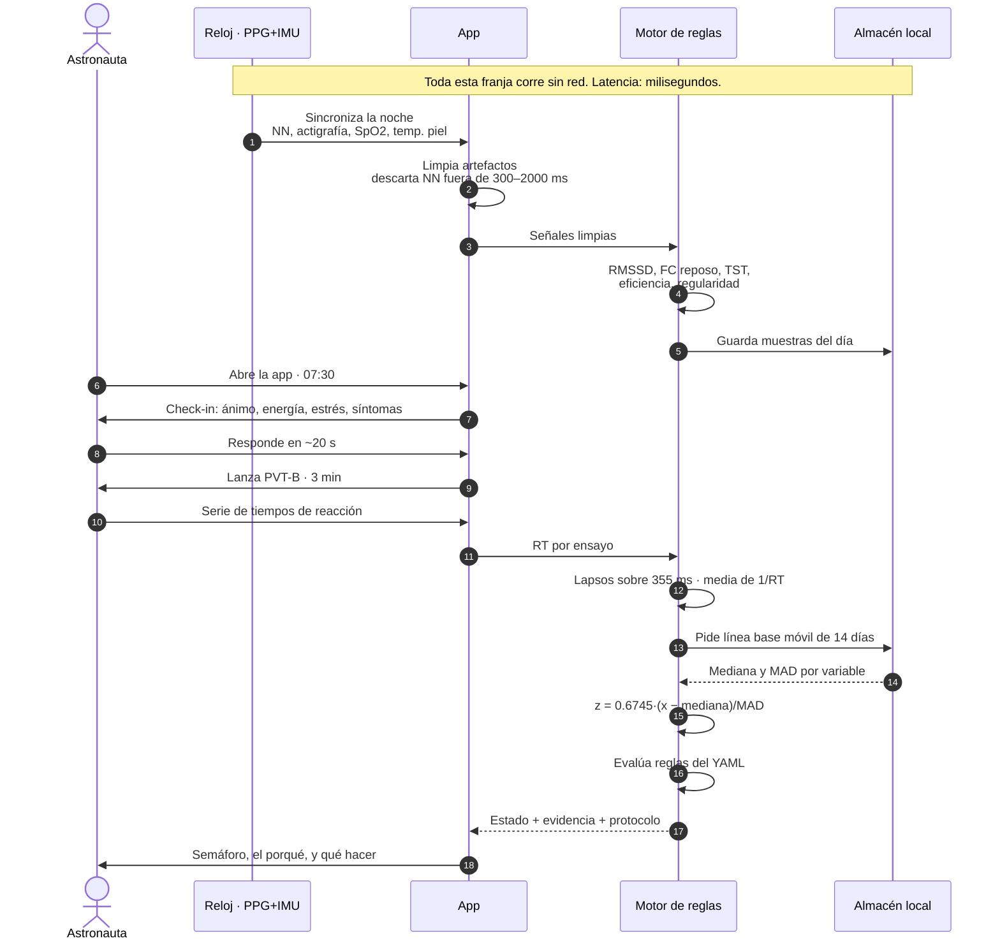
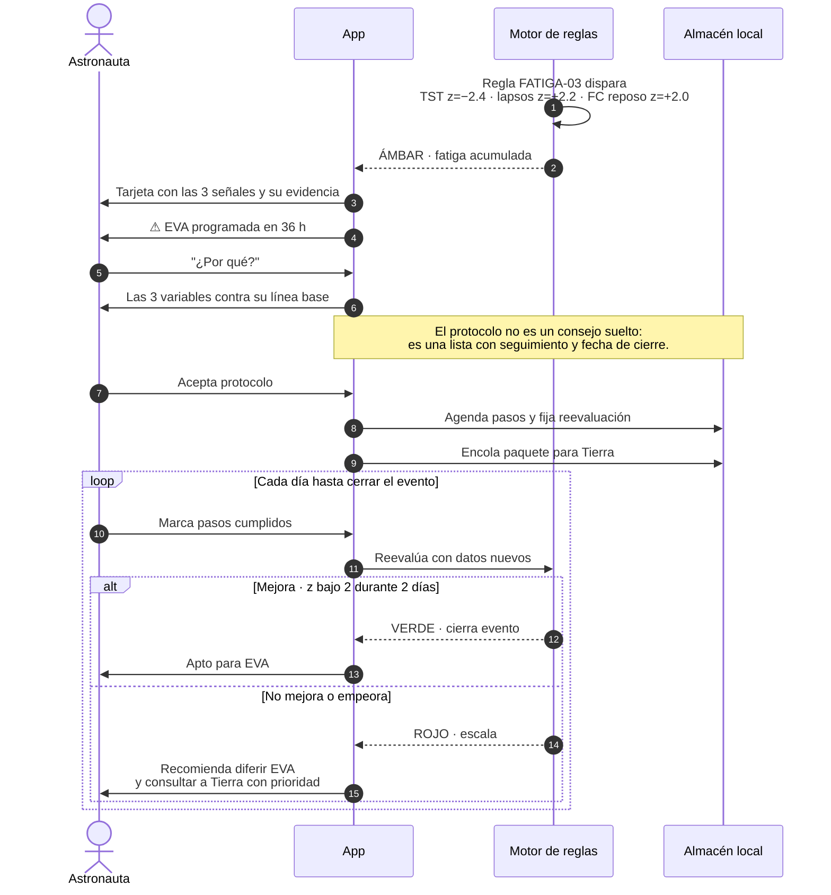
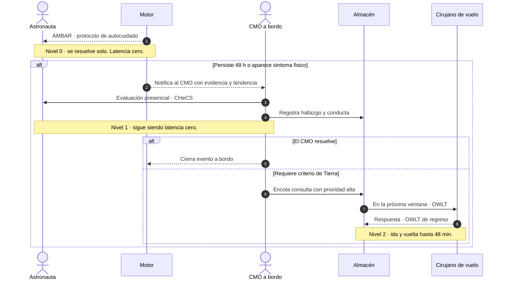
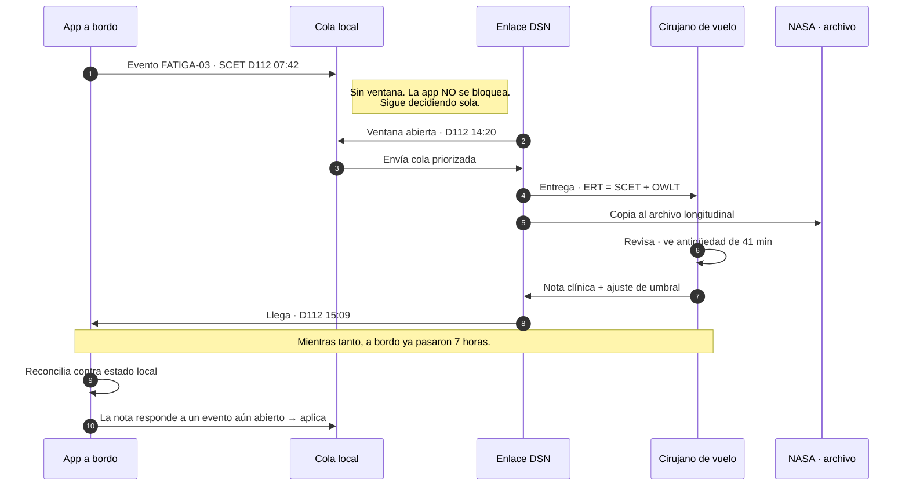

# Comportamiento del software — diagramas de secuencia y escenario

Documento de diseño. Define qué hace el sistema, en qué orden, y con qué números.
Sirve de tres cosas a la vez: especificación para quien programa, guion para la demo,
y spec del generador de datos sintéticos.

Convención heredada del diccionario de datos: ✅ verificado · ⚠️ verificar · 🔶 decisión nuestra.

---

## 1. Actores del sistema

| Actor | Dónde | Latencia | Nota |
|---|---|---|---|
| **Astronauta** | A bordo | 0 | Sujeto de la medición. Decide y actúa. |
| **CMO** · Crew Medical Officer | A bordo | 0 | ✅ Tripulante asignado como experto médico. **Frecuentemente, pero no obligatoriamente, es médico.** |
| **Reloj** | A bordo | — | PPG + acelerómetro + termistor |
| **App + Motor** | A bordo | ms | Reglas deterministas. **Nunca necesita red.** |
| **Almacén** | A bordo | — | Base cifrada + cola de salida |
| **Enlace DSN** | — | OWLT 4–24 min | Ventanas, no continuo |
| **Cirujano de vuelo** | Tierra · MCC | OWLT por trayecto | Supervisa, ajusta umbrales |
| **NASA · segmento de tierra** | Tierra | Diferido | Archivo longitudinal, HRP |

### El CMO cambia el diseño

✅ Datos verificados sobre el rol: el CMO recibe entrenamiento preflight en trauma,
emergencias, odontología, ultrasonido y toma de decisiones clínicas en aislamiento.
Maneja las pruebas médicas rutinarias y atiende a quien enferme o se lesione,
**siguiendo las indicaciones de los cirujanos de vuelo en Tierra**. En la literatura se
le describe como *healthcare extender* del cirujano de vuelo. Se apoya en el **CHeCS**
(Crew Health Care System): diagnóstico, trauma y formulario de medicamentos.

⚠️ Las horas de entrenamiento no son consistentes entre fuentes: un resumen de AsMA
2021 indica ~15 h en los dos años previos al lanzamiento; otra fuente menos autorizada
dice ~40 h en 18 meses. **No citar una cifra concreta sin verificar.**

✅ **Y aquí está la frase que justifica el proyecto entero, en voz de la propia
literatura de NASA:** se espera que el paradigma actual sea **insuficiente** para
misiones de exploración a la Luna y Marte, donde los retrasos de comunicación exigirán
**mayor autonomía en la toma de decisiones**.

Eso no es nuestra opinión de hackathon. Es el planteamiento del problema, publicado.

## 2. Diagrama 1 — Ciclo diario nominal



**Duración real del ciclo para el astronauta: ~4 minutos.** Si pasa de eso, no lo hace
todos los días, y un monitor que no se usa no monitorea nada.

---

## 3. Diagrama 2 — Escalamiento, protocolo y cierre

Este es el diferenciador. Nótese que **no termina en la alerta**: hay seguimiento,
reevaluación y cierre del evento.



🔶 El criterio de cierre (`z < 2` durante 2 días) es decisión nuestra. Hay que decirlo.

---

## 4. Escalera de escalamiento

El error de diseño que evitamos: tratar "alerta" como sinónimo de "llamar a Tierra".
Hay dos niveles **a bordo** antes de que la latencia importe siquiera.

| Nivel | Quién resuelve | Latencia | Cuándo |
|---|---|---|---|
| **0 · Autocuidado** | Motor + astronauta | 0 | Verde y ámbar con protocolo estándar |
| **1 · CMO a bordo** | Crew Medical Officer | 0 | Ámbar persistente, rojo, cualquier síntoma físico |
| **2 · Cirujano de vuelo** | Tierra · MCC | OWLT por trayecto | Rojo sin resolver, ajuste de umbrales, duda clínica |
| **3 · Junta médica NASA** | Tierra | Horas o días | Decisiones de misión, consulta especializada |

**La métrica de éxito del software es cuánto se resuelve en niveles 0 y 1.** Un rojo que
exige a Tierra ya es un caso perdido en términos de autonomía.

🔶 **Caso borde que hay que manejar:** si el afectado **es el propio CMO**, el sistema
salta el nivel 1, escala directo a nivel 2 y notifica al comandante. En una tripulación
de 4 esto no es hipotético.

🔶 **Privacidad:** el CMO ve los datos de salud de la tripulación; el resto de
tripulantes, no. El astronauta siempre ve los suyos completos. Tres niveles de acceso,
no uno.



---

## 5. Modelo de tiempos — SCET, ERT y OWLT

Tu observación es correcta y tiene nomenclatura formal en operaciones de espacio
profundo. ✅ Los términos y las relaciones:

| Término | Qué es |
|---|---|
| **SCET** · Spacecraft Event Time | Cuándo **ocurrió** el evento a bordo, en UTC |
| **ERT** · Earth Received Time | UTC en que una estación del DSN **recibió** el dato |
| **OWLT** · One-Way Light Time | Retraso de un trayecto. Marte: 4–24 min |
| **TWLT** · Two-Way Light Time | Ida y vuelta. Marte: hasta ~48 min |
| **SCLK** · Spacecraft Clock | Reloj de a bordo. Es la mejor estimación del SCET, **pero deriva** |

Las relaciones, verificadas:

    SCET = ERT − OWLT          (bajada: de la nave a Tierra)
    ERT  = SCET + OWLT
    llegada_a_bordo = TRM + OWLT   (subida: TRM = UTC de envío desde Tierra)

✅ **Sobre la deriva del reloj:** el SCLK no coincide exactamente con el SCET. NASA
analiza los valores de SCLK telemetrados contra el SCET derivado de UTC y produce
periódicamente un **archivo de coeficientes SCLK/SCET** para corregirlo. En la misión
Cluster se rehace la correlación cuando la discrepancia supera los 2 ms.

🔶 Para nosotros eso es exagerado, pero **el campo tiene que existir en el esquema**:
dejamos `t_sclk` crudo y `t_scet` corregido. Decir en la presentación que sabemos que
el reloj deriva y que dejamos el espacio para la corrección vale mucho y cuesta un campo.

### Esquema de cada registro

```json
{
  "id": "ms2-112-0742-fatiga03",
  "t_sclk":  "D112T07:42:11",
  "t_scet":  "2027-03-18T07:42:09Z",
  "t_ert":   null,
  "owlt_s":  null,
  "origen":  "a_bordo",
  "tipo":    "evento",
  "payload": { }
}
```

`t_ert` y `owlt_s` los rellena Tierra al recibir. A bordo son `null`, y eso es correcto:
**la nave no sabe cuándo llegará su propio paquete.**

### Las cinco consecuencias que hay que programar

1. **Ordenar por SCET, nunca por ERT.** Los paquetes llegan desordenados. Si la UI de
   Tierra ordena por hora de recepción, muestra una historia clínica falsa.
2. **Idempotencia.** Hay reenvíos. Cada registro con `id` único; aplicarlo dos veces no
   puede duplicar nada.
3. **Ninguna pantalla en Tierra dice "estado actual".** Dice *"estado al SCET X,
   recibido ERT Y, **antigüedad Z min**"*. La antigüedad va visible siempre.
4. **Config versionada.** Tierra sube un umbral basado en datos viejos. Cada config
   lleva versión y el SCET de los datos que la motivaron. Si a bordo hay una decisión
   más nueva, **no se pisa en silencio** — se avisa.
5. **Priorizar la cola.** Tras un hueco largo de enlace la cola es grande. Orden:
   rojos abiertos → ámbares abiertos → resúmenes diarios → series crudas si cabe.

### El caso que hay que enseñar en la demo: el consejo que llega tarde



Y la tarjeta que resuelve la ambigüedad para el astronauta:

```
┌──────────────────────────────────────────────┐
│  Nota de Tierra · cirujano de vuelo          │
├──────────────────────────────────────────────┤
│  Responde a:  evento FATIGA-03, día 112      │
│  Estado hoy:  CERRADO el día 114             │
│                                              │
│  Emitida con datos hasta  SCET D112 14:20    │
│  Antigüedad al llegar:    41 min             │
│                                              │
│  ⓘ Esta recomendación no conocía tu          │
│    recuperación del día 113–114.             │
├──────────────────────────────────────────────┤
│  [ Leer de todos modos ]  [ Archivar ]       │
└──────────────────────────────────────────────┘
```

**Ese recuadro es la demo entera en una imagen.** Dice, sin explicarlo: *aquí la
latencia es real, el software la entiende, y por eso decide solo.*

---

## 6. Escenario corrido — Día 112, fatiga antes de una EVA

Misión de tránsito a Marte. Tripulante MS-2. EVA de mantenimiento el día 114.

### Línea base móvil (14 días, construida en vuelo)

| Variable | Mediana | MAD |
|---|---|---|
| FC en reposo | 58 lpm | 2.0 |
| RMSSD nocturno | 42 ms | 6.0 |
| TST | 7 h 05 (425 min) | 24 min |
| Lapsos PVT-B | 2 | 1.2 |
| Eficiencia de sueño | 88 % | 3.0 |

### Los días previos

| Día | TST | RMSSD | FC reposo | Lapsos | Estado |
|---|---|---|---|---|---|
| 109 | 6 h 10 | 38 | 59 | 2 | Verde |
| 110 | 5 h 50 | 34 | 61 | 3 | Verde |
| 111 | 5 h 35 | 30 | 63 | 4 | Verde · nota interna |
| **112** | **5 h 40** | **28** | **64** | **6** | **ÁMBAR** |

Contexto narrativo: una anomalía de equipo el día 109 alargó las jornadas. Nadie se
reportó enfermo. Nada se sintió como una emergencia.

### El cálculo del día 112

    TST:        z = 0.6745 × (340 − 425) / 24  = −2.4
    Lapsos:     z = 0.6745 × (6 − 2)   / 1.2   = +2.2
    FC reposo:  z = 0.6745 × (64 − 58) / 2.0   = +2.0
    RMSSD:      z = 0.6745 × (28 − 42) / 6.0   = −1.6   (bajo umbral)

Regla disparada:

```yaml
- id: FATIGA-03
  severidad: ambar
  riesgo_nasa: "Inadequate Sleep and Irregular Schedules"
  requiere_todas:
    - { var: tst,          z_menor_que: -2.0, dias_consecutivos: 3 }
    - { var: lapsos_pvtb,  z_mayor_que:  2.0 }
    - { var: fc_reposo,    z_mayor_que:  2.0 }
  protocolo: FATIGA-03
  escala_si: "sin mejora en 48 h"
```

**Por qué el YAML importa en la demo:** se abre el archivo frente al jurado y se ve que
la lógica es auditable. Ese es el argumento contra *"¿y si la IA alucina?"*.

### Lo que ve el astronauta

```
┌────────────────────────────────────────────┐
│  ÁMBAR · Fatiga acumulada                  │
│  Día 112 · detectado 07:42, a bordo        │
├────────────────────────────────────────────┤
│  Tres señales se movieron juntas:          │
│                                            │
│   Sueño          5 h 40   z −2.4   ↓ 3 días│
│   Lapsos PVT-B        6   z +2.2   ↑       │
│   FC en reposo    64 lpm  z +2.0   ↑       │
│                                            │
│   Ninguna sola dispararía.                 │
│   Las tres juntas, sí.                     │
├────────────────────────────────────────────┤
│  ⚠  EVA programada en 36 h                 │
│                                            │
│  Protocolo FATIGA-03 · 48 h                │
│   ☐ Luz circadiana 07:00–07:30             │
│   ☐ Carga de ejercicio −30 %               │
│   ☐ Sin cafeína después de 14:00           │
│   ☐ Objetivo de sueño: 7 h 30              │
│                                            │
│  Reevaluación automática: día 114, 07:00   │
├────────────────────────────────────────────┤
│  [ Ver evidencia ]        [ Aceptar ]      │
│  [ Encolar consulta con Tierra ]           │
└────────────────────────────────────────────┘
```

⚠️ **El contenido clínico de los protocolos es marcador de posición.** Las
contramedidas de iluminación circadiana y manejo de fatiga existen en la literatura
aeroespacial, pero **no verifiqué los parámetros concretos (lux, duración, horarios)
contra una fuente de NASA.** Antes de presentar: o se verifican, o se presentan
explícitamente como ejemplo ilustrativo. No inventar cifras clínicas y darlas por
oficiales.

### Cómo cierra

**Día 113** — cumple 3 de 4 pasos. TST 6 h 50. El motor mantiene ámbar y lo dice:
*"vas mejor, pero aún no."*

**Día 114, 07:00** — reevaluación automática: TST 7 h 10, lapsos 3, FC reposo 60.
Los tres z por debajo de 2.

    VERDE · Evento cerrado tras 48 h. Apto para EVA.

**La rama que no ocurrió** (y que hay que enseñar igual en la demo): si al día 114 los
indicadores siguen fuera, pasa a **ROJO**, recomienda **diferir la EVA** y sube la
consulta con Tierra a prioridad alta. El software nunca bloquea por sí mismo — recomienda,
con evidencia. **La decisión sigue siendo de la tripulación.**

---

## 7. Segundo escenario, corto — Día 115, evento de partículas solares

Muestra el módulo de radiación, que es el hazard #1 del reto.

```
     11:04   Tasa de dosis pasa de 0.3 a 14 mSv/día
     11:04   ROJO · EVENTO DE PARTÍCULAS SOLARES
             "Dirígete al refugio blindado. Ahora."
             Dosis acumulada de misión: 212 mSv
             Proyección si permaneces fuera: +9 mSv/h
     11:05   Protocolo RAD-01, 4 pasos, sin texto superfluo
     11:31   Tasa normalizada · evento registrado · 218 mSv
```

Aquí el argumento de la latencia se vuelve literal: **a 4–24 minutos por trayecto, para
cuando Houston alcanzara a avisar, el astronauta ya tomó la dosis.** La decisión tiene
que ser local o no sirve.

⚠️ Las cifras de dosis son ilustrativas, no medidas. El límite de carrera está en
disputa entre fuentes — ver el diccionario de datos antes de ponerlo en una slide.

---

## 8. Por qué esto no es un dashboard

Cuatro diferencias concretas, útiles como diapositiva:

| Un dashboard | Esto |
|---|---|
| Muestra gráficas y espera interpretación | Cruza variables y **concluye** |
| Compara contra la Tierra | Compara contra **su propia normalidad en vuelo** |
| La alerta es el final | La alerta es el **principio**: hay protocolo, seguimiento y cierre |
| Necesita a un experto al otro lado | Cierra el ciclo **a bordo, en milisegundos** |

---

## 9. Guion de demo — 90 segundos

1. **0:00–0:15** — "Un astronauta con una señal preocupante no puede preguntarle a
   Houston. La respuesta tarda hasta 48 minutos."
2. **0:15–0:35** — Check-in del día 112 en vivo: sliders + PVT-B real corriendo.
3. **0:35–0:55** — Aparece el ámbar. Leer en voz alta: *"ninguna sola dispararía; las
   tres juntas, sí."*
4. **0:55–1:10** — Abrir el YAML. "Esto no alucina. Es auditable."
5. **1:10–1:25** — Avanzar a día 114: cierra en verde. Entra la **nota de Tierra con
   41 min de antigüedad**, respondiendo a un evento ya cerrado. *"Esto es por qué no
   podemos esperar."*
6. **1:25–1:30** — Modo avión encendido **toda la demo**. Señalarlo al final.

🔶 **Dejar el teléfono en modo avión durante toda la presentación y decirlo hasta el
final** es el remate más barato y más efectivo que tenemos.

---

## 10. Qué le toca a cada rol

| Rol | Qué sale de este documento |
|---|---|
| Datos y sensores | Diagrama 1 · franja del reloj |
| Motor de reglas | §6: fórmulas de z, YAML, criterio de cierre · §4: niveles de escalamiento |
| UI | §6: tarjeta y semáforo · §5: la tarjeta de nota tardía y el indicador de antigüedad |
| Contenido científico | ⚠️ verificar protocolos clínicos · mapear cada regla a un riesgo de NASA |
| Demo y presentación | §9 completa |
| Datos sintéticos | §6 y §7: tablas día a día. **Ese es el spec.** Más los campos SCET/ERT de §5. |

**Lo mínimo que no puede faltar del modelo de tiempos**, aunque se recorte todo lo demás:
cada registro con `t_scet`, la UI de Tierra ordenando por SCET, y el indicador de
antigüedad visible. Son tres cosas pequeñas y son las que hacen que un juez de
operaciones levante la ceja.

---

## Fuentes

Verificadas el 2026-11-14. Ver también `docs/diccionario-de-datos.md`.

- Spacecraft Event Time · SCET, ERT, OWLT: https://en.wikipedia.org/wiki/Spacecraft_Event_Time
- NAIF/JPL · CHRONOS, conversión entre SCET, ERT y SCLK: https://naif.jpl.nasa.gov/pub/naif/utilities/PC_Windows_64bit/chronos.ug
- Reconstitución precisa del SCET y correlación SCLK (misión Cluster): https://cdaweb.gsfc.nasa.gov/istp_public/data/cluster/documents/DWP/Precise_reconstitution_of_SCET.pdf
- NASA NTRS · Crew Medical Officer, rol y entrenamiento: https://ntrs.nasa.gov/api/citations/20230013415/downloads/IWS_CMO.pdf
- NASA NTRS · CMO training (resumen AsMA 2021): https://ntrs.nasa.gov/citations/20205008925
- JAXA · sistema de operaciones médicas y rol del CMO: https://humans-in-space.jaxa.jp/en/biz-lab/med-in-space/healthcare/medops/system
- NASA · Space Communications, 7 Things (retraso 4–24 min): https://www.nasa.gov/centers-and-facilities/goddard/space-communications-7-things-you-need-to-know/
