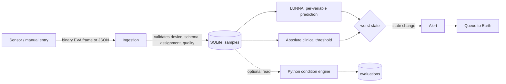

> 🌐 [Español](README_02_PROTOCOLO_INVESTIGACION.md) · **English**

# 02 · Research protocol

**LUNNA · health monitoring software for space missions**
Team Monarcas · NASA Space Apps Challenge 2026 · revision of November 15, 2026

> **Scope and safety.** This protocol describes an academic prototype. It is not a medical device, it does not diagnose, and it does not replace the medical crew.
>
> - The measurements of the demonstration crew are **synthetic**.
> - The solar events from NASA DONKI are real records, but the doses and responses shown are simulated.
> - The only real human data used are public: ECG records from PhysioNet, from hospital patients, and Inspiration4 laboratory data in OSDR, which are open access. None of them is presented as clinical validation.

The document keeps three planes separate at all times:

| Plane | What it contains | How it is marked |
|---|---|---|
| **Rationale** | What the literature or the team's catalogs say | With its reference |
| **Proposed methodology** | What the software implements or specifies | With the file that implements it |
| **Result obtained** | What was actually run and measured | With date, dataset and figure |

## 1. Problem statement

On long missions, a population reference range may not represent a person's usual state, and microgravity shifts some variables in expected ways. In addition, communication with Earth suffers delays (240–1,440 s one way toward Mars, project values) and interruptions. Local monitoring is needed that:

1. compares each variable with the baseline and expected response of **each** crew member;
2. explains what evidence produced an alert;
3. preserves the telemetry and communicates it to Earth with priority and delay.

## 2. Scientific and technological rationale

- **Individualization.** The team's catalogs report in-flight changes with between-person dispersion (for example, 24-h mean systolic pressure −8 ± 2 mmHg, n = 8; core temperature +~1 °C over 2.5 months, n = 11; see the [dictionary](README_07_DICCIONARIO_DATOS_VARIABLES.en.md)). A fixed threshold cannot distinguish an expected change from an anomaly.
- **Temporal aggregation.** According to the backend, the Smart Fusion validation showed that the instantaneous value barely outperforms a constant, whereas the aggregate does carry signal. That is why the personal criterion uses the 24-h median. The original report of that validation is not available in the repository.
- **Freezing the calibration.** If the personal reference kept learning, a slow drift such as fatigue would be absorbed as the new normal.
- **On-board autonomy.** The *store-and-forward* link makes it possible to demonstrate local decisions while the link is closed.

## 3. Research questions

**Main question (defined in the team's protocol):**
Can a reproducible local pipeline integrate telemetry, individual baselines, explicit references and differentiated thresholds to flag deviations without confusing a change expected from the environment with an anomaly?

**Secondary questions** (derived from the `ALGORITMOS.md` specification, included in the consolidated README):

1. Can a per-condition traffic light prioritize review without presenting clinical probabilities or inventing normality when data are missing?
2. Can a protected self-calibration prevent alerted points from being learned as normal?
3. What do the outputs of echocardiography models and of ECG processing contribute to that traffic light, and how reliably?

## 4. Working hypotheses

These are hypotheses about system behavior, verifiable by construction with simulated data (see [§9](#9-evaluation-criteria)):

- **H1.** With a frozen pre-flight baseline, an abrupt jump generates an alert and does not modify the adaptive mean.
- **H2.** A slow drift is detected by CUSUM without being absorbed as the new normal.
- **H3.** Without sufficient coverage, the result is GRAY, not GREEN.
- **H4.** A simulated data point never modifies the real traffic light.
- **H5.** A change expected from the environment (e.g., lower blood pressure in orbit) does not generate a personal alert if the person follows their expected response.

## 5. Research objectives

1. Normalize sensor data, manual readings and derived data with provenance, unit and event time.
2. Combine an individual Bayesian prediction with absolute reference thresholds.
3. Present states, uncertainty, provenance and limitations in the crew, CMO and Earth interfaces.
4. Simulate link delay and interruptions.
5. Specify and implement a 20-condition traffic light with two evidence channels (weights and likelihood ratios) and a minimum coverage.

Current success is in **software integration and demonstration**, not clinical prediction.

## 6. Conceptual framework and background

| Concept | Use in LUNNA | Reference cited in the repository |
|---|---|---|
| Precision-weighted normal-normal Bayesian updating | LUNNA model of each variable | In-house implementation ([`lunna.ts`](../Sistema/backend/src/lunna.ts)) |
| Shrinkage toward the population (Sottas 2007) and minimum baseline size (Coskun 2021) | Pre-flight baseline of the condition engine | ALGORITMOS specification §c.3 |
| Tabular CUSUM | Slow drifts | Customary values k = 0.5 and h = 5 (provisional, S3) |
| Early warning scores (NEWS2, MEWS) | Ordinal SpO₂ and respiratory-rate bands; fixed layers | Smith 2013; Subbe 2001 |
| AF detection from RR irregularity | Experimental ECG flag | Dash et al. 2009, doi:10.1007/s10439-009-9740-z |
| Infection detection from a watch | NightSignal-type rule R3 | Alavi et al. 2022; Mishra et al. 2020 |
| Cabin CO₂ and headache | Link P07 | Law et al. 2014 |
| Human Research Roadmap risks | Risk names in the catalogs | NASA HRR; Evidence Report NTRS 20160003870 |

Full references and DOIs: see §10 of the original protocol, included in the consolidated README, and [`Planeacion/Leo/modelo-pesos/pesos.json`](../Planeacion/Leo/modelo-pesos/pesos.json).

## 7. Methodology

### 7.1 General design

This is a **technology development study with verification by construction**:

1. the algorithms are implemented;
2. they are checked against purpose-written synthetic scenarios with injected anomalies;
3. where available, they are compared against labeled public data.

There is no prospective study with human subjects.

### 7.2 Study variables

There are three levels of variables. The full detail is in the [data dictionary](README_07_DICCIONARIO_DATOS_VARIABLES.en.md).

| Level | Count | Source of truth |
|---|---|---|
| Variables evaluated by the backend | 7 (6 measured + 1 computed: `X:PAM`) | [`semillas/inicial.json`](../Sistema/backend/semillas/inicial.json), [`semillas/medibles.json`](../Sistema/backend/semillas/medibles.json) |
| Indicators in the crew mock-up | 10 | [`Sistema/interfaces/eva/motor.js`](../Sistema/interfaces/eva/motor.js) |
| Condition-variable links in the engine | 350 links, 20 conditions | [`prototipo-salud/datos/modelo/`](../prototipo-salud/datos/modelo/) |
| Per-ailment weight matrix | 11 ailments × 9 predictors = 99 cells | [`Planeacion/Leo/modelo-pesos/pesos.csv`](../Planeacion/Leo/modelo-pesos/pesos.csv) |
| Catalog of variables measured in astronauts | 388 rows | [`Planeacion/data/variables/VARIABLES-MEDIDAS-ASTRONAUTAS.csv`](../Planeacion/data/variables/VARIABLES-MEDIDAS-ASTRONAUTAS.csv) |

### 7.3 Information sources

| Source | Type | Access | Use |
|---|---|---|---|
| Team catalogs (`Planeacion/data/`) | Literature review | Internal | Variables, priors, thresholds, links |
| MedlinePlus, CDC, ACC/AHA | Terrestrial clinical references [T] | Public | Absolute thresholds |
| NASA-STD-3001 Vol. 2, OCHMO, HRR | NASA standards and technical briefs | Public | Context; provides no in-flight vital-sign thresholds |
| NASA DONKI | Solar particle events | Public API (`NASA_API_KEY`) | Day 115 scenario |
| PhysioNet MIT-BIH Arrhythmia (100, 201, 203) and AF Database (04015) | ECG from hospital patients | ODC-By 1.0 | Technical validation of the ECG module |
| NASA OSDR OSD-569 / OSD-575 (Inspiration4) | Laboratory data from 4 civilians | Public | External test of the engine |
| Official samples from the echo repositories | Example videos | Licenses of each repository | Adapter tests |

No controlled-access data (LSAH, LSDA, restricted OSDR) were used, nor the EchoNet-Dynamic dataset, which requires a data use agreement.

### 7.4 Data acquisition and processing

1. **Acquisition.** Frames arrive over BLE at the gateway, or directly over HTTP. In the demo they are generated by the simulator.
2. **Attribution.** The crew member is taken from the device's assignment in effect at `t_scet`, not from the frame.
3. **Validation.** Unregistered variables and `estimated` values without `method` or `quality.ic95` are rejected. With `quality.contacto: false` the sample is stored but not evaluated.
4. **Personal model.** Combines three layers: population prior, history and 14-day calibration.
5. **Absolute threshold.** Uses the median of the last 5 valid samples within 10 min.
6. **Condition engine** (optional, Python). Applies the N0–N4 quality gate, normalization, protected self-calibration, the two-channel score and the traffic light.

The algorithms are detailed in [Computational models](README_06_MODELOS_COMPUTACIONALES_ALGORITMOS.en.md).

## 8. Experimental procedures performed

| Procedure | Data | Result obtained (team figures) |
|---|---|---|
| Backend synthetic scenario | 4 crew members, 7 variables, 119 days, 6,188 binary frames | 2 alerts, both on Ana's injected fatigue (amber on day 111, red on day 112, z = 3.34). No false positives elsewhere. Ana's predicted HR: 57.4 bpm versus the simulated response of −8% (predicted −7.6%). Weights: literature 1%, history 11%, flight 88% |
| ECG technical validation | Complete records mitdb 100/201/203 and afdb 04015 | R peaks: sensitivity 0.999/1.000/0.919 and PPV 1.000/0.972/0.989 (100/201/203). Irregular-rhythm flag: per-segment specificity 1.000/0.054/0.000/0.904. It detects irregularity, not AF |
| Echo inference | Official samples | One real PanEcho inference on Iker's PC (CUDA, 17.4 s). None on the development machine. The rest pending |
| Inspiration4 (OSDR) | 278 laboratory rows, 4 people | Default configuration: 80/80 cells GRAY (no personal baseline with 3 pre-flight draws). Sensitivity analysis with n0_min = 3: potassium ↓ at R+1 (C002, C003); no RED |

These results are technical. **The synthetic scenario is purpose-written so that the pipeline detects it**, so it demonstrates that the software works, not the model's accuracy with real people.

## 9. Evaluation criteria

| Criterion | Metric | Applies to |
|---|---|---|
| Software correctness | Automated tests passed | Backend, engine, interfaces |
| Engine invariants (ALGORITMOS §e.1) | Met / not met in 14 simulated scenarios | Condition engine |
| R-peak detection | Sensitivity and PPV with 150 ms tolerance (ANSI/AAMI EC57) | ECG |
| Irregularity flag | Per-segment sensitivity, specificity and PPV | ECG |
| Detection of injected anomalies | Detection delay, alerts without an anomaly | Synthetic scenario |
| Consistency with what has been reported | Absence of RED where the literature reports stability | Inspiration4 |

The false alarm rate **has not been measured**: the engine's simulated dataset uses deliberately bounded noise.

## 10. Methodological limitations

1. **There is no validation in astronauts**, nor any prospective validation. Most of the priors and dispersions (τ₀, σ) are assumptions.
2. **Terrestrial thresholds.** All vital-sign thresholds are [T], because no public NASA table for them was found. In addition, the system compares strictly (`<`, `>`): a value equal to the limit does not trigger.
3. **Weak evidence in the engine.** 310 of the 350 links are level C (team judgment). In the weight matrix, 29 of the 54 weighted cells are C.
4. **Temperature.** The +1 °C prior comes from core temperature measured at the forehead, whereas the smart shirt measures axillary temperature and the mock-up skin temperature. The three are not interchangeable.
5. **Instantaneous HR versus resting pulse.** `04:A4` and `01:V3` are distinct variables, and PADECIMIENTO-VARIABLE only links `01:V3`.
6. **Catalogs that do not match.** The weight matrix uses 11 ailments (jugular thrombosis and SANS combined), whereas PADECIMIENTOS.csv uses 20 (P11 and P12 separate). There is no agreed correspondence table.
7. **Selection of version v2 of the ECG flag.** It was chosen after seeing v1 on the same records, so its figures are not an independent validation.
8. **Echocardiography.** A single real inference (PanEcho) reported. LVEF enters only as N4 evidence with weight 1.
9. **Hardware.** The firmware has not been tested on a real board and there is no end-to-end BLE validation.

## Related documentation

- [General planning](README_01_PLANEACION.en.md)
- [Computational models and algorithms](README_06_MODELOS_COMPUTACIONALES_ALGORITMOS.en.md)
- [Data and variable dictionary](README_07_DICCIONARIO_DATOS_VARIABLES.en.md)
- [Testing and validation](README_08_PRUEBAS_VALIDACION.en.md)
- [Security, reliability and risks](README_10_SEGURIDAD_CONFIABILIDAD_RIESGOS.en.md)
