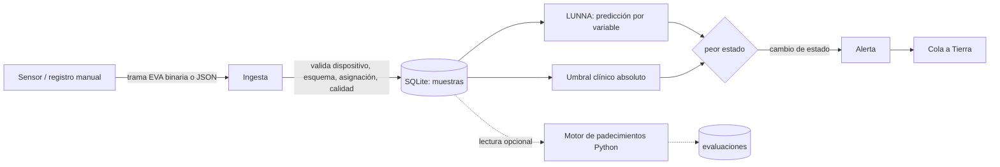

> 🌐 **Español** · [English](README_02_PROTOCOLO_INVESTIGACION.en.md)

# 02 · Protocolo de investigación

**LUNNA · software de monitoreo de salud para misiones espaciales**
Equipo Monarcas · NASA Space Apps Challenge 2026 · revisión del 15 de noviembre de 2026

> **Alcance y seguridad.** Este protocolo describe un prototipo académico. No es un dispositivo médico, no diagnostica y no sustituye a la tripulación médica.
>
> - Las mediciones de la tripulación de demostración son **sintéticas**.
> - Los eventos solares de NASA DONKI son registros reales, pero las dosis y respuestas mostradas son simuladas.
> - Los únicos datos reales de personas que se usan son públicos: registros ECG de PhysioNet, de pacientes hospitalarios, y laboratorios de Inspiration4 en OSDR, de acceso abierto. Ninguno de ellos se presenta como validación clínica.

El documento separa en todo momento tres planos:

| Plano | Qué contiene | Cómo se marca |
|---|---|---|
| **Fundamento** | Lo que dice la literatura o los catálogos del equipo | Con su referencia |
| **Metodología propuesta** | Lo que el software implementa o especifica | Con el archivo que lo implementa |
| **Resultado obtenido** | Lo que efectivamente se ejecutó y midió | Con fecha, conjunto de datos y cifra |

## 1. Planteamiento del problema

En misiones largas, un rango de referencia poblacional puede no representar el estado habitual de una persona, y la microgravedad desplaza de forma esperada algunas variables. Además, la comunicación con Tierra sufre retardo (240–1440 s por trayecto hacia Marte, valores del proyecto) e interrupciones. Se necesita una vigilancia local que:

1. compare cada variable con el basal y la respuesta esperada de **cada** tripulante;
2. explique qué evidencia produjo una alerta;
3. conserve la telemetría y la comunique a Tierra con prioridad y retardo.

## 2. Justificación científica y tecnológica

- **Individualización.** Los catálogos del equipo reportan cambios en vuelo con dispersión entre personas (por ejemplo, presión sistólica media de 24 h −8 ± 2 mmHg, n = 8; temperatura central +~1 °C en 2,5 meses, n = 11; ver [diccionario](README_07_DICCIONARIO_DATOS_VARIABLES.md)). Un umbral fijo no distingue un cambio esperado de una anomalía.
- **Agregación temporal.** Según el backend, la validación de Smart Fusion mostró que el valor instantáneo apenas supera a una constante, mientras que el agregado sí tiene señal. Por eso el criterio personal usa la mediana de 24 h. No se cuenta con el informe original de esa validación dentro del repositorio.
- **Congelar la calibración.** Si la referencia personal siguiera aprendiendo, una deriva lenta como la fatiga se absorbería como nueva normalidad.
- **Autonomía a bordo.** El enlace *store-and-forward* permite demostrar decisiones locales con el enlace cerrado.

## 3. Preguntas de investigación

**Pregunta principal (definida en el protocolo del equipo):**
¿Puede una tubería local reproducible integrar telemetría, basales individuales, referencias explícitas y umbrales diferenciados para señalar desviaciones sin confundir un cambio esperado por el entorno con una anomalía?

**Preguntas secundarias** (derivadas de la especificación `ALGORITMOS.md`, incluida en el README consolidado):

1. ¿Puede un semáforo por padecimiento ordenar la revisión sin presentar probabilidades clínicas ni inventar normalidad ante datos faltantes?
2. ¿Puede una autocalibración protegida evitar que puntos alertados se aprendan como normales?
3. ¿Qué aportan, y con qué fiabilidad, las salidas de modelos de ecocardiografía y del procesamiento de ECG a ese semáforo?

## 4. Hipótesis de trabajo

Son hipótesis de comportamiento del sistema, verificables por construcción con datos simulados (ver [§9](#9-criterios-de-evaluación)):

- **H1.** Con una base prevuelo congelada, un salto brusco genera alerta y no modifica la media adaptativa.
- **H2.** Una deriva lenta se detecta por CUSUM sin absorberse como nueva normalidad.
- **H3.** Sin cobertura suficiente, el resultado es GRIS y no VERDE.
- **H4.** Un dato simulado nunca modifica el semáforo real.
- **H5.** Un cambio esperado por el entorno (p. ej. la presión más baja en órbita) no genera alerta personal si la persona sigue su respuesta esperada.

## 5. Objetivos de investigación

1. Normalizar datos de sensores, lecturas manuales y datos derivados con procedencia, unidad y hora del evento.
2. Combinar una predicción individual bayesiana con umbrales absolutos de referencia.
3. Presentar estados, incertidumbre, procedencia y limitaciones en las interfaces de tripulación, CMO y Tierra.
4. Simular retardo e interrupciones del enlace.
5. Especificar e implementar un semáforo de 20 padecimientos con dos canales de evidencia (pesos y razones de verosimilitud) y una cobertura mínima.

El éxito actual es de **integración de software y demostración**, no de predicción clínica.

## 6. Marco conceptual y antecedentes

| Concepto | Uso en LUNNA | Referencia citada en el repositorio |
|---|---|---|
| Actualización bayesiana normal-normal por precisión | Modelo LUNNA de cada variable | Implementación propia ([`lunna.ts`](../Sistema/backend/src/lunna.ts)) |
| Encogimiento hacia la población (Sottas 2007) y tamaño mínimo de base (Coskun 2021) | Base prevuelo del motor de padecimientos | Especificación ALGORITMOS §c.3 |
| CUSUM tabular | Derivas lentas | Valores habituales k = 0,5 y h = 5 (provisional, S3) |
| Escalas de alerta temprana (NEWS2, MEWS) | Bandas ordinales de SpO₂ y FR; capas fijas | Smith 2013; Subbe 2001 |
| Detección de FA por irregularidad del RR | Bandera experimental del ECG | Dash et al. 2009, doi:10.1007/s10439-009-9740-z |
| Detección de infección por reloj | Regla R3 tipo NightSignal | Alavi et al. 2022; Mishra et al. 2020 |
| CO₂ de cabina y cefalea | Liga P07 | Law et al. 2014 |
| Riesgos del Human Research Roadmap | Nombres de riesgos en catálogos | NASA HRR; Evidence Report NTRS 20160003870 |

Referencias completas y DOI: ver §10 del protocolo original, incluido en el README consolidado, y [`Planeacion/Leo/modelo-pesos/pesos.json`](../Planeacion/Leo/modelo-pesos/pesos.json).

## 7. Metodología

### 7.1 Diseño general

Es un estudio de **desarrollo tecnológico con verificación por construcción**:

1. se implementan los algoritmos;
2. se comprueban con escenarios sintéticos escritos a propósito, con anomalías inyectadas;
3. se contrastan, donde existen, con datos públicos etiquetados.

No hay un estudio prospectivo con personas.

### 7.2 Variables de estudio

Hay tres niveles de variables. El detalle completo está en el [diccionario de datos](README_07_DICCIONARIO_DATOS_VARIABLES.md).

| Nivel | Cantidad | Fuente de verdad |
|---|---|---|
| Variables que evalúa el backend | 7 (6 medidas + 1 calculada: `X:PAM`) | [`semillas/inicial.json`](../Sistema/backend/semillas/inicial.json), [`semillas/medibles.json`](../Sistema/backend/semillas/medibles.json) |
| Indicadores de la maqueta de tripulación | 10 | [`Sistema/interfaces/eva/motor.js`](../Sistema/interfaces/eva/motor.js) |
| Ligas padecimiento-variable del motor | 350 ligas, 20 padecimientos | [`prototipo-salud/datos/modelo/`](../prototipo-salud/datos/modelo/) |
| Matriz de pesos por malestar | 11 malestares × 9 predictores = 99 celdas | [`Planeacion/Leo/modelo-pesos/pesos.csv`](../Planeacion/Leo/modelo-pesos/pesos.csv) |
| Catálogo de variables medidas en astronautas | 388 filas | [`Planeacion/data/variables/VARIABLES-MEDIDAS-ASTRONAUTAS.csv`](../Planeacion/data/variables/VARIABLES-MEDIDAS-ASTRONAUTAS.csv) |

### 7.3 Fuentes de información

| Fuente | Tipo | Acceso | Uso |
|---|---|---|---|
| Catálogos del equipo (`Planeacion/data/`) | Revisión bibliográfica | Interno | Variables, priores, umbrales, ligas |
| MedlinePlus, CDC, ACC/AHA | Referencias clínicas terrestres [T] | Público | Umbrales absolutos |
| NASA-STD-3001 Vol. 2, OCHMO, HRR | Normas y notas técnicas de NASA | Público | Contexto; no aporta umbrales de signos vitales en vuelo |
| NASA DONKI | Eventos de partículas solares | API pública (`NASA_API_KEY`) | Escenario del día 115 |
| PhysioNet MIT-BIH Arrhythmia (100, 201, 203) y AF Database (04015) | ECG de pacientes hospitalarios | ODC-By 1.0 | Validación técnica del módulo ECG |
| NASA OSDR OSD-569 / OSD-575 (Inspiration4) | Laboratorios de 4 civiles | Público | Prueba externa del motor |
| Muestras oficiales de los repositorios de eco | Videos de ejemplo | Licencias de cada repositorio | Pruebas de los adaptadores |

No se usaron datos de acceso controlado (LSAH, LSDA, OSDR restringido) ni el conjunto EchoNet-Dynamic, que exige acuerdo de uso.

### 7.4 Adquisición y procesamiento de datos

1. **Adquisición.** Las tramas llegan por BLE a la pasarela, o directamente por HTTP. En la demo las genera el simulador.
2. **Atribución.** El tripulante sale de la asignación vigente del dispositivo en `t_scet`, no de la trama.
3. **Validación.** Se rechazan variables no registradas y valores `estimated` sin `method` ni `quality.ic95`. Con `quality.contacto: false` la muestra se guarda, pero no se evalúa.
4. **Modelo personal.** Combina tres capas: prior poblacional, historial y calibración de 14 días.
5. **Umbral absoluto.** Usa la mediana de las últimas 5 muestras válidas, dentro de 10 min.
6. **Motor de padecimientos** (opcional, Python). Aplica la puerta de calidad N0–N4, la normalización, la autocalibración protegida, el score de dos canales y el semáforo.

Los algoritmos se detallan en [Modelos computacionales](README_06_MODELOS_COMPUTACIONALES_ALGORITMOS.md).

## 8. Procedimientos experimentales realizados

| Procedimiento | Datos | Resultado obtenido (cifras del equipo) |
|---|---|---|
| Escenario sintético del backend | 4 tripulantes, 7 variables, 119 días, 6188 tramas binarias | 2 alertas, ambas sobre la fatiga inyectada de Ana (ámbar día 111, rojo día 112, z = 3,34). Sin falsos positivos en el resto. FC predicha de Ana: 57,4 lpm frente a la respuesta simulada de −8 % (predicha −7,6 %). Pesos: literatura 1 %, historial 11 %, vuelo 88 % |
| Validación técnica de ECG | Registros completos mitdb 100/201/203 y afdb 04015 | Picos R: sensibilidad 0,999/1,000/0,919 y PPV 1,000/0,972/0,989 (100/201/203). Bandera de ritmo irregular: especificidad por segmento 1,000/0,054/0,000/0,904. Detecta irregularidad, no FA |
| Inferencia de eco | Muestras oficiales | Una inferencia real de PanEcho en la PC de Iker (CUDA, 17,4 s). Ninguna en la máquina de desarrollo. Resto pendiente |
| Inspiration4 (OSDR) | 278 filas de laboratorio, 4 personas | Configuración por defecto: 80/80 celdas GRIS (sin base personal con 3 tomas prevuelo). Sensibilidad n0_min = 3: potasio ↓ en R+1 (C002, C003); ningún ROJO |

Estos resultados son técnicos. **El escenario sintético está escrito a propósito para que la tubería lo detecte**, de modo que demuestra el funcionamiento del software, no la exactitud del modelo con personas reales.

## 9. Criterios de evaluación

| Criterio | Métrica | Aplica a |
|---|---|---|
| Correctitud del software | Pruebas automatizadas aprobadas | Backend, motor, interfaces |
| Invariantes del motor (ALGORITMOS §e.1) | Cumple / no cumple en 14 escenarios simulados | Motor de padecimientos |
| Detección de picos R | Sensibilidad y PPV con tolerancia de 150 ms (ANSI/AAMI EC57) | ECG |
| Bandera de irregularidad | Sensibilidad, especificidad y PPV por segmento | ECG |
| Detección de anomalías inyectadas | Retraso de detección, alertas sin anomalía | Escenario sintético |
| Consistencia con lo reportado | Ausencia de ROJO donde la literatura reporta estabilidad | Inspiration4 |

La tasa de falsas alarmas **no está medida**: el conjunto simulado del motor usa ruido acotado a propósito.

## 10. Limitaciones metodológicas

1. **No hay validación en astronautas** ni prospectiva. La mayoría de los priores y de las dispersiones (τ₀, σ) son supuestos.
2. **Umbrales terrestres.** Todos los umbrales de signos vitales son [T], porque no se encontró una tabla pública de NASA para ellos. Además, el sistema compara de forma estricta (`<`, `>`): un valor igual al límite no dispara.
3. **Evidencia débil en el motor.** 310 de las 350 ligas son de nivel C (juicio del equipo). En la matriz de pesos, 29 de las 54 celdas con peso son C.
4. **Temperatura.** El prior de +1 °C viene de temperatura central medida en la frente, mientras que la playera mide temperatura axilar y la maqueta temperatura de piel. Las tres no son intercambiables.
5. **FC instantánea frente a pulso en reposo.** `04:A4` y `01:V3` son variables distintas, y PADECIMIENTO-VARIABLE solo liga `01:V3`.
6. **Catálogos que no coinciden.** La matriz de pesos usa 11 malestares (trombosis yugular y SANS juntos), mientras que PADECIMIENTOS.csv usa 20 (P11 y P12 separados). No hay una tabla de correspondencia acordada.
7. **Selección de la versión v2 de la bandera ECG.** Se eligió después de ver la v1 sobre los mismos registros, así que sus cifras no son una validación independiente.
8. **Ecocardiografía.** Una sola inferencia real (PanEcho) reportada. La FEVI entra solo como evidencia N4 de peso 1.
9. **Hardware.** El firmware no se ha probado en una placa real y no hay validación BLE de extremo a extremo.

## Documentación relacionada

- [Planeación general](README_01_PLANEACION.md)
- [Modelos computacionales y algoritmos](README_06_MODELOS_COMPUTACIONALES_ALGORITMOS.md)
- [Diccionario de datos y variables](README_07_DICCIONARIO_DATOS_VARIABLES.md)
- [Pruebas y validación](README_08_PRUEBAS_VALIDACION.md)
- [Seguridad, confiabilidad y riesgos](README_10_SEGURIDAD_CONFIABILIDAD_RIESGOS.md)
