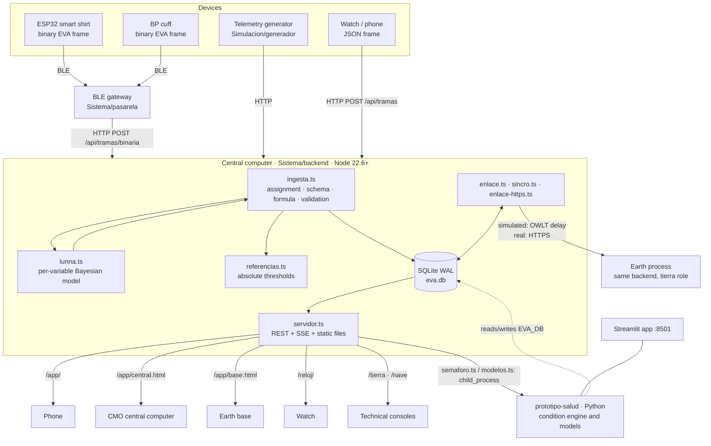
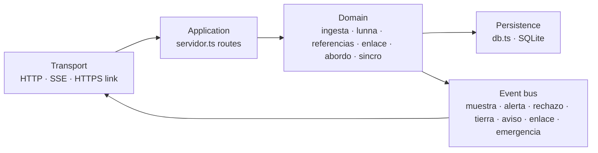
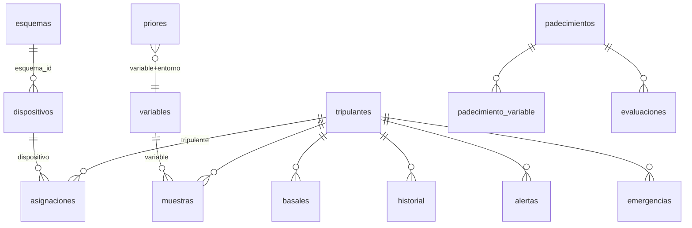
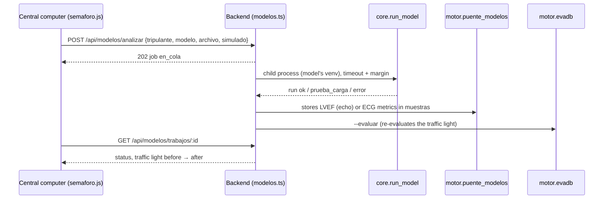

> 🌐 [Español](README_04_ARQUITECTURA_SISTEMA.md) · **English**

# 04 · System architecture

## 1. Overview

LUNNA follows a **client–server architecture centered on the spacecraft's central computer**. The central computer is a single Node.js process that:

- receives frames from any device;
- attributes them to the correct crew member;
- stores them in SQLite;
- evaluates each variable with the LUNNA model and the clinical thresholds;
- emits live events (SSE) to the web interfaces that it serves itself;
- queues whatever is relevant for Earth.

The same code runs as **spacecraft** or as **Earth** (role) and in **operational** or **simulation** mode.

The health prototype (Python) is a **separate and optional** component. It reads and writes the same SQLite database, and the backend launches it as a child process to evaluate the traffic light or to analyze a sample with a model. If Python is not available, `POST /api/padecimientos/evaluar` returns 503 and the rest of the backend keeps working.

## 2. Main components

| Component | Path | Technology | Responsibility |
|---|---|---|---|
| HTTP server | [`Sistema/backend/src/servidor.ts`](../Sistema/backend/src/servidor.ts) | `node:http` | REST, SSE (`/api/stream`), static files, modes, status page |
| Ingestion | [`ingesta.ts`](../Sistema/backend/src/ingesta.ts) | TS | Attribution by assignment, decoding, formulas, validation, storage, monitoring and alerts; event bus |
| EVA profile | [`esquema.ts`](../Sistema/backend/src/esquema.ts) | TS | 13 B header, versioned schemas, `codificar()`/`decodificar()` |
| Formulas | [`formula.ts`](../Sistema/backend/src/formula.ts) | TS | In-house expression interpreter (no `eval`) |
| LUNNA model | [`lunna.ts`](../Sistema/backend/src/lunna.ts) | TS | Per-environment priors, precision-weighted combination, 95% band, z |
| Clinical references | [`referencias.ts`](../Sistema/backend/src/referencias.ts) | TS | Loading of `semillas/medibles.json`, absolute threshold |
| App state | [`app.ts`](../Sistema/backend/src/app.ts) | TS | `GET /api/app/:tripulante`: everything about one person, already evaluated |
| On board | [`abordo.ts`](../Sistema/backend/src/abordo.ts) | TS | CMO notices, consultations with Earth, emergencies |
| Simulated link | [`enlace.ts`](../Sistema/backend/src/enlace.ts) | TS | Window, OWLT, `bajada`/`subida` queues, summaries and raw data |
| Synchronization | [`sincro.ts`](../Sistema/backend/src/sincro.ts) | TS | Exactly-once protocol (sender, seq, ACK) |
| HTTPS transport | [`enlace-https.ts`](../Sistema/backend/src/enlace-https.ts), [`rol.ts`](../Sistema/backend/src/rol.ts), [`certs.ts`](../Sistema/backend/src/certs.ts) | `node:https` | Spacecraft (client) ↔ Earth (TLS server :8443) |
| Seeds | [`semillas.ts`](../Sistema/backend/src/semillas.ts) | TS | Idempotent loading of `inicial.json`; import of the `SalidaTipo` contract |
| Health tables | [`salud.ts`](../Sistema/backend/src/salud.ts), [`migrar.ts`](../Sistema/backend/src/migrar.ts) | TS | Tables `padecimientos`, `padecimiento_variable`, `pesos_usuario`, `evaluaciones`, seeded from the prototype's CSV files |
| Condition traffic light | [`semaforo.ts`](../Sistema/backend/src/semaforo.ts), [`evaluar-salud.ts`](../Sistema/backend/src/evaluar-salud.ts) | TS + Python | Reads `evaluaciones`, edits weights and thresholds (`pesos_usuario`), launches the Python engine (`python -m motor.evadb --evaluar`) |
| Engine normal value | [`referencias-motor.ts`](../Sistema/backend/src/referencias-motor.ts) | TS | Normal range per variable stored by the engine in its latest evaluation |
| Models from the central computer | [`modelos.ts`](../Sistema/backend/src/modelos.ts) | TS → Python | In-memory queue of echo and ECG jobs: runner `core.run_model` → bridge `motor.puente_modelos` → re-evaluation |
| Database | [`db.ts`](../Sistema/backend/src/db.ts) | `node:sqlite` | Schema and additive migrations |
| Consoles | [`web/tierra.html`](../Sistema/backend/web/tierra.html), [`web/nave.html`](../Sistema/backend/web/nave.html) | HTML | Mission control and link panel |
| EVA interfaces | [`Sistema/interfaces/eva/`](../Sistema/interfaces/eva/) | HTML/CSS/JS | Phone, central computer, base |
| Watch | [`Sistema/interfaces/reloj/`](../Sistema/interfaces/reloj/) | HTML/CSS/JS | Reuses styles, Lunna and engine from `eva/` |
| BLE gateway | [`Sistema/pasarela/`](../Sistema/pasarela/) | Python + `bleak` | BLE → HTTP with a local queue of up to 50,000 frames |
| Firmware | [`Sistema/esp32/playera_eva/`](../Sistema/esp32/playera_eva/) | Arduino ESP32 | EVA BLE service; `SIMULAR 1` by default |
| Simulation | [`Simulacion/`](../Simulacion/) | Node + HTML | Visual simulator, scenario, generator, DONKI |
| Health prototype | [`prototipo-salud/`](../prototipo-salud/) | Python, Streamlit | Adapters, ECG, sensors, engine, validation |

## 3. Software architecture

### 3.1 Backend layers

- **Zero dependencies.** Only built-in Node modules (`node:http`, `node:https`, `node:sqlite`, `node:test`). TypeScript runs with `--experimental-strip-types`.
- **Data-driven configuration.** Variables, schemas, devices, crew members, priors and phases are registered through the API or seed files, not in code.
- **Schema versioning.** Editing a schema creates a new `id`, so older frames keep being decoded with their own.

### 3.2 Modes and roles

| Dimension | Values | Effect |
|---|---|---|
| Mode (`--modo`) | `operativo` (default) · `simulacion` | In simulation: serves `/simulador`, `/app/escenario/*`, allows `POST /api/demo/reiniciar` and uses `Simulacion/eva-simulacion.db`. In operational mode those routes return 404/403 and the database is `Sistema/backend/eva.db` |
| Role (`rol.ts`) | none · `nave` · `tierra` | `nave` adds the HTTPS client toward Earth; `tierra` opens HTTPS :8443 and serves `/enlace/*` |

The interfaces discover the mode through `/app/config.js` (`window.EVA_CONFIG = {modo, escenario}`), which reads [`modo.js`](../Sistema/interfaces/eva/modo.js). This way, the same interfaces serve both modes without duplicating code.

### 3.3 Web interfaces

They are static sites with no framework, sharing a common set of files:

| Piece | Function |
|---|---|
| `estilos.css`, `cuerpo.css`, `tema.css`, `consola.css` | Styles |
| `luna.js`, `cuerpo.js`, `iconos.js` | Lunna avatar, LUNNA Body and icons |
| `motor.js` | Browser engine: crew and scenario series, personal normal, robust z |
| `app.js`, `modulos.js` | Phone |
| `consola.js`, `central.js`, `base.js` | Consoles |
| `central-vivo.js`, `telefono-vivo.js`, `notificaciones.js` | Connection to the backend (REST + SSE) |
| `semaforo.js` | Traffic light of the 20 conditions on the central computer, weight editing and the collapsible “Analyze with models” card |
| `referencias.js`, `alertas-motor.js` | Normal value from the condition engine (`/api/padecimientos/referencias`); on the phone, it replaces “your normal” when available |
| `pesos.js` | Weight matrix, generated by `generar_pesos.py` |
| `idioma.js`, `idioma-en.js` | Spanish and English texts |

Without a backend, the central computer and the base communicate through `localStorage` (key `lunna:enlace`) with the light-time delay: 18 min each way in the mock-up scenario (`OWLT_ESCENARIO_MIN`). The demo backend uses 20 s by default (`owlt_s` in [`enlace.ts`](../Sistema/backend/src/enlace.ts); `SIMULAR_OWLT=1` also applies that delay to the HTTPS link).

## 4. Hardware and software

| Element | Planned hardware | Status |
|---|---|---|
| Smart shirt | ESP32 with BLE; ECG, respiratory band and axillary thermometer | Firmware written; `SIMULAR 1`; **not tested on a real board** |
| Cuff | Oscillometric (systolic, diastolic) | Schema 2 and the gateway's `--prueba` mode |
| Watch | PPG (pulse, SpO₂) via a JSON intermediate device | Simulated (`reloj-ana`) |
| Central computer | Any machine with Node 22.6+ | Tested on Windows and Linux |
| GPU for echo | RTX 4050 Laptop 6 GB (reference) | Used on Iker's PC for PanEcho |

## 5. Databases

One SQLite database per mode (and per role in the HTTPS link):

| File | When |
|---|---|
| `Sistema/backend/eva.db` | Operational mode (default) |
| `Simulacion/eva-simulacion.db` | Simulation mode |
| `BD` variable | Any path, including `:memory:` in tests |

Table groups (details in the [dictionary](README_07_DICCIONARIO_DATOS_VARIABLES.en.md#6-database-structure)):

The link queues (`enlace`, `bajada`, `subida`, `entrada`, `enlace_contador`, `enlace_estado`, `abordo`) have no foreign keys.

## 6. APIs

- **REST JSON** with 60 routes, in [`servidor.ts`](../Sistema/backend/src/servidor.ts). Errors: `{ "error": "<mensaje>" }` with status 400, 403, 404, 413 or 500.
- **SSE** at `/api/stream`: events `muestra`, `alerta`, `rechazo`, `tierra`, `aviso`, `enlace` and `emergencia`, with a heartbeat every 15 s.
- **Link transport** `/enlace/ping|lote|descarga|ack` (Earth role only).
- **Open CORS** (`Access-Control-Allow-Origin: *`).

The full endpoint catalog is in [Integration and interoperability](README_05_INTEGRACION_INTEROPERABILIDAD.en.md).

## 7. General information flow

```mermaid
sequenceDiagram
  participant D as Device
  participant G as Gateway
  participant C as Central computer
  participant UI as Interfaces
  participant T as Earth
  D->>G: BLE notification (EVA frame)
  G->>C: POST /api/tramas/binaria (b64 batch)
  C->>C: assignment → schema → formula → validation
  C->>C: INSERT muestra (UNIQUE: no duplicates)
  C->>C: LUNNA (24 h median) + threshold (5 samples / 10 min)
  C-->>UI: SSE muestra / alerta
  C->>C: queues alert (priority 0 red, 1 amber, 2 rest)
  Note over C,T: window open + OWLT
  C->>T: downlink (alert, 30 s summary, raw ≤ 200)
  T->>C: uplink (notice / manual alert)
  C-->>UI: SSE aviso
  C->>T: acknowledgement
```

## 8. Dependencies between components

| Depends on → | Backend | Interfaces | Simulation | Health prototype |
|---|---|---|---|---|
| **Backend** | — | Serves their files | Needs `--simulacion <dir>` in simulation mode | Seeds tables from `prototipo-salud/datos/modelo/` (`MODELO_SALUD`); launches the engine and the models (`PROTOTIPO_DIR`, `PYTHON`) |
| **Interfaces** | `/app/config.js`, REST, SSE (optional) | The watch loads `../eva/` | Scenario `datos.js`/`demo.js` | — |
| **Simulation** | Runs `../Sistema/backend/src/servidor.ts`; the generator imports `esquema.ts` | The simulator opens the interfaces in iframes | — | — |
| **Health prototype** | `EVA_DB` (optional); its tests run `Sistema/backend/src/migrar.ts` | — | — | — |
| **Gateway / firmware** | `POST /api/tramas/binaria`, `/api/asignaciones`, `/api/salud` | — | — | — |

`Sistema/` does not depend on `Simulacion/`; `Simulacion/` does depend on `Sistema/`.

## 9. Model analysis flow from the central computer

A loading-test job stores nothing. With **SIMULATED**, the real channel ignores the data, so the real traffic light does not change. Jobs live in memory (up to 50); the data remain in `eva.db` and in `prototipo-salud/outputs/raw/<run_id>/`.

## Related documentation

- [Integration and interoperability](README_05_INTEGRACION_INTEROPERABILIDAD.en.md)
- [Computational models and algorithms](README_06_MODELOS_COMPUTACIONALES_ALGORITMOS.en.md)
- [Data and variable dictionary](README_07_DICCIONARIO_DATOS_VARIABLES.en.md)
- [Installation, configuration and deployment](README_09_INSTALACION_CONFIGURACION_DESPLIEGUE.en.md)
- [Security, reliability and risks](README_10_SEGURIDAD_CONFIABILIDAD_RIESGOS.en.md)
