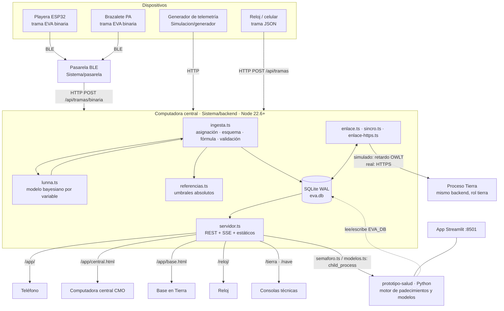
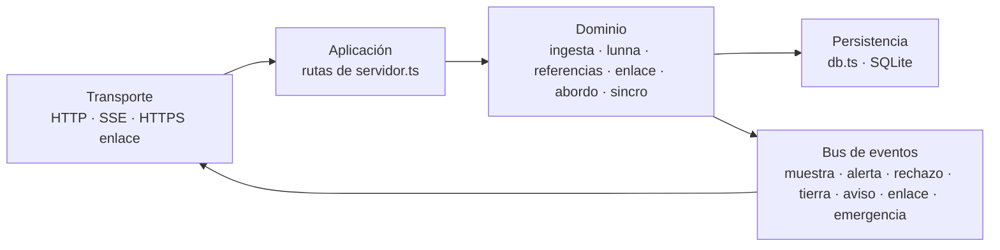
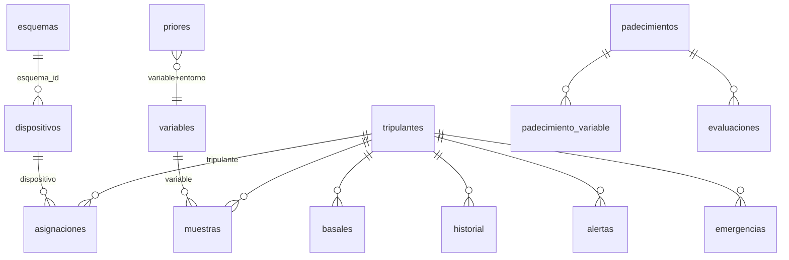
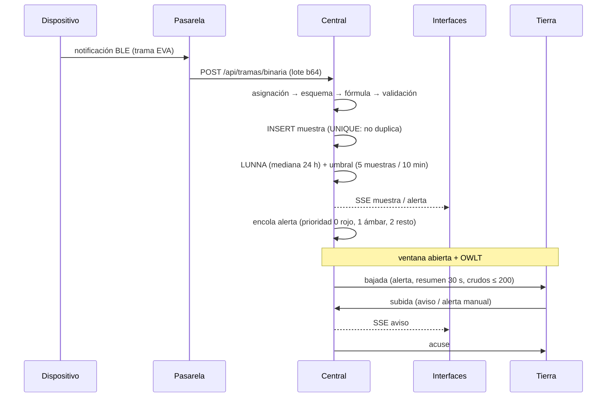
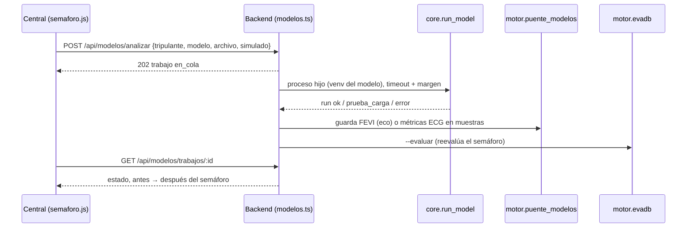

> 🌐 **Español** · [English](README_04_ARQUITECTURA_SISTEMA.en.md)

# 04 · Arquitectura del sistema

## 1. Visión general

LUNNA sigue una arquitectura **cliente-servidor centrada en la computadora central de la nave**. La central es un único proceso Node.js que:

- recibe tramas de cualquier dispositivo;
- las atribuye al tripulante correcto;
- las guarda en SQLite;
- evalúa cada variable con el modelo LUNNA y los umbrales clínicos;
- emite eventos en vivo (SSE) a las interfaces web que ella misma sirve;
- encola lo relevante hacia Tierra.

El mismo código corre como **nave** o como **Tierra** (rol) y en modo **operativo** o **simulación**.

El prototipo de salud (Python) es un componente **separado y opcional**. Lee y escribe la misma base SQLite, y el backend lo lanza como proceso hijo para evaluar el semáforo o analizar una muestra con un modelo. Si no hay Python, `POST /api/padecimientos/evaluar` responde 503 y el resto del backend sigue funcionando.

## 2. Componentes principales

| Componente | Ruta | Tecnología | Responsabilidad |
|---|---|---|---|
| Servidor HTTP | [`Sistema/backend/src/servidor.ts`](../Sistema/backend/src/servidor.ts) | `node:http` | REST, SSE (`/api/stream`), estáticos, modos, página de estado |
| Ingesta | [`ingesta.ts`](../Sistema/backend/src/ingesta.ts) | TS | Atribución por asignación, decodificación, fórmulas, validación, guardado, vigilancia y alertas; bus de eventos |
| Perfil EVA | [`esquema.ts`](../Sistema/backend/src/esquema.ts) | TS | Cabecera de 13 B, esquemas versionados, `codificar()`/`decodificar()` |
| Fórmulas | [`formula.ts`](../Sistema/backend/src/formula.ts) | TS | Intérprete propio de expresiones (sin `eval`) |
| Modelo LUNNA | [`lunna.ts`](../Sistema/backend/src/lunna.ts) | TS | Priores por entorno, combinación por precisión, banda del 95 %, z |
| Referencias clínicas | [`referencias.ts`](../Sistema/backend/src/referencias.ts) | TS | Carga de `semillas/medibles.json`, umbral absoluto |
| Estado para la app | [`app.ts`](../Sistema/backend/src/app.ts) | TS | `GET /api/app/:tripulante`: todo lo de una persona ya evaluado |
| A bordo | [`abordo.ts`](../Sistema/backend/src/abordo.ts) | TS | Avisos de la CMO, consultas a Tierra, emergencias |
| Enlace simulado | [`enlace.ts`](../Sistema/backend/src/enlace.ts) | TS | Ventana, OWLT, colas `bajada`/`subida`, resúmenes y crudos |
| Sincronización | [`sincro.ts`](../Sistema/backend/src/sincro.ts) | TS | Protocolo exactamente-una-vez (emisor, seq, ACK) |
| Transporte HTTPS | [`enlace-https.ts`](../Sistema/backend/src/enlace-https.ts), [`rol.ts`](../Sistema/backend/src/rol.ts), [`certs.ts`](../Sistema/backend/src/certs.ts) | `node:https` | Nave (cliente) ↔ Tierra (servidor TLS :8443) |
| Semillas | [`semillas.ts`](../Sistema/backend/src/semillas.ts) | TS | Carga idempotente de `inicial.json`; importación del contrato `SalidaTipo` |
| Tablas de salud | [`salud.ts`](../Sistema/backend/src/salud.ts), [`migrar.ts`](../Sistema/backend/src/migrar.ts) | TS | Tablas `padecimientos`, `padecimiento_variable`, `pesos_usuario`, `evaluaciones`, sembradas desde los CSV del prototipo |
| Semáforo de padecimientos | [`semaforo.ts`](../Sistema/backend/src/semaforo.ts), [`evaluar-salud.ts`](../Sistema/backend/src/evaluar-salud.ts) | TS + Python | Lee `evaluaciones`, edita pesos y umbrales (`pesos_usuario`), lanza el motor Python (`python -m motor.evadb --evaluar`) |
| Valor normal del motor | [`referencias-motor.ts`](../Sistema/backend/src/referencias-motor.ts) | TS | Rango normal por variable guardado por el motor en su última evaluación |
| Modelos desde la central | [`modelos.ts`](../Sistema/backend/src/modelos.ts) | TS → Python | Cola en memoria de trabajos de eco y ECG: runner `core.run_model` → puente `motor.puente_modelos` → reevaluación |
| Base de datos | [`db.ts`](../Sistema/backend/src/db.ts) | `node:sqlite` | Esquema y migraciones aditivas |
| Consolas | [`web/tierra.html`](../Sistema/backend/web/tierra.html), [`web/nave.html`](../Sistema/backend/web/nave.html) | HTML | Control de misión y panel del enlace |
| Interfaces EVA | [`Sistema/interfaces/eva/`](../Sistema/interfaces/eva/) | HTML/CSS/JS | Teléfono, central, base |
| Reloj | [`Sistema/interfaces/reloj/`](../Sistema/interfaces/reloj/) | HTML/CSS/JS | Reutiliza estilos, Lunna y motor de `eva/` |
| Pasarela BLE | [`Sistema/pasarela/`](../Sistema/pasarela/) | Python + `bleak` | BLE → HTTP con cola local de hasta 50 000 tramas |
| Firmware | [`Sistema/esp32/playera_eva/`](../Sistema/esp32/playera_eva/) | Arduino ESP32 | Servicio BLE EVA; `SIMULAR 1` por defecto |
| Simulación | [`Simulacion/`](../Simulacion/) | Node + HTML | Simulador visual, escenario, generador, DONKI |
| Prototipo de salud | [`prototipo-salud/`](../prototipo-salud/) | Python, Streamlit | Adaptadores, ECG, sensores, motor, validación |

## 3. Arquitectura de software

### 3.1 Capas del backend

- **Cero dependencias.** Solo módulos integrados de Node (`node:http`, `node:https`, `node:sqlite`, `node:test`). TypeScript se ejecuta con `--experimental-strip-types`.
- **Configuración por datos.** Variables, esquemas, dispositivos, tripulantes, priores y fases se registran por API o semilla, no en código.
- **Versionado de esquemas.** Editar un esquema crea otro `id`, de modo que las tramas antiguas siguen decodificándose con el suyo.

### 3.2 Modos y roles

| Dimensión | Valores | Efecto |
|---|---|---|
| Modo (`--modo`) | `operativo` (defecto) · `simulacion` | En simulación: sirve `/simulador`, `/app/escenario/*`, permite `POST /api/demo/reiniciar` y usa `Simulacion/eva-simulacion.db`. En operativo esas rutas responden 404/403 y la base es `Sistema/backend/eva.db` |
| Rol (`rol.ts`) | ninguno · `nave` · `tierra` | `nave` agrega el cliente HTTPS hacia Tierra; `tierra` abre HTTPS :8443 y atiende `/enlace/*` |

Las interfaces descubren el modo con `/app/config.js` (`window.EVA_CONFIG = {modo, escenario}`), que lee [`modo.js`](../Sistema/interfaces/eva/modo.js). Así, las mismas interfaces sirven para los dos modos sin duplicar código.

### 3.3 Interfaces web

Son sitios estáticos sin framework, con una serie común:

| Pieza | Función |
|---|---|
| `estilos.css`, `cuerpo.css`, `tema.css`, `consola.css` | Estilos |
| `luna.js`, `cuerpo.js`, `iconos.js` | Avatar de Lunna, Cuerpo LUNNA e iconos |
| `motor.js` | Motor del navegador: tripulación y series del escenario, normal personal, z robusto |
| `app.js`, `modulos.js` | Teléfono |
| `consola.js`, `central.js`, `base.js` | Consolas |
| `central-vivo.js`, `telefono-vivo.js`, `notificaciones.js` | Conexión con el backend (REST + SSE) |
| `semaforo.js` | Semáforo de los 20 padecimientos en la central, edición de pesos y tarjeta plegable «Analizar con modelos» |
| `referencias.js`, `alertas-motor.js` | Valor normal del motor de padecimientos (`/api/padecimientos/referencias`); en el teléfono, sustituye a «tu normal» cuando existe |
| `pesos.js` | Matriz de pesos, generada por `generar_pesos.py` |
| `idioma.js`, `idioma-en.js` | Textos en español e inglés |

Sin backend, la central y la base se comunican por `localStorage` (clave `lunna:enlace`) con el retardo de la luz: 18 min por trayecto en el escenario de la maqueta (`OWLT_ESCENARIO_MIN`). El backend de la demo usa 20 s por defecto (`owlt_s` en [`enlace.ts`](../Sistema/backend/src/enlace.ts); `SIMULAR_OWLT=1` aplica ese retardo también en el enlace HTTPS).

## 4. Hardware y software

| Elemento | Hardware previsto | Estado |
|---|---|---|
| Playera | ESP32 con BLE; ECG, banda respiratoria y termómetro axilar | Firmware escrito; `SIMULAR 1`; **no probado en placa real** |
| Brazalete | Oscilométrico (sistólica, diastólica) | Esquema 2 y modo `--prueba` de la pasarela |
| Reloj | PPG (pulso, SpO₂) vía dispositivo intermedio JSON | Simulado (`reloj-ana`) |
| Computadora central | Cualquier equipo con Node 22.6+ | Probado en Windows y Linux |
| GPU para eco | RTX 4050 Laptop 6 GB (referencia) | Usada en la PC de Iker para PanEcho |

## 5. Bases de datos

Una base SQLite por modo (y por rol en el enlace HTTPS):

| Archivo | Cuándo |
|---|---|
| `Sistema/backend/eva.db` | Modo operativo (defecto) |
| `Simulacion/eva-simulacion.db` | Modo simulación |
| Variable `BD` | Cualquier ruta, incluida `:memory:` en pruebas |

Grupos de tablas (detalle en el [diccionario](README_07_DICCIONARIO_DATOS_VARIABLES.md#6-estructura-de-la-base-de-datos)):

Las colas del enlace (`enlace`, `bajada`, `subida`, `entrada`, `enlace_contador`, `enlace_estado`, `abordo`) no tienen claves foráneas.

## 6. APIs

- **REST JSON** con 60 rutas, en [`servidor.ts`](../Sistema/backend/src/servidor.ts). Errores: `{ "error": "<mensaje>" }` con estado 400, 403, 404, 413 o 500.
- **SSE** en `/api/stream`: eventos `muestra`, `alerta`, `rechazo`, `tierra`, `aviso`, `enlace` y `emergencia`, con latido cada 15 s.
- **Transporte del enlace** `/enlace/ping|lote|descarga|ack` (solo en el rol Tierra).
- **CORS abierto** (`Access-Control-Allow-Origin: *`).

El catálogo completo de endpoints está en [Integración e interoperabilidad](README_05_INTEGRACION_INTEROPERABILIDAD.md).

## 7. Flujo general de información

## 8. Dependencias entre componentes

| Depende de → | Backend | Interfaces | Simulación | Prototipo de salud |
|---|---|---|---|---|
| **Backend** | — | Sirve sus archivos | Necesita `--simulacion <dir>` en modo simulación | Siembra tablas desde `prototipo-salud/datos/modelo/` (`MODELO_SALUD`); lanza el motor y los modelos (`PROTOTIPO_DIR`, `PYTHON`) |
| **Interfaces** | `/app/config.js`, REST, SSE (opcionales) | El reloj carga `../eva/` | Escenario `datos.js`/`demo.js` | — |
| **Simulación** | Ejecuta `../Sistema/backend/src/servidor.ts`; el generador importa `esquema.ts` | El simulador abre las interfaces en iframes | — | — |
| **Prototipo de salud** | `EVA_DB` (opcional); sus pruebas ejecutan `Sistema/backend/src/migrar.ts` | — | — | — |
| **Pasarela / firmware** | `POST /api/tramas/binaria`, `/api/asignaciones`, `/api/salud` | — | — | — |

`Sistema/` no depende de `Simulacion/`; `Simulacion/` sí depende de `Sistema/`.

## 9. Flujo del análisis con modelos desde la central

Un trabajo de prueba de carga no guarda nada. Con **SIMULADO**, el canal real ignora el dato, así que el semáforo real no cambia. Los trabajos viven en memoria (hasta 50); los datos quedan en `eva.db` y en `prototipo-salud/outputs/raw/<run_id>/`.

## Documentación relacionada

- [Integración e interoperabilidad](README_05_INTEGRACION_INTEROPERABILIDAD.md)
- [Modelos computacionales y algoritmos](README_06_MODELOS_COMPUTACIONALES_ALGORITMOS.md)
- [Diccionario de datos y variables](README_07_DICCIONARIO_DATOS_VARIABLES.md)
- [Instalación, configuración y despliegue](README_09_INSTALACION_CONFIGURACION_DESPLIEGUE.md)
- [Seguridad, confiabilidad y riesgos](README_10_SEGURIDAD_CONFIABILIDAD_RIESGOS.md)
