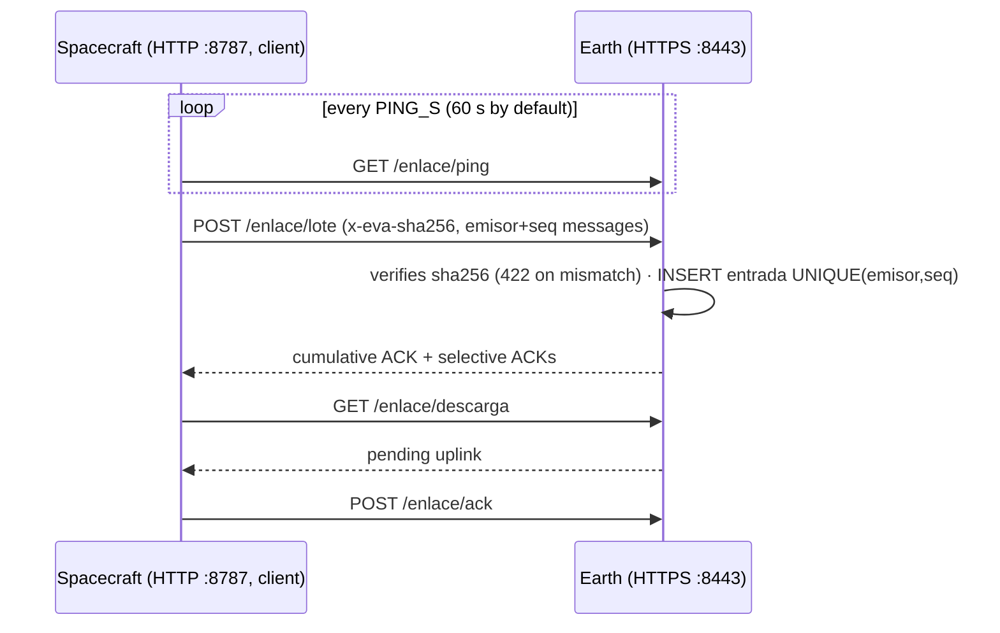

> 🌐 [Español](README_05_INTEGRACION_INTEROPERABILIDAD.md) · **English**

# 05 · Integration and interoperability

Each integration is classified as follows:

- **Implemented**: there is code in `Sistema/` or `prototipo-salud/` and, unless stated otherwise, automated tests.
- **Partial**: there is code, but real hardware, a run on the target machine, or the connection with the rest is missing.
- **Proposed / pending**: it is described in documents, but it does not exist in the code that runs.

## 1. Integration map

| Integration | Protocol | Status |
|---|---|---|
| ESP32 smart shirt → gateway | BLE GATT, custom EVA profile | Partial: firmware and gateway written; **not tested on a real board** |
| Cuff → gateway | BLE, schema 2 | Partial: `--prueba` mode without hardware |
| Gateway → central computer | HTTP `POST /api/tramas/binaria` (base64 batch) | Implemented |
| Watch/phone (intermediate device) → central computer | HTTP `POST /api/tramas` JSON `eva.telemetry.v1` | Implemented (the simulator acts as the watch) |
| Telemetry generator → central computer | Binary and JSON HTTP | Implemented |
| Central computer → interfaces | REST + SSE `/api/stream` | Implemented |
| Central computer ↔ Earth, simulated | Queues in the same database, OWLT delay and window | Implemented |
| Central computer ↔ Earth, real | HTTPS (TLS) between two processes, exactly-once | Implemented with a self-signed development certificate |
| Central computer ↔ condition engine | Shared SQLite (`EVA_DB`) + `child_process` → `python -m motor.evadb --evaluar` | Implemented: [`semaforo.ts`](../Sistema/backend/src/semaforo.ts) and `motor/evadb.py` |
| Central computer → echo/ECG models (`/api/modelos/*`) | `child_process` → `python -m core.run_model` → `motor.puente_modelos` | Implemented: [`modelos.ts`](../Sistema/backend/src/modelos.ts). Tested with a fake Python and with real ECG on Linux; **echo with weights and CUDA, pending on the GPU PC** |
| Import of research seeds | HTTP `POST /api/semillas` (`SalidaTipo` contract) | Implemented in the backend; the producer (`Planeacion/Leo/ingesta`) is no longer in the tree; it is preserved in the `planeacion-archivo` tag |
| NASA DONKI → scenario | NASA REST API (`fetch_donki.py`) | Implemented; data stored in `Simulacion/donki/datos/` |
| Standard BLE profiles (Heart Rate, Blood Pressure) | Standard GATT | **Pending** (backend README, “Pendiente”) |
| Real EVA infrastructure / space network | — | **Not implemented**: there is no integration with flight systems |

## 2. Binary EVA profile

This is what the smart shirt's ESP32, the cuff and the simulator send. Everything is *little-endian*.

```
┌ header, 13 B ────────────────────────────────────────┬ payload ──────────────┐
│ ver u8 │ id_disp u32 │ id_esquema u16 │ seq u16 │ t_scet u32 │ per schema    │
└──────────────────────────────────────────────────────┴───────────────────────┘
```

- **The crew member is not in the frame.** The central computer resolves it with the `asignaciones` table, as valid at `t_scet`.
- The payload is defined by the **schema**: a list of fields with `clave`, `variable`, `tipo` and, optionally, a `formula`. A field without `tipo` is virtual: it takes up no bytes and is computed solely from its formula.
- Implementations that must produce the same bytes:
  - TypeScript: [`esquema.ts`](../Sistema/backend/src/esquema.ts);
  - Python: [`pasarela/trama_eva.py`](../Sistema/pasarela/trama_eva.py), checked with `test_trama.py`;
  - C++: [`esp32/playera_eva/trama_eva.h`](../Sistema/esp32/playera_eva/trama_eva.h), with the vectors in [`esp32/test/vectores.json`](../Sistema/esp32/test/vectores.json).
- **There is no CRC or FEC** in the current format.

Seeded schemas ([`semillas/inicial.json`](../Sistema/backend/semillas/inicial.json)):

| id | Name | Fields (key = variable : type) |
|---|---|---|
| 1 | `traje-v1` | fc = 04:A4 : u8 · spo2 = 04:A3 : u8 · fr = 04:A2 : u8 · temp = 04:A1 : i16 |
| 2 | `brazalete-pa-v1` | sis = 01:V1 : u8 · dia = X:PAD : u8 · pam = X:PAM : (virtual, `(sis + 2 * dia) / 3`) |
| 5 | `playera-esp32-v1` | fc = 04:A4 : u8 · fr = 04:A2 : u8 · temp = 04:A1 : i16 |

Seeded devices: 101–104 (suits), 201 (cuff), 302 `reloj-ana` (`json` profile) and 401 `playera-01`.

### 2.1 EVA BLE service (firmware)

| Characteristic | UUID | Property |
|---|---|---|
| Service | `a3c87500-8ed3-4bdf-8a39-a01bebede295` | — |
| Data (frames) | `a3c87501-…` | Notify |
| Schema | `a3c87502-…` | Read |
| UTC time | `a3c87503-…` | Write |

The gateway ([`pasarela_ble.py`](../Sistema/pasarela/pasarela_ble.py)) does the following:

1. Looks for the service, writes the UTC time, reads the schema and subscribes to notifications.
2. Forwards the frames in batches.
3. If the backend does not respond, it stores up to **50,000 frames** and retries with increasing wait intervals.
4. On startup, it checks `GET /api/salud` and warns if the backend is an old version.
5. It can assign devices with `--asignar ID=TRIPULANTE`.

The `seq` sequence number makes it possible to detect gaps, but **a lost notification is not recovered** on the current BLE link.

## 3. JSON contract for intermediate devices

`POST /api/tramas` accepts one frame or a list:

```json
{
  "frame": "eva.telemetry.v1",
  "source": { "id": "reloj-ana", "kind": "wrist" },
  "subject": "ana",
  "t_scet": "2027-03-18T07:42:09Z",
  "seq": 10452,
  "samples": [
    { "var": "04:A4", "value": 75, "unit": "bpm", "origin": "sensor", "quality": { "contacto": true } }
  ]
}
```

Validation rules ([`ingesta.ts`](../Sistema/backend/src/ingesta.ts)):

| Condition | Result |
|---|---|
| `frame` other than `eva.telemetry.v1` | Rejected: «frame debe ser eva.telemetry.v1» (“frame must be eva.telemetry.v1”) |
| `t_scet` missing or invalid | Rejected |
| `samples` that is not a list | Rejected |
| `source.id` not registered | Rejected: «dispositivo "…" no registrado» (“device "…" not registered”) |
| Device with no assignment and no `subject` | Rejected |
| Assigned device | **The assignment prevails**; `subject` is only a fallback |
| Unregistered variable | That sample is rejected |
| `origin: "estimated"` without `method` or `quality.ic95` | That sample is rejected |
| `quality.contacto: false` | Stored, but LUNNA does not evaluate it |
| Identical resend | Counted as `duplicadas` |

Response per frame: `{ "aceptadas": n, "duplicadas": n, "rechazos": ["…"] }`. Rejections are also emitted as the SSE event `rechazo`.

Binary frame: `POST /api/tramas/binaria` with the raw body, or with `{"b64": "…"}`, or with `{"b64": ["…", "…"]}` for a batch. Possible rejections: unregistered device, unknown schema, device not assigned at that instant.

## 4. Endpoint catalog (`Sistema/backend`, v0.7.0)

### 4.1 System and model

| Method | Route | Use |
|---|---|---|
| GET | `/` | Plain-text status page (refreshes every 2 s) |
| GET | `/api/salud` | `{ ok, version, modo, hora, entorno, ventana_personal_min }` |
| GET / PUT | `/api/lunna/ventana` | `{ minutos }`: window of the personal criterion (1,440 in a mission; shortened only in demonstrations) |
| GET | `/api/prediccion/:tripulante` | Prediction and band per variable, with `pesos: {poblacion, historial, vuelo}` |
| GET | `/api/referencias` · POST `/api/referencias/recargar` | Absolute thresholds from `medibles.json` |

### 4.2 Registration and configuration

| Method | Route | Body / notes |
|---|---|---|
| GET / POST | `/api/variables` | `{ id, nombre, unidad, descripcion?, tipo_umbral?, procedencia? }`; the `id` must contain `:` (e.g. `X:TPIEL`) |
| GET / POST | `/api/esquemas` | `{ nombre, campos[] }` → responds with a new `id`; validates formulas and registered variables |
| GET / POST | `/api/dispositivos` | `{ id (u32), clave, nombre, tipo, perfil, esquema_id? }` |
| GET / POST | `/api/asignaciones` | `{ dispositivo, tripulante, desde? }`; closes the device's previous assignment |
| GET / POST | `/api/tripulantes` · GET `/api/tripulantes/:id` | The GET by id includes baselines, history and devices |
| PUT | `/api/tripulantes/:id/basales` | `{ "04:A4": 62, … }` |
| POST | `/api/tripulantes/:id/historial` | `[{ mision, entorno, variable, delta, escala }]` |
| GET / POST | `/api/fases` | `{ desde, entorno }`; environments: tierra, orbita, transito, luna, marte |
| GET / PUT | `/api/priores` | Prior per variable and environment; **without `fuente`, 400**; τ₀ and σ must be > 0 |
| POST | `/api/semillas` | `SalidaTipo` contract |

### 4.3 Ingestion and query

| Method | Route | Use |
|---|---|---|
| POST | `/api/tramas/binaria` · `/api/tramas` | Ingestion (§2–3) |
| GET | `/api/muestras?tripulante=&variable=&desde=&limite=` | Up to 5,000 samples |
| GET | `/api/estado` | Latest value and state per crew member and variable |
| GET | `/api/alertas?limite=` | Up to 1,000 alerts |
| GET | `/api/app/:tripulante` | Per variable: latest value, median, expected value, band, z, `estado`, `motivo`, threshold, 14-day series; plus their alerts and notices |
| GET | `/api/stream` | SSE |

### 4.4 Link with Earth and on board

| Method | Route | Use |
|---|---|---|
| GET / PUT | `/api/enlace` | `{ owlt_s, abierto }` |
| GET | `/api/tierra/bandeja?tipo=` | What has already arrived at Earth, with `t_evento`, `t_recepcion`, `antiguedad_s` and `antiguedad_al_llegar_s`. Types: `resumen`, `alerta`, `crudos`, `acuse`, `consulta`, `emergencia` |
| GET | `/api/tierra/pendientes` | Queued and in-flight counters, in both directions |
| POST | `/api/tierra/avisos` | `{ para, texto, prioridad }` or `{ tipo: "alerta", nivel: "ambar" o "rojo", para, variable?, texto }` |
| GET | `/api/tierra/avisos` · `/api/avisos` | All notices / those already delivered on board |
| GET · POST | `/api/tierra/cola` · `/api/tierra/ack` | Legacy queue of unsent alerts (red first) and its confirmation |
| GET | `/api/enlace/estado` | HTTPS status (spacecraft/Earth) or `SIMULADO` when there is no role |
| GET / POST | `/api/nave/avisos` | Spacecraft → Earth notices (`aviso` channel of the downlink) |
| GET / POST | `/api/abordo/avisos` | CMO notice: `{ para, texto, nivel?, de? }` |
| POST | `/api/central/consultas` | `{ sobre?, texto, nivel?, de? }` → `consulta` packet |
| GET / POST | `/api/emergencias` · PUT `/api/emergencias/:id` | `{ tripulante, modo: "SOS manual" o "automático", causa?, disparadores? }` · `{ resultado }` |
| POST | `/api/demo/reiniciar` | Simulation only (403 in operational mode) |

### 4.5 Condition traffic light and models

| Method | Route | Use |
|---|---|---|
| GET | `/api/padecimientos/semaforo[?tripulante=ID]` | The 20 colors per crew member (GRAY if there is no evaluation), with `vacio` and `como_poblar` |
| GET | `/api/padecimientos/semaforo/:tripulante/:padecimiento` | Evaluation and per-variable breakdown: source weight, user weight, effective weight and contribution |
| GET | `/api/padecimientos/referencias?tripulante=ID[&variable=VID]` | Normal value per variable from the latest evaluation (range, source, personal baseline; `SIMULADO` if applicable) |
| GET / PUT | `/api/padecimientos/pesos[?padecimiento=P07]` | Weights per link (range [0, 3]) and thresholds; PUT `{padecimiento_id, variable_id, peso?, prior_de?}` or `{umbral, valor}` |
| POST | `/api/padecimientos/pesos/restaurar` | `{}` restores everything; `{padecimiento_id[, variable_id]}` or `{umbral}` restores a part |
| POST | `/api/padecimientos/evaluar` | `{simulado?, origen_simulador?}`: runs the engine. 409 if the database is in memory or an evaluation is already in progress; 503 without Python |
| GET | `/api/modelos/disponibles` | Models (from the `manifest.json` files) and samples from `MUESTRAS_DIR`, without subfolders |
| POST | `/api/modelos/analizar` | `{tripulante, modelo, archivo, simulado, vista?, prueba_carga?}` → **202** with the job `en_cola`. `archivo` must be a name from the list; paths, `..` and symbolic links that point outside give 400 |
| GET | `/api/modelos/trabajos` · `/api/modelos/trabajos/:id` | Status (`en_cola`, `corriendo`, `ok`, `error`), phase, summarized output, bridge result and traffic-light changes |

Changed weights are applied at the **next evaluation**.

### 4.6 Static files

`/app/…` → `Sistema/interfaces/eva/` · `/app/config.js` (dynamic) · `/app/escenario/…` (simulation only) · `/reloj` → 302 to `/interfaces/reloj/` · `/interfaces/eva|reloj/…` · `/maquetas/Leo/maqueta-eva/…` and `/maquetas/Fani/maqueta-reloj/…` → 301 · `/tierra` · `/nave` · `/simulador` (simulation only).

### 4.7 SSE events

```js
const es = new EventSource('http://localhost:8787/api/stream');
es.addEventListener('alerta', (e) => mostrar(JSON.parse(e.data)));
```

| Event | When |
|---|---|
| `muestra` | A sample was stored |
| `alerta` | The combined state of a variable changed (including the return to green) |
| `rechazo` | A frame or sample was rejected |
| `tierra` | Something arrived at Earth |
| `aviso` | A notice from Earth reached the spacecraft, or one from the CMO (`origen: "abordo"`) |
| `enlace` | The window or the delay changed |
| `emergencia` | An emergency was opened or closed |

## 5. Spacecraft ↔ Earth link

### 5.1 Simulated link ([`enlace.ts`](../Sistema/backend/src/enlace.ts))

| Item | Detail |
|---|---|
| What goes down | Alerts (priority 0 red, 1 amber, 2 rest), **summaries every 30 s**, **raw frames in batches of up to 200**, acknowledgements, consultations and emergencies (priority 0) |
| What goes up | Notices and manual alerts; when they arrive on board, an acknowledgement is created and sent back to Earth |
| Behavior | With the window closed, packets wait |
| Delay | `owlt_s` = one-way delay. The mock-up scenario uses 18 min each way. The demo backend uses 20 s by default. The 240–1,440 s interval illustrates the physical range for Mars |
| Times | SCET (when it happened) and ERT (when it arrived) |

### 5.2 Real HTTPS link ([`sincro.ts`](../Sistema/backend/src/sincro.ts), [`enlace-https.ts`](../Sistema/backend/src/enlace-https.ts))



- Each side has its own outgoing queue, ordered by priority and then by `seq`; `seq` is monotonic per sender.
- The receiver applies the inbox and the changes in a single transaction. Resends are ignored as duplicates.
- Any failure (timeout, network, status ≠ 200) switches to **DISCONNECTED** immediately and retries with exponential *backoff* with *jitter* (base 1 s, cap `PING_S`).
- Result: at-least-once in the transport plus idempotency at the receiver, that is, **exactly-once**.
- Environment variables: `TIERRA_URL`, `TIERRA_CA`, `TLS_CERT`, `TLS_KEY`, `PING_S`, `TIMEOUT_S`, `SIMULAR_OWLT=1` (see [installation](README_09_INSTALACION_CONFIGURACION_DESPLIEGUE.en.md)).

## 6. Integration with the health prototype

| Direction | Mechanism | Status |
|---|---|---|
| Backend → health tables | On startup, `sembrarSalud()` loads `prototipo-salud/datos/modelo/PADECIMIENTOS.csv` and `PADECIMIENTO-VARIABLE.csv` (or `MODELO_SALUD`) into `padecimientos` and `padecimiento_variable` | Implemented |
| Engine ← `eva.db` | `python -m motor.evadb --evaluar [--simulado|--origen-simulador]` with `EVA_DB=<ruta>` reads `muestras`, `tripulantes`, `basales` and `fases` | Implemented; tests in `tests/test_evadb.py` |
| Engine → `eva.db` | Writes to `evaluaciones` (`real` or `SIMULADO` channel) and `pesos_usuario`; `guardar_muestra_eco` adds LVEF (`01:V18`) | Implemented |
| Interfaces ← traffic light | `GET /api/padecimientos/semaforo…` (`semaforo.js` on the central computer) | Implemented |
| Phone ← normal value | `GET /api/padecimientos/referencias` (`alertas-motor.js`) | Implemented |
| Central computer → models | `POST /api/modelos/analizar` | Implemented (§4.5) |

Internal contract of the prototype (adapters ↔ runner ↔ common format): the columns of `outputs/normalized.csv` are

`subject_id, study_id, timestamp, source, model, metric, value, unit, quality, simulated, tipo, run_id, input_file, notes`

See [models](README_06_MODELOS_COMPUTACIONALES_ALGORITMOS.en.md#5-health-prototype-adapters-and-runner).

## 7. Handling of communication errors

| Point | Behavior |
|---|---|
| HTTP body > 5 MB | 413 |
| Malformed JSON | 400 «JSON inválido» (“invalid JSON”) |
| Nonexistent route | 404 `{ "error": "ruta no existe" }` |
| Gateway without backend | Local queue of up to 50,000 frames; retry with increasing wait intervals |
| Interfaces without backend | “No connection to the backend” and a retry every 5 s; the watch falls back to the simulated value after 20 s without a reading |
| HTTPS link down | DISCONNECTED, retry with *backoff*; nothing is lost (anything unconfirmed is included again) |
| Corrupt batch | 422 via `x-eva-sha256`; nothing is applied |
| SSE | Heartbeat `: latido` every 15 s; the client removes its listeners on close |

## 8. Connectivity considerations

- With real Mars (RTT of 8 to 48 min), a heartbeat of a few seconds only models the terrestrial segment. What matters is the window and the delay, which are simulated with `SIMULAR_OWLT=1`.
- Resumption is at batch level, not at byte level.
- There is a single spacecraft and a single Earth, with no rate limits.
- The interfaces and the API respond with open CORS: this is intended for the demo's local network, not for exposure to the internet (see [security](README_10_SEGURIDAD_CONFIABILIDAD_RIESGOS.en.md)).

## Related documentation

- [System architecture](README_04_ARQUITECTURA_SISTEMA.en.md)
- [Data and variable dictionary](README_07_DICCIONARIO_DATOS_VARIABLES.en.md)
- [Testing and validation](README_08_PRUEBAS_VALIDACION.en.md)
- [Security, reliability and risks](README_10_SEGURIDAD_CONFIABILIDAD_RIESGOS.en.md)
