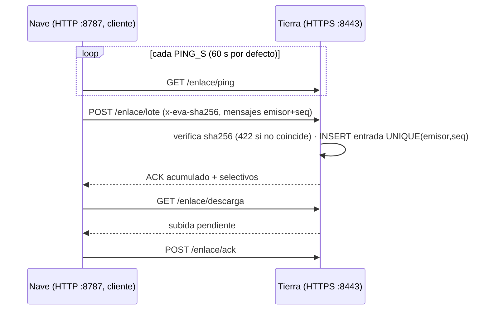

# 05 · Integración e interoperabilidad

Cada integración se clasifica así:

- **Implementada**: hay código en `Sistema/` o `prototipo-salud/` y, salvo que se diga lo contrario, pruebas automatizadas.
- **Parcial**: hay código, pero falta hardware real, una ejecución en el equipo objetivo o la conexión con el resto.
- **Propuesta / pendiente**: está descrita en documentos, pero no existe en el código que se ejecuta.

## 1. Mapa de integraciones

| Integración | Protocolo | Estado |
|---|---|---|
| Playera ESP32 → pasarela | BLE GATT, perfil EVA propio | Parcial: firmware y pasarela escritos; **sin prueba en placa real** |
| Brazalete → pasarela | BLE, esquema 2 | Parcial: modo `--prueba` sin hardware |
| Pasarela → central | HTTP `POST /api/tramas/binaria` (lote base64) | Implementada |
| Reloj/celular (dispositivo intermedio) → central | HTTP `POST /api/tramas` JSON `eva.telemetry.v1` | Implementada (el simulador hace de reloj) |
| Generador de telemetría → central | HTTP binario y JSON | Implementada |
| Central → interfaces | REST + SSE `/api/stream` | Implementada |
| Central ↔ Tierra, simulado | Colas en la misma base, retardo OWLT y ventana | Implementada |
| Central ↔ Tierra, real | HTTPS (TLS) entre dos procesos, exactamente-una-vez | Implementada con certificado autofirmado de desarrollo |
| Central ↔ motor de padecimientos | SQLite compartida (`EVA_DB`) + `child_process` → `python -m motor.evadb --evaluar` | Implementada: [`semaforo.ts`](../Sistema/backend/src/semaforo.ts) y `motor/evadb.py` |
| Central → modelos de eco/ECG (`/api/modelos/*`) | `child_process` → `python -m core.run_model` → `motor.puente_modelos` | Implementada: [`modelos.ts`](../Sistema/backend/src/modelos.ts). Probada con un Python falso y con ECG real en Linux; **eco con pesos y CUDA, pendiente en la PC con GPU** |
| Importación de semillas de investigación | HTTP `POST /api/semillas` (contrato `SalidaTipo`) | Implementada en el backend; el productor (`Planeacion/Leo/ingesta`) ya no está en el árbol; se conserva en la etiqueta `planeacion-archivo` |
| NASA DONKI → escenario | API REST de NASA (`fetch_donki.py`) | Implementada; datos guardados en `Simulacion/donki/datos/` |
| Perfiles BLE estándar (Heart Rate, Blood Pressure) | GATT estándar | **Pendiente** (README del backend, «Pendiente») |
| Infraestructura EVA real / red espacial | — | **No implementada**: no hay integración con sistemas de vuelo |

## 2. Perfil EVA binario

Es lo que mandan el ESP32 de la playera, el brazalete y el simulador. Todo en *little-endian*.

```
┌ cabecera, 13 B ──────────────────────────────────────┬ carga ────────────────┐
│ ver u8 │ id_disp u32 │ id_esquema u16 │ seq u16 │ t_scet u32 │ según esquema │
└──────────────────────────────────────────────────────┴───────────────────────┘
```

- **El tripulante no va en la trama.** La central lo resuelve con la tabla `asignaciones`, vigente en `t_scet`.
- La carga se define por el **esquema**: lista de campos con `clave`, `variable`, `tipo` y, opcionalmente, una `formula`. Un campo sin `tipo` es virtual: no ocupa bytes y se calcula solo con su fórmula.
- Implementaciones que deben producir los mismos bytes:
  - TypeScript: [`esquema.ts`](../Sistema/backend/src/esquema.ts);
  - Python: [`pasarela/trama_eva.py`](../Sistema/pasarela/trama_eva.py), comprobada con `test_trama.py`;
  - C++: [`esp32/playera_eva/trama_eva.h`](../Sistema/esp32/playera_eva/trama_eva.h), con los vectores de [`esp32/test/vectores.json`](../Sistema/esp32/test/vectores.json).
- **No hay CRC ni FEC** en el formato actual.

Esquemas sembrados ([`semillas/inicial.json`](../Sistema/backend/semillas/inicial.json)):

| id | Nombre | Campos (clave = variable : tipo) |
|---|---|---|
| 1 | `traje-v1` | fc = 04:A4 : u8 · spo2 = 04:A3 : u8 · fr = 04:A2 : u8 · temp = 04:A1 : i16 |
| 2 | `brazalete-pa-v1` | sis = 01:V1 : u8 · dia = X:PAD : u8 · pam = X:PAM : (virtual, `(sis + 2 * dia) / 3`) |
| 5 | `playera-esp32-v1` | fc = 04:A4 : u8 · fr = 04:A2 : u8 · temp = 04:A1 : i16 |

Dispositivos sembrados: 101–104 (trajes), 201 (brazalete), 302 `reloj-ana` (perfil `json`) y 401 `playera-01`.

### 2.1 Servicio BLE EVA (firmware)

| Característica | UUID | Propiedad |
|---|---|---|
| Servicio | `a3c87500-8ed3-4bdf-8a39-a01bebede295` | — |
| Datos (tramas) | `a3c87501-…` | Notificar |
| Esquema | `a3c87502-…` | Leer |
| Hora UTC | `a3c87503-…` | Escribir |

La pasarela ([`pasarela_ble.py`](../Sistema/pasarela/pasarela_ble.py)) hace lo siguiente:

1. Busca el servicio, escribe la hora UTC, lee el esquema y se suscribe a las notificaciones.
2. Reenvía las tramas en lotes.
3. Si el backend no responde, guarda hasta **50 000 tramas** y reintenta con espera creciente.
4. Al arrancar comprueba `GET /api/salud` y avisa si el backend es una versión vieja.
5. Puede asignar dispositivos con `--asignar ID=TRIPULANTE`.

La secuencia `seq` permite detectar huecos, pero **una notificación perdida no se recupera** en el enlace BLE actual.

## 3. Contrato JSON para dispositivos intermedios

`POST /api/tramas` acepta una trama o una lista:

```json
{
  "frame": "eva.telemetry.v1",
  "source": { "id": "reloj-ana", "kind": "wrist" },
  "subject": "ana",
  "t_scet": "2027-03-18T07:42:09Z",
  "seq": 10452,
  "samples": [
    { "var": "04:A4", "value": 75, "unit": "bpm", "origin": "sensor", "quality": { "contacto": true } }
  ]
}
```

Reglas de validación ([`ingesta.ts`](../Sistema/backend/src/ingesta.ts)):

| Condición | Resultado |
|---|---|
| `frame` distinto de `eva.telemetry.v1` | Rechazo: «frame debe ser eva.telemetry.v1» |
| `t_scet` ausente o inválido | Rechazo |
| `samples` que no sea una lista | Rechazo |
| `source.id` no registrado | Rechazo: «dispositivo "…" no registrado» |
| Dispositivo sin asignación y sin `subject` | Rechazo |
| Dispositivo asignado | **Manda la asignación**; `subject` es solo respaldo |
| Variable no registrada | Rechazo de esa muestra |
| `origin: "estimated"` sin `method` ni `quality.ic95` | Rechazo de esa muestra |
| `quality.contacto: false` | Se guarda, pero LUNNA no la evalúa |
| Reenvío idéntico | Contado como `duplicadas` |

Respuesta por trama: `{ "aceptadas": n, "duplicadas": n, "rechazos": ["…"] }`. Los rechazos también salen como evento SSE `rechazo`.

Trama binaria: `POST /api/tramas/binaria` con el cuerpo crudo, o con `{"b64": "…"}`, o con `{"b64": ["…", "…"]}` para un lote. Rechazos posibles: dispositivo no registrado, esquema desconocido, dispositivo sin asignar en ese instante.

## 4. Catálogo de endpoints (`Sistema/backend`, v0.7.0)

### 4.1 Sistema y modelo

| Método | Ruta | Uso |
|---|---|---|
| GET | `/` | Página de estado en texto plano (se refresca cada 2 s) |
| GET | `/api/salud` | `{ ok, version, modo, hora, entorno, ventana_personal_min }` |
| GET / PUT | `/api/lunna/ventana` | `{ minutos }`: ventana del criterio personal (1440 en misión; se acorta solo en demostraciones) |
| GET | `/api/prediccion/:tripulante` | Predicción y banda por variable, con `pesos: {poblacion, historial, vuelo}` |
| GET | `/api/referencias` · POST `/api/referencias/recargar` | Umbrales absolutos de `medibles.json` |

### 4.2 Registro y configuración

| Método | Ruta | Cuerpo / notas |
|---|---|---|
| GET / POST | `/api/variables` | `{ id, nombre, unidad, descripcion?, tipo_umbral?, procedencia? }`; el `id` debe tener `:` (p. ej. `X:TPIEL`) |
| GET / POST | `/api/esquemas` | `{ nombre, campos[] }` → responde con un `id` nuevo; valida fórmulas y variables registradas |
| GET / POST | `/api/dispositivos` | `{ id (u32), clave, nombre, tipo, perfil, esquema_id? }` |
| GET / POST | `/api/asignaciones` | `{ dispositivo, tripulante, desde? }`; cierra la asignación anterior del dispositivo |
| GET / POST | `/api/tripulantes` · GET `/api/tripulantes/:id` | El GET por id incluye basales, historial y dispositivos |
| PUT | `/api/tripulantes/:id/basales` | `{ "04:A4": 62, … }` |
| POST | `/api/tripulantes/:id/historial` | `[{ mision, entorno, variable, delta, escala }]` |
| GET / POST | `/api/fases` | `{ desde, entorno }`; entornos: tierra, orbita, transito, luna, marte |
| GET / PUT | `/api/priores` | Prior por variable y entorno; **sin `fuente`, 400**; τ₀ y σ deben ser > 0 |
| POST | `/api/semillas` | Contrato `SalidaTipo` |

### 4.3 Ingesta y consulta

| Método | Ruta | Uso |
|---|---|---|
| POST | `/api/tramas/binaria` · `/api/tramas` | Ingesta (§2–3) |
| GET | `/api/muestras?tripulante=&variable=&desde=&limite=` | Hasta 5000 muestras |
| GET | `/api/estado` | Último valor y estado por tripulante y variable |
| GET | `/api/alertas?limite=` | Hasta 1000 alertas |
| GET | `/api/app/:tripulante` | Por variable: último valor, mediana, esperado, banda, z, `estado`, `motivo`, umbral, serie de 14 días; además sus alertas y avisos |
| GET | `/api/stream` | SSE |

### 4.4 Enlace con Tierra y a bordo

| Método | Ruta | Uso |
|---|---|---|
| GET / PUT | `/api/enlace` | `{ owlt_s, abierto }` |
| GET | `/api/tierra/bandeja?tipo=` | Lo que ya llegó a Tierra, con `t_evento`, `t_recepcion`, `antiguedad_s` y `antiguedad_al_llegar_s`. Tipos: `resumen`, `alerta`, `crudos`, `acuse`, `consulta`, `emergencia` |
| GET | `/api/tierra/pendientes` | Contadores de cola y en vuelo, en los dos sentidos |
| POST | `/api/tierra/avisos` | `{ para, texto, prioridad }` o `{ tipo: "alerta", nivel: "ambar" o "rojo", para, variable?, texto }` |
| GET | `/api/tierra/avisos` · `/api/avisos` | Todos los avisos / los ya entregados a bordo |
| GET · POST | `/api/tierra/cola` · `/api/tierra/ack` | Cola heredada de alertas sin enviar (rojo primero) y su confirmación |
| GET | `/api/enlace/estado` | Estado HTTPS (nave/Tierra) o `SIMULADO` sin rol |
| GET / POST | `/api/nave/avisos` | Avisos nave → Tierra (canal `aviso` de la bajada) |
| GET / POST | `/api/abordo/avisos` | Aviso de la CMO: `{ para, texto, nivel?, de? }` |
| POST | `/api/central/consultas` | `{ sobre?, texto, nivel?, de? }` → paquete `consulta` |
| GET / POST | `/api/emergencias` · PUT `/api/emergencias/:id` | `{ tripulante, modo: "SOS manual" o "automático", causa?, disparadores? }` · `{ resultado }` |
| POST | `/api/demo/reiniciar` | Solo en simulación (403 en modo operativo) |

### 4.5 Semáforo de padecimientos y modelos

| Método | Ruta | Uso |
|---|---|---|
| GET | `/api/padecimientos/semaforo[?tripulante=ID]` | Los 20 colores por tripulante (GRIS si no hay evaluación), con `vacio` y `como_poblar` |
| GET | `/api/padecimientos/semaforo/:tripulante/:padecimiento` | Evaluación y desglose por variable: peso de la fuente, del usuario, efectivo y contribución |
| GET | `/api/padecimientos/referencias?tripulante=ID[&variable=VID]` | Valor normal por variable de la última evaluación (rango, fuente, base personal; `SIMULADO` si aplica) |
| GET / PUT | `/api/padecimientos/pesos[?padecimiento=P07]` | Pesos por liga (rango [0, 3]) y umbrales; PUT `{padecimiento_id, variable_id, peso?, prior_de?}` o `{umbral, valor}` |
| POST | `/api/padecimientos/pesos/restaurar` | `{}` restaura todo; `{padecimiento_id[, variable_id]}` o `{umbral}` restaura una parte |
| POST | `/api/padecimientos/evaluar` | `{simulado?, origen_simulador?}`: corre el motor. 409 si la base está en memoria o ya hay una evaluación en curso; 503 sin Python |
| GET | `/api/modelos/disponibles` | Modelos (de los `manifest.json`) y muestras de `MUESTRAS_DIR`, sin subcarpetas |
| POST | `/api/modelos/analizar` | `{tripulante, modelo, archivo, simulado, vista?, prueba_carga?}` → **202** con el trabajo `en_cola`. `archivo` debe ser un nombre de la lista; rutas, `..` y enlaces que salgan dan 400 |
| GET | `/api/modelos/trabajos` · `/api/modelos/trabajos/:id` | Estado (`en_cola`, `corriendo`, `ok`, `error`), fase, salida resumida, resultado del puente y cambios del semáforo |

Los pesos cambiados se aplican en la **próxima evaluación**.

### 4.6 Estáticos

`/app/…` → `Sistema/interfaces/eva/` · `/app/config.js` (dinámico) · `/app/escenario/…` (solo simulación) · `/reloj` → 302 a `/interfaces/reloj/` · `/interfaces/eva|reloj/…` · `/maquetas/Leo/maqueta-eva/…` y `/maquetas/Fani/maqueta-reloj/…` → 301 · `/tierra` · `/nave` · `/simulador` (solo simulación).

### 4.7 Eventos SSE

```js
const es = new EventSource('http://localhost:8787/api/stream');
es.addEventListener('alerta', (e) => mostrar(JSON.parse(e.data)));
```

| Evento | Cuándo |
|---|---|
| `muestra` | Se guardó una muestra |
| `alerta` | Cambió el estado combinado de una variable (incluida la vuelta a verde) |
| `rechazo` | Una trama o muestra fue rechazada |
| `tierra` | Algo llegó a Tierra |
| `aviso` | Un aviso de Tierra llegó a la nave, o uno de la CMO (`origen: "abordo"`) |
| `enlace` | Cambió la ventana o el retardo |
| `emergencia` | Se abrió o se cerró una emergencia |

## 5. Enlace nave ↔ Tierra

### 5.1 Enlace simulado ([`enlace.ts`](../Sistema/backend/src/enlace.ts))

| Dato | Detalle |
|---|---|
| Qué baja | Alertas (prioridad 0 rojo, 1 ámbar, 2 resto), **resúmenes cada 30 s**, **tramas crudas en lotes de hasta 200**, acuses, consultas y emergencias (prioridad 0) |
| Qué sube | Avisos y alertas manuales; al llegar a bordo se crea un acuse que vuelve a Tierra |
| Comportamiento | Con la ventana cerrada, los paquetes esperan |
| Retardo | `owlt_s` = retardo de un trayecto. El escenario de la maqueta usa 18 min por trayecto. El backend de la demo usa 20 s por defecto. El intervalo 240–1440 s ilustra el rango físico de Marte |
| Tiempos | SCET (cuándo ocurrió) y ERT (cuándo llegó) |

### 5.2 Enlace HTTPS real ([`sincro.ts`](../Sistema/backend/src/sincro.ts), [`enlace-https.ts`](../Sistema/backend/src/enlace-https.ts))



- Cada lado tiene su cola de salida, ordenada por prioridad y luego `seq`; el `seq` es monótono por emisor.
- El receptor aplica bandeja de entrada y cambios en una sola transacción. Los reenvíos se ignoran como duplicados.
- Cualquier fallo (timeout, red, estado ≠ 200) pasa a **DESCONECTADO** al instante y reintenta con *backoff* exponencial con *jitter* (base 1 s, tope `PING_S`).
- Resultado: al-menos-una-vez en el transporte más idempotencia en el receptor, es decir, **exactamente-una-vez**.
- Variables de entorno: `TIERRA_URL`, `TIERRA_CA`, `TLS_CERT`, `TLS_KEY`, `PING_S`, `TIMEOUT_S`, `SIMULAR_OWLT=1` (ver [instalación](README_09_INSTALACION_CONFIGURACION_DESPLIEGUE.md)).

## 6. Integración con el prototipo de salud

| Sentido | Mecanismo | Estado |
|---|---|---|
| Backend → tablas de salud | Al arrancar, `sembrarSalud()` carga `prototipo-salud/datos/modelo/PADECIMIENTOS.csv` y `PADECIMIENTO-VARIABLE.csv` (o `MODELO_SALUD`) en `padecimientos` y `padecimiento_variable` | Implementada |
| Motor ← `eva.db` | `python -m motor.evadb --evaluar [--simulado|--origen-simulador]` con `EVA_DB=<ruta>` lee `muestras`, `tripulantes`, `basales` y `fases` | Implementada; pruebas en `tests/test_evadb.py` |
| Motor → `eva.db` | Escribe en `evaluaciones` (canal `real` o `SIMULADO`) y `pesos_usuario`; `guardar_muestra_eco` añade FEVI (`01:V18`) | Implementada |
| Interfaces ← semáforo | `GET /api/padecimientos/semaforo…` (`semaforo.js` en la central) | Implementada |
| Teléfono ← valor normal | `GET /api/padecimientos/referencias` (`alertas-motor.js`) | Implementada |
| Central → modelos | `POST /api/modelos/analizar` | Implementada (§4.5) |

Contrato interno del prototipo (adaptadores ↔ runner ↔ formato común): las columnas de `outputs/normalized.csv` son

`subject_id, study_id, timestamp, source, model, metric, value, unit, quality, simulated, tipo, run_id, input_file, notes`

Ver [modelos](README_06_MODELOS_COMPUTACIONALES_ALGORITMOS.md#5-prototipo-de-salud-adaptadores-y-runner).

## 7. Manejo de errores de comunicación

| Punto | Comportamiento |
|---|---|
| Cuerpo HTTP > 5 MB | 413 |
| JSON mal formado | 400 «JSON inválido» |
| Ruta inexistente | 404 `{ "error": "ruta no existe" }` |
| Pasarela sin backend | Cola local de hasta 50 000 tramas; reintento con espera creciente |
| Interfaces sin backend | «Sin conexión con el backend» y reintento cada 5 s; el reloj vuelve al valor simulado tras 20 s sin lectura |
| Enlace HTTPS caído | DESCONECTADO, reintento con *backoff*; nada se pierde (lo no confirmado se reincluye) |
| Lote corrupto | 422 por `x-eva-sha256`; no se aplica nada |
| SSE | Latido `: latido` cada 15 s; el cliente limpia oyentes al cerrar |

## 8. Consideraciones de conectividad

- Con Marte real (RTT de 8 a 48 min), un latido de segundos solo modela el tramo terrestre. Lo que manda es la ventana y el retardo, que se simulan con `SIMULAR_OWLT=1`.
- La reanudación es a nivel de lote, no de byte.
- Hay una sola nave y una sola Tierra, sin límites de tasa.
- Las interfaces y la API responden con CORS abierto: pensado para la red local de la demo, no para exponerse a internet (ver [seguridad](README_10_SEGURIDAD_CONFIABILIDAD_RIESGOS.md)).

## Documentación relacionada

- [Arquitectura del sistema](README_04_ARQUITECTURA_SISTEMA.md)
- [Diccionario de datos y variables](README_07_DICCIONARIO_DATOS_VARIABLES.md)
- [Pruebas y validación](README_08_PRUEBAS_VALIDACION.md)
- [Seguridad, confiabilidad y riesgos](README_10_SEGURIDAD_CONFIABILIDAD_RIESGOS.md)
