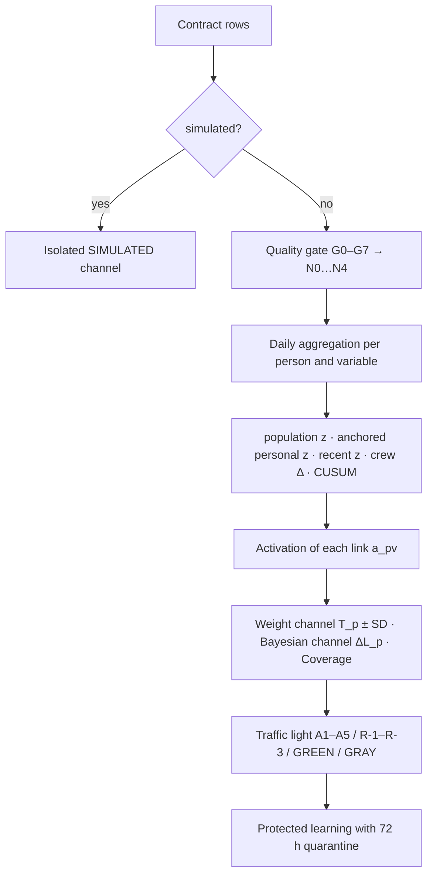

> 🌐 [Español](README_06_MODELOS_COMPUTACIONALES_ALGORITMOS.md) · **English**

# 06 · Computational models and algorithms

> **Nothing described here is a diagnosis.** The thresholds are provisional, none of them is validated in astronauts, and the colors and states are not clinical probabilities.

The project has **four independent computation engines**. It is important not to confuse them:

| # | Engine | Where it runs | Purpose | Status |
|---|---|---|---|---|
| 1 | **LUNNA** (per-variable Bayesian model) + clinical threshold | Backend, [`lunna.ts`](../Sistema/backend/src/lunna.ts), [`ingesta.ts`](../Sistema/backend/src/ingesta.ts) | Green/amber/red state of each variable, and alerts | Implemented and tested |
| 2 | **Browser engine** (14-day personal normal) | Interfaces, [`motor.js`](../Sistema/interfaces/eva/motor.js) | ●■▲○ states of the interfaces' scenario | Implemented (synthetic scenario) |
| 3 | **Per-condition index** (weight matrix of 11 ailments) | Central computer and base, [`consola.js`](../Sistema/interfaces/eva/consola.js), [`pesos.js`](../Sistema/interfaces/eva/pesos.js) | Prioritize the review in “Forecasts” | Implemented; deterministic, not probabilistic |
| 4 | **Condition engine** (20 conditions, traffic light) | Python, [`prototipo-salud/motor/`](../prototipo-salud/motor/); launched by the backend ([`semaforo.ts`](../Sistema/backend/src/semaforo.ts)) and displayed by the central computer (`semaforo.js`) | GREEN/YELLOW/RED/GRAY with traceability | Implemented; provisional thresholds |

In addition, there are the **model adapters** (five for echocardiography and one for ECG) of the health prototype.

## 1. LUNNA: per-variable model (backend)

### 1.1 Inputs and outputs

| | Detail |
|---|---|
| Inputs | Valid samples of one variable and one crew member; baseline (`basales`); prior per variable and environment (`priores`); history of previous missions (`historial`); mission phase (`fases`) |
| Outputs | Expected value, 95% band, `z`, `prob_nominal`, state (`verde`, `ambar`, `rojo`), `pesos` of each source, and alerts with `motivo` (`personal`, `umbral` or `ambos`) |

### 1.2 Change relative to the baseline

```text
Δ = x/b − 1     (relative scale)
Δ = x − b       (absolute scale)
```

The population prior can be adjusted for centered covariates (age 35 years, weight 70 kg, height 1.70 m, female sex as an indicator). If the prior does not declare β coefficients, they are zero. **Blood type does not enter the model.**

### 1.3 Precision-weighted combination (three layers)

| Layer | Source | Example |
|---|---|---|
| ① Population prior | Literature (catalogs) | Systolic BP −6.7% in orbit |
| ② Personal history | Imported previous missions | “On Artemis their HR dropped 10%” |
| ③ Calibration | Daily median of the first **14 days** in the environment; then **frozen** | — |

```text
q₀ = 1/τ₀²      qₕ = n_hist/σ_misión²      q_f = n_cal/σ_día²
μ  = (q₀·μ₀ + ΣΔ_hist/σ_misión² + ΣΔ_cal/σ_día²) / (q₀ + qₕ + q_f)
τ  = √(1/(q₀ + qₕ + q_f))
SD_pred = √(τ² + σ_día²)
banda_95 = value(μ ± 1.96 · SD_pred)
```

The expected value is converted back to the original units: `b(1+μ)` on the relative scale or `b+μ` on the absolute scale. The band describes predictive uncertainty; **it is not a clinical reference interval**.

**Per-environment priors.** Earth uses zero change. Orbit uses the seed. Transit multiplies τ₀ by 1.5, and Moon and Mars by 2; these three are flagged as **extrapolated**, because there are no human data.

### 1.4 Monitoring and states

| Criterion | What it compares | Requirements |
|---|---|---|
| **Personal** | Valid **24 h** median (window configurable with `/api/lunna/ventana`; 1,440 min in a mission) against the expected value: `z = (Δ_obs − μ) / √(τ² + σ_día²)` | Calibration completed and ≥ 3 valid samples |
| **Clinical threshold** | Median of the last **5 valid samples within ≤ 10 min** against `medibles.json` | ≥ 3 samples; also applies during calibration |

- Personal states: `verde` if \|z\| < 2, `ámbar` if 2 ≤ \|z\| < 3, `rojo` if \|z\| ≥ 3.
- `prob_nominal = 1 − erf(|z|/√2)`: two-sided normal tail. **It is not a posterior probability of a condition.**
- The worse of the two criteria prevails. Only **state changes** generate an alert; the return to green is also recorded.
- Strict comparison (`<` and `>`): a value equal to the limit does not trigger.
- “Valid” means a non-null value and `contacto` other than `false`.

## 2. Browser engine (interfaces)

[`motor.js`](../Sistema/interfaces/eva/motor.js) generates the crew and the scenario series (days 106–115, fixed seed) and evaluates:

- **Your normal**: the previous 14 days, with a minimum of 7.
- **Deviation**: robust z with median and MAD, with a minimum credible variation per indicator.
- **State rules**:
  - a single signal calls for attention at \|z\| ≥ 3;
  - three signals with \|z\| ≥ 2 at the same time also call for it (episode FATIGA-03);
  - the notice is closed after two days with \|z\| < 2;
  - your normal never yields red on its own.
- **Absolute thresholds** for blood pressure (AHA [T]), SpO₂, glucose (ADA [T]) and CO₂.
- **Normal value from the condition engine.** If the backend has an engine reference for that person and variable (`GET /api/padecimientos/referencias`, wired up by [`alertas-motor.js`](../Sistema/interfaces/eva/alertas-motor.js)), that reference replaces the 14-day “your normal”.

Tests: `node --test Sistema/interfaces/eva/motor.test.mjs Sistema/interfaces/eva/alertas-motor.test.mjs`.

> Pending item documented by the team: `motor.js` generates the crew and the scenario series internally. Separating the scenario from the engine and rendering the screens with live data is a separate change.

## 3. Per-condition index (weight matrix of 11 ailments)

**Source:** [`Planeacion/Leo/modelo-pesos/generar_pesos.py`](../Planeacion/Leo/modelo-pesos/generar_pesos.py). It is the source of truth, and it generates `pesos.csv`, `pesos.json` and `Sistema/interfaces/eva/pesos.js`.

The matrix has 11 ailments × 9 predictors = 99 cells. Each cell carries a weight of 0–3, direction, mechanism, evidence level A/B/C, a reference with DOI, and a prior. There are 54 weighted cells (11 A · 14 B · 29 C) and 45 discarded ones.

| Weight | Meaning |
|---|---|
| 0 | No physiological pathway (discarded) |
| 1 | Associated marker |
| 2 | Direct causal link |
| 3 | The variable **is** the mechanism |

**Calculation in the console (deterministic):**

1. Points by \|z\| in the physiological direction: < 1 → 0 · [1, 2) → 1 · [2, 3) → 2 · ≥ 3 → 3.
2. Blood pressure, SpO₂ and CO₂ use the phone's thresholds: attention → 2, alert → 3. The scenario's CO₂ gives 2 points above 3 mmHg.
3. `índice = Σ(peso × puntos) / Σ(peso × 3)` over the available signals. Coverage is shown; if the highest-weight variable is missing, the index is reported as **incomplete**.
4. The 3-day trend is an **illustrative** linear extrapolation.

Variables that are not measured daily (symptoms, irregular pulse, orthostatism, circadian phase) are left out.

### 3.1 Bayesian weight updater (reference, not used live)

[`actualizacion_bayesiana.py`](../Planeacion/Leo/modelo-pesos/actualizacion_bayesiana.py) implements a Bayesian logistic regression in pure Python:

```text
η = β₀ + Σ βᵥ·xᵥ ;  P = σ(η)
κ = ln(20)/9 ≈ 0.333   (weight 3 with extreme deviation ⇒ odds × 20; team decision)
βᵥ ~ Normal(κ·prior_mediaᵥ, (κ·prior_deᵥ)²),  prior_de: A 0.5 · B 1.0 · C 1.5
β₀ ~ Normal(logit(p₀), 1)
β̂ = argmax Σ[y log σ(η) + (1−y) log(1−σ(η))] − ½(β−μ)ᵀΣ⁻¹(β−μ)     (MAP)
Σ_post = (XᵀWX + Σ⁻¹)⁻¹,  W = diag(p(1−p))                           (Laplace)
```

Its demonstration uses **600 simulated days** of the “infection” ailment. With them, HR rises from 2.00 to 2.36 against a simulated “truth” of 2.6, and blood pressure drops from 1.00 to 0.59 against 0. **There is no flow of real labels and no deployed learning.**

## 4. Condition engine (health prototype)

It implements the normative specification `ALGORITMOS.md` of November 14, 2026, included in the consolidated README; the design is in the `motor/DISENO.md` section of that same README. It uses only `numpy`, `pandas` and the standard library.

| Module | Function |
|---|---|
| [`calidad.py`](../prototipo-salud/motor/calidad.py) | Gate G0–G7, metric → `variable_id` mapping, device class, level N0–N4, validity period |
| [`entradas.py`](../prototipo-salud/motor/entradas.py) | Reads runs from `outputs/raw`, sensors, native CSV and echo LVEF (`desde_eco`) |
| [`normalizacion.py`](../prototipo-salud/motor/normalizacion.py) | Daily aggregation, population z, personal baseline, crew delta, variable state |
| [`calibracion.py`](../prototipo-salud/motor/calibracion.py) | Immutable pre-flight baseline, protected EWMA, CUSUM, quarantine |
| [`score.py`](../prototipo-salud/motor/score.py) | Activation, weight channel with uncertainty, Bayesian channel, coverage |
| [`semaforo.py`](../prototipo-salud/motor/semaforo.py) | Rules A1–A5, R-1–R-3, GREEN/GRAY, hysteresis |
| [`evaluacion.py`](../prototipo-salud/motor/evaluacion.py) | Orchestrates and returns a serializable JSON |
| [`parametros.py`](../prototipo-salud/motor/parametros.py), [`tablas.py`](../prototipo-salud/motor/tablas.py) | Provisional constants S1–S20, overrides, sourced tables |
| [`evadb.py`](../prototipo-salud/motor/evadb.py) | Reading from and writing to `eva.db` |
| [`referencias.py`](../prototipo-salud/motor/referencias.py) | Normal value per variable |
| [`puente_modelos.py`](../prototipo-salud/motor/puente_modelos.py) | Model outputs → samples |
| [`simulador.py`](../prototipo-salud/motor/simulador.py) | **SIMULATED** crew (5 people, 30 days) |

### 4.1 Calculation order



### 4.2 Quality gate

Quality **downgrades the evidence level, not the weight**. This way the team's scale is reused (`prior_de`: A = 0.5, B = 1.0, C = 1.5).

| Level | When | Effect |
|---|---|---|
| N1 | “High” precision or reference instrument | Table level; updates the baseline |
| N2 | “Medium” precision (PPG watch, wrist SpO₂) | Drops one step; only updates the baseline of its device class |
| N3a / N3b | Downgraded on evidence / precision not assessed | Drops one step / table level, flagged |
| **N4** | Cuffless, PR/QTc from the adapter, rhythm flag, **any echo output**, discordant metric | Forced to C; **never** updates the baseline, does not give RED on its own, and a negative result does not support GREEN |
| N0 | Rejected (contract, domain, context) | — |

### 4.3 Deviation and self-calibration

- **Population z** only where a published range exists: resting HR (NHANES, asymmetric z), temperature (Obermeyer 2017: 36.6 °C, s ≈ 0.41) and HRV on a logarithmic scale (Nunan 2010). SpO₂, BP and respiratory rate are treated as ordinal bands, without z.
- **Shrunk pre-flight baseline** (Sottas 2007):

  ```text
  μ_i = B·m_ref + (1 − B)·x̄_i,   B = (s_w²/n0) / (s_w²/n0 + s_b²),   s_i² = s_w² + B·s_b²
  ```

  Requires n0 ≥ 5 (Coskun 2021). It is **frozen at launch** and is **immutable**.
- **Per-phase z**: `z_fase = (x − μ_i − δ_vφ)/s_i`. In this prototype δ = 0 for all variables, the conservative option.
- **Protected EWMA**: α = 0.1, capped at ±1.5 SD. It learns only from points that are stable, not simulated, not N4, without an alert, outside episodes and transitions, and after a **72 h quarantine**.
- **CUSUM** anchored to pre-flight: `C(t) = max(0, C(t−1) + r(t) − k)`, with k = 0.5 and h = 5. Only a human review resets it.
- **Variable states**: normal (u < 1.5), deviated, alerted (u ≥ 2.33 in one direction or 2.58 in two), persistent (≥ 24 h) and drift.

“Learns” refers to this per-person self-calibration, not to training a network. Reproducible example (**SIMULATED** data, run on 15 Nov 2026 with `python3 -m validacion.ejemplo_aprende` in `prototipo-salud/`): two 30-year-old men record the same sleeping HR, 85 bpm, on flight day 5. Against the population (NHANES), both give z = 1.32 (normal). Against their own 14-night baseline, SIM-A (58.1 ± 2.9 bpm) gives z = 9.17 and is flagged as alerted; SIM-B (83.6 ± 3.3 bpm) gives z = 0.43 and remains normal. With 2 nights, SIM-A's baseline is 54.0 ± 5.1 bpm (pooled crew SD, B = 0.07); from 5 nights onward it uses its own SD. Full figures and the notice that this is not a diagnosis: [tests §4.3](README_08_PRUEBAS_VALIDACION.en.md#43-condition-engine-with-simulated-data-arm-2-of-the-specification).

### 4.4 Two-channel score

- **Weight channel** (all 350 links): `T_p = Σ_grupos max(μ_pv · a_pv)`. Correlated variables, for example HR and instantaneous HR, count only once. The uncertainty is computed as `Var(T_p) ≈ Σ[a²σ² + μ²Var(a)]` and `T_inf = max(0, T − 1.645·SD)` is reported.
- **Bayesian channel**: only in the 6 links with a published LR or OR (Taggar 2016, Kroenke 2001, McGee 1999 ×2, Call 2005, Law 2014). It computes `ΔL_p = Σ κ_v · ln LR_v`, with κ = 1 only if the measurement is of the same type as the one in the study.
- **Coverage**: `Cob_p = Σ μ of links with current N1–N3 data / Σ μ of links measurable in the phase`.

### 4.5 Traffic light

| Color | Criterion (all cutoffs are provisional, assumption S2) |
|---|---|
| **YELLOW** | A1: T ≥ 3 · A2: ΔL ≥ ln 3 · A3: published criterion in a link of weight ≥ 2 · A4: drift in a link of weight ≥ 2 · A5: a fixed layer exceeds its criterion (PHQ-9 ≥ 10) |
| **RED** | R-1: T_inf ≥ 2 and persistence ≥ 24 h · R-2: lower bound of ΔL ≥ ln 10 · R-3: sentinel event. In all cases, at least one active link that is **not** N4 |
| **GREEN** | No active criteria **and** Cob ≥ 0.5 **and** at least one core link (weight 3) with current data |
| **GRAY** | Any other case: “insufficient evidence” |

- **Hysteresis**: YELLOW clears after 2 evaluations with no active criterion. RED additionally requires a human acknowledgement, which **has no interface** in the prototype.
- **No probability is displayed.**

Arithmetic checks fixed by the specification (d.7):

- P01 with the ECG adapter only: T = 5, SD = 2.12, T_inf = 1.51 → YELLOW; never RED.
- P04 with alerted HR (N1, A) and alerted temperature (N3b, B): T = 5, SD = 1.12, T_inf = 3.16 → YELLOW, and RED if it persists for 24 h.

### 4.6 Configurable parameters

From the **Configuración** (Settings) view (or `datos/modelo/overrides.json`, or the `pesos_usuario` table if `EVA_DB` is set), thresholds (`T_amarillo`, …), link weights and `prior_de` can be changed. The sourced CSV files are never written. The 20 open assumptions (S1–S20) are listed in the specification §(i).

### 4.7 Demonstration rules R1–R5 (`fusion/reglas.py`)

| Rule | What it does | Relationship with the traffic light |
|---|---|---|
| R1 | LVEF < 40% | Separate layer; does not feed into the traffic light |
| R2 | Discrepancy between models > 10 pp | Becomes a quality gate (“discordant”) |
| R3 | Nighttime HR ≥ baseline + 4 bpm for 2 nights (NightSignal-type) | Wrapped as an experimental activation in P04, with the baseline from §4.3 |
| R4 | Echo older than 72 h | Validity rule |
| R5 | R1 ∧ R3 | Separate layer |

`fusion/red_fusion_stub.py` declares that **there is no trained fusion network**: `disponible: False`.

## 5. Health prototype: adapters and runner

Each model runs **isolated in its own virtual environment** (Python 3.11, torch 2.5.1 cu124) through the runner `python -m core.run_model`. It can be launched from the Streamlit app or from the central computer (`POST /api/modelos/analizar`; see [architecture §9](README_04_ARQUITECTURA_SISTEMA.en.md#9-model-analysis-flow-from-the-central-computer)). The runner:

1. validates the modality (`core/modalidad.py`) and the view;
2. copies the input to `outputs/raw/<run_id>/input/`;
3. writes `request.json` and launches `adapters/<key>/infer.py`;
4. reads `response.json`.

The response status is `ok`, `error`, `rechazado` or `prueba_carga`. A loading test (architecture without weights and a random tensor) is **never written** to `outputs/normalized.csv`.

### 5.1 Echocardiography models

| Model | Input | Outputs | Weights and resources | Actual status |
|---|---|---|---|---|
| **PanEcho** (commit 836c46e) | 2D video, any view | 40 tasks: class probabilities (uncalibrated) and estimates (EF, dimensions, volumes) | 505 MB; ~2 GB of VRAM, estimated | **One real inference reported** on Iker's PC (CUDA, 17.4 s). This is not validation |
| **EchoNet-Dynamic** (e01d029) | A4C video (the view is declared) | LVEF %, LV area in px², systole frames, masks | 568 MB; ~3 GB | Weight-loading fix tested with random weights; **pending on the PC** |
| **MedSAM2** (332f30d) | 2D video or image **with a mandatory initial box or mask** | Masks and areas in px² | 156 MB; ~1.5 GB | Pending |
| **EchoPrime** (6d9c1ee) | Multi-view study (DICOM / mp4) | View, 21 metrics by retrieval (fraction of neighbors), report **retrieved** from other studies | ~3.9 GB; ~1.6–2 GB + high RAM | Pending |
| **EchoCLIP / EchoCLIP-R** (23cd327) | 2D video or image | Cosine similarity, *zero-shot* LVEF | ~1.2 GB; ~1.5 GB | Pending |

Notes:

- The VRAM estimates **are not measurements**.
- No physical conversion is made for px².
- Similarity is not a probability.
- In the engine, LVEF (`01:V18`) enters as **N4 with weight 1** in P01 and P02 (Lang 2015 criterion: < 52% in men and < 54% in women). **On its own, it does not change any color.**
- If two models disagree by more than 10 pp, LVEF is marked as “discordant”.

### 5.2 ECG processing (`adapters/ecg`)

It is not a trained model. It is signal processing with NeuroKit2 0.3.0 and wfdb 4.3.1, on CPU, without weights.

| Stage | Method |
|---|---|
| R peaks | `nk.ecg_clean(method="neurokit")` + `nk.ecg_peaks` |
| Valid RR | 0.25 s ≤ RR ≤ 3.0 s; HR = 60 / mean(RR) |
| Irregular beats | Premature if RR < 0.80 × median of the previous 8 RR (20% criterion, experimental) |
| HRV | RMSSD and SDNN (ddof = 1) over NN intervals, excluding the RR adjacent to flagged beats |
| PR, QTc Bazett | DWT delineation, per-beat medians (minimum 5) |
| Irregular-rhythm flag compatible with AF | Dash et al. 2009, over 128-beat segments: nRMSSD > 0.10 ∧ TPR ∈ [0.54, 0.77] ∧ entropy > 0.70; flag if there are ≥ 2 consecutive flagged segments. **EXPERIMENTAL FLAG – NOT A DIAGNOSIS** |

Input: WFDB record (`.hea` + `.dat`, optionally `.atr`/`.qrs`) or CSV/TXT/TSV with `fs`. Output: 8 normalized rows, plus the `ecg_traza.npz` artifact and the comparison with annotations, if they exist.

The “omitted RR” branch of the Dash article is not implemented. PR and QTc are not validated.

## 6. Computational requirements

| Component | Requirements |
|---|---|
| Backend and LUNNA | Node 22.6+; modest CPU; no GPU |
| Browser engine and index | Any browser |
| Condition engine | Python 3.13 (`envs\app`): pandas, numpy, streamlit |
| ECG | Python 3.11, CPU |
| Echo | Python 3.11, torch 2.5.1 cu124, GPU with 6 GB (reference), ~6.3 GB of weights, ≥ 30 GB free for everything |

## 7. Limitations

1. Priors, dispersions, traffic-light thresholds, α, k, h, quarantine and validity periods are **provisional** (S1–S20).
2. 310 of the 350 links are level C, and there are no LRs derived in flight.
3. The rhythm flag is an incomplete reimplementation of Dash 2009, and its figures are not an independent validation.
4. The echo models have no validation of their own, and their licenses are restrictive (academic or non-commercial; EchoNet-Dynamic has contradictory licenses).
5. Phase δ = 0. Of the fixed layers, only PHQ-9 is computed: NEWS2, qSOFA and Centor remain “incomplete” and Conkin remains “inactive”.
6. The RED acknowledgement and the CUSUM closure have no interface.
7. The false alarm rate has not been measured.
8. LUNNA freezes calibration at 14 days; that value is a prototype decision without experimental validation.

## Related documentation

- [Research protocol](README_02_PROTOCOLO_INVESTIGACION.en.md)
- [Data and variable dictionary](README_07_DICCIONARIO_DATOS_VARIABLES.en.md)
- [Testing and validation](README_08_PRUEBAS_VALIDACION.en.md)
- [Installation, configuration and deployment](README_09_INSTALACION_CONFIGURACION_DESPLIEGUE.en.md)
