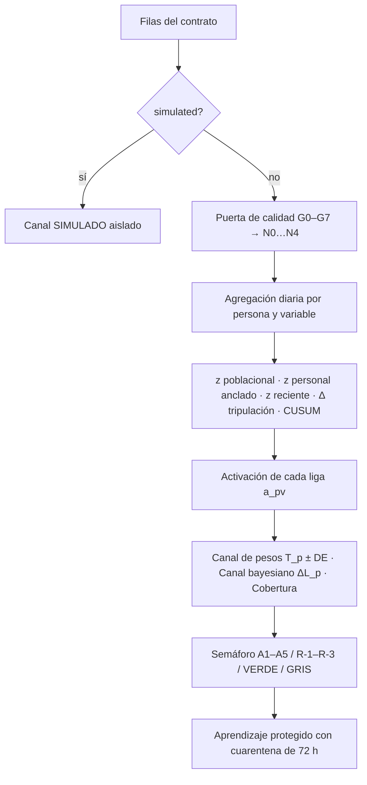

> 🌐 **Español** · [English](README_06_MODELOS_COMPUTACIONALES_ALGORITMOS.en.md)

# 06 · Modelos computacionales y algoritmos

> **Nada de lo que aquí se describe es un diagnóstico.** Los umbrales son provisionales, ninguno está validado en astronautas y los colores y estados no son probabilidades clínicas.

El proyecto tiene **cuatro motores de cálculo independientes**. Es importante no confundirlos:

| # | Motor | Dónde corre | Para qué | Estado |
|---|---|---|---|---|
| 1 | **LUNNA** (modelo bayesiano por variable) + umbral clínico | Backend, [`lunna.ts`](../Sistema/backend/src/lunna.ts), [`ingesta.ts`](../Sistema/backend/src/ingesta.ts) | Estado verde/ámbar/rojo de cada variable y alertas | Implementado y probado |
| 2 | **Motor del navegador** (normal personal de 14 días) | Interfaces, [`motor.js`](../Sistema/interfaces/eva/motor.js) | Estados ●■▲○ del escenario de las interfaces | Implementado (escenario sintético) |
| 3 | **Índice por padecimiento** (matriz de pesos de 11 malestares) | Central y base, [`consola.js`](../Sistema/interfaces/eva/consola.js), [`pesos.js`](../Sistema/interfaces/eva/pesos.js) | Ordenar la revisión en «Pronósticos» | Implementado; determinista, no probabilístico |
| 4 | **Motor de padecimientos** (20 padecimientos, semáforo) | Python, [`prototipo-salud/motor/`](../prototipo-salud/motor/); lo lanza el backend ([`semaforo.ts`](../Sistema/backend/src/semaforo.ts)) y lo muestra la central (`semaforo.js`) | VERDE/AMARILLO/ROJO/GRIS con trazabilidad | Implementado; umbrales provisionales |

A esto se suman los **adaptadores de modelos** (cinco de ecocardiografía y uno de ECG) del prototipo de salud.

## 1. LUNNA: modelo por variable (backend)

### 1.1 Entradas y salidas

| | Detalle |
|---|---|
| Entradas | Muestras válidas de una variable y un tripulante; basal (`basales`); prior por variable y entorno (`priores`); historial de misiones previas (`historial`); fase de la misión (`fases`) |
| Salidas | Valor esperado, banda del 95 %, `z`, `prob_nominal`, estado (`verde`, `ambar`, `rojo`), `pesos` de cada fuente y alertas con `motivo` (`personal`, `umbral` o `ambos`) |

### 1.2 Cambio respecto del basal

```text
Δ = x/b − 1     (escala relativa)
Δ = x − b       (escala absoluta)
```

El prior poblacional puede ajustarse por covariables centradas (edad 35 años, peso 70 kg, altura 1,70 m, sexo femenino como indicador). Si el prior no declara coeficientes β, estos son cero. **El grupo sanguíneo no entra en el modelo.**

### 1.3 Combinación por precisión (tres capas)

| Capa | Fuente | Ejemplo |
|---|---|---|
| ① Prior poblacional | Literatura (catálogos) | PA sistólica −6,7 % en órbita |
| ② Historial personal | Misiones previas importadas | «En Artemis su FC bajó 10 %» |
| ③ Calibración | Mediana diaria de los primeros **14 días** del entorno; luego se **congela** | — |

```text
q₀ = 1/τ₀²      qₕ = n_hist/σ_misión²      q_f = n_cal/σ_día²
μ  = (q₀·μ₀ + ΣΔ_hist/σ_misión² + ΣΔ_cal/σ_día²) / (q₀ + qₕ + q_f)
τ  = √(1/(q₀ + qₕ + q_f))
SD_pred = √(τ² + σ_día²)
banda_95 = valor(μ ± 1,96 · SD_pred)
```

El valor esperado vuelve a unidades originales: `b(1+μ)` en escala relativa o `b+μ` en escala absoluta. La banda describe incertidumbre predictiva, **no es un intervalo de referencia clínica**.

**Priores por entorno.** Tierra usa cambio cero. Órbita usa la semilla. Tránsito multiplica τ₀ por 1,5, y Luna y Marte por 2; estos tres se marcan **extrapolados**, porque no hay datos humanos.

### 1.4 Vigilancia y estados

| Criterio | Qué compara | Requisitos |
|---|---|---|
| **Personal** | Mediana válida de **24 h** (ventana configurable con `/api/lunna/ventana`; 1440 min en misión) contra lo esperado: `z = (Δ_obs − μ) / √(τ² + σ_día²)` | Calibración terminada y ≥ 3 muestras válidas |
| **Umbral clínico** | Mediana de las últimas **5 muestras válidas en ≤ 10 min** contra `medibles.json` | ≥ 3 muestras; vale también durante la calibración |

- Estados personales: `verde` si \|z\| < 2, `ámbar` si 2 ≤ \|z\| < 3, `rojo` si \|z\| ≥ 3.
- `prob_nominal = 1 − erf(|z|/√2)`: cola bilateral normal. **No es una probabilidad posterior de padecimiento.**
- Manda el peor de los dos criterios. Solo los **cambios de estado** generan alerta; la vuelta a verde también se registra.
- Comparación estricta (`<` y `>`): un valor igual al límite no dispara.
- «Válida» significa valor no nulo y `contacto` distinto de `false`.

## 2. Motor del navegador (interfaces)

[`motor.js`](../Sistema/interfaces/eva/motor.js) genera la tripulación y las series del escenario (días 106–115, semilla fija) y evalúa:

- **Tu normal**: los 14 días anteriores, con un mínimo de 7.
- **Desviación**: z robusto con mediana y MAD, con una variación mínima creíble por indicador.
- **Reglas de estado**:
  - una señal sola pide atención con \|z\| ≥ 3;
  - tres señales con \|z\| ≥ 2 a la vez también la piden (episodio FATIGA-03);
  - el aviso se cierra tras dos días con \|z\| < 2;
  - tu normal nunca da rojo por sí sola.
- **Umbrales absolutos** para presión (AHA [T]), SpO₂, glucosa (ADA [T]) y CO₂.
- **Valor normal del motor de padecimientos.** Si el backend tiene una referencia del motor para esa persona y variable (`GET /api/padecimientos/referencias`, conectada por [`alertas-motor.js`](../Sistema/interfaces/eva/alertas-motor.js)), esa referencia sustituye a «tu normal» de 14 días.

Pruebas: `node --test Sistema/interfaces/eva/motor.test.mjs Sistema/interfaces/eva/alertas-motor.test.mjs`.

> Pendiente documentado por el equipo: `motor.js` genera dentro de sí la tripulación y las series del escenario. Separar el escenario del motor y pintar las pantallas con datos en vivo es un cambio aparte.

## 3. Índice por padecimiento (matriz de pesos de 11 malestares)

**Fuente:** [`Planeacion/Leo/modelo-pesos/generar_pesos.py`](../Planeacion/Leo/modelo-pesos/generar_pesos.py). Es la fuente de verdad, y genera `pesos.csv`, `pesos.json` y `Sistema/interfaces/eva/pesos.js`.

La matriz tiene 11 malestares × 9 predictores = 99 celdas. Cada celda lleva peso 0–3, dirección, mecanismo, nivel de evidencia A/B/C, referencia con DOI y prior. Hay 54 celdas con peso (11 A · 14 B · 29 C) y 45 descartadas.

| Peso | Significado |
|---|---|
| 0 | Sin vía fisiológica (descartada) |
| 1 | Marcador asociado |
| 2 | Eslabón causal directo |
| 3 | La variable **es** el mecanismo |

**Cálculo en la consola (determinista):**

1. Puntos por \|z\| en la dirección fisiológica: < 1 → 0 · [1, 2) → 1 · [2, 3) → 2 · ≥ 3 → 3.
2. Presión, SpO₂ y CO₂ usan los umbrales del teléfono: atención → 2, alerta → 3. El CO₂ del escenario da 2 puntos por encima de 3 mmHg.
3. `índice = Σ(peso × puntos) / Σ(peso × 3)` sobre las señales disponibles. Se muestra la cobertura; si falta la variable de mayor peso, el índice sale **incompleto**.
4. La tendencia a 3 días es una extrapolación lineal **ilustrativa**.

Las variables que no se miden a diario (síntomas, pulso irregular, ortostatismo, fase circadiana) quedan fuera.

### 3.1 Actualizador bayesiano de pesos (referencia, no se usa en vivo)

[`actualizacion_bayesiana.py`](../Planeacion/Leo/modelo-pesos/actualizacion_bayesiana.py) implementa una regresión logística bayesiana en Python puro:

```text
η = β₀ + Σ βᵥ·xᵥ ;  P = σ(η)
κ = ln(20)/9 ≈ 0,333   (peso 3 con desviación extrema ⇒ momios × 20; decisión del equipo)
βᵥ ~ Normal(κ·prior_mediaᵥ, (κ·prior_deᵥ)²),  prior_de: A 0,5 · B 1,0 · C 1,5
β₀ ~ Normal(logit(p₀), 1)
β̂ = argmax Σ[y log σ(η) + (1−y) log(1−σ(η))] − ½(β−μ)ᵀΣ⁻¹(β−μ)     (MAP)
Σ_post = (XᵀWX + Σ⁻¹)⁻¹,  W = diag(p(1−p))                           (Laplace)
```

Su demostración usa **600 días simulados** del malestar «infección». Con ellos, la FC sube de 2,00 a 2,36 frente a una «verdad» simulada de 2,6, y la presión baja de 1,00 a 0,59 frente a 0. **No hay un flujo de etiquetas reales ni aprendizaje desplegado.**

## 4. Motor de padecimientos (prototipo de salud)

Implementa la especificación normativa `ALGORITMOS.md` del 14 de noviembre de 2026, recogida en el README consolidado; el diseño está en la sección `motor/DISENO.md` del mismo. Solo usa `numpy`, `pandas` y la biblioteca estándar.

| Módulo | Función |
|---|---|
| [`calidad.py`](../prototipo-salud/motor/calidad.py) | Puerta G0–G7, mapeo métrica → `variable_id`, clase de dispositivo, nivel N0–N4, vigencia |
| [`entradas.py`](../prototipo-salud/motor/entradas.py) | Lee runs de `outputs/raw`, sensores, CSV nativo y FEVI de eco (`desde_eco`) |
| [`normalizacion.py`](../prototipo-salud/motor/normalizacion.py) | Agregación diaria, z poblacional, base personal, delta de tripulación, estado de variable |
| [`calibracion.py`](../prototipo-salud/motor/calibracion.py) | Base prevuelo inmutable, EWMA protegido, CUSUM, cuarentena |
| [`score.py`](../prototipo-salud/motor/score.py) | Activación, canal de pesos con incertidumbre, canal bayesiano, cobertura |
| [`semaforo.py`](../prototipo-salud/motor/semaforo.py) | Reglas A1–A5, R-1–R-3, VERDE/GRIS, histéresis |
| [`evaluacion.py`](../prototipo-salud/motor/evaluacion.py) | Orquesta y devuelve un JSON serializable |
| [`parametros.py`](../prototipo-salud/motor/parametros.py), [`tablas.py`](../prototipo-salud/motor/tablas.py) | Constantes provisionales S1–S20, overrides, tablas con fuente |
| [`evadb.py`](../prototipo-salud/motor/evadb.py) | Lectura y escritura en `eva.db` |
| [`referencias.py`](../prototipo-salud/motor/referencias.py) | Valor normal por variable |
| [`puente_modelos.py`](../prototipo-salud/motor/puente_modelos.py) | Salidas de modelos → muestras |
| [`simulador.py`](../prototipo-salud/motor/simulador.py) | Tripulación **SIMULADA** (5 personas, 30 días) |

### 4.1 Orden de cálculo



### 4.2 Puerta de calidad

La calidad **degrada el nivel de evidencia, no el peso**. Así se reutiliza la escala del equipo (`prior_de`: A = 0,5, B = 1,0, C = 1,5).

| Nivel | Cuándo | Efecto |
|---|---|---|
| N1 | Precisión «alta» o instrumento de referencia | Nivel de la tabla; actualiza la base |
| N2 | Precisión «media» (reloj PPG, SpO₂ de muñeca) | Baja un escalón; solo actualiza la base de su clase de dispositivo |
| N3a / N3b | Baja por evidencia / precisión no evaluada | Baja un escalón / nivel de la tabla, marcado |
| **N4** | Cuffless, PR/QTc del adaptador, bandera de ritmo, **toda salida de eco**, métrica discordante | Forzado a C; **nunca** actualiza la base, no da ROJO por sí solo y un negativo no respalda VERDE |
| N0 | Rechazada (contrato, dominio, contexto) | — |

### 4.3 Desviación y autocalibración

- **z poblacional** solo donde hay rango publicado: FC en reposo (NHANES, z asimétrico), temperatura (Obermeyer 2017: 36,6 °C, s ≈ 0,41) y HRV en logaritmo (Nunan 2010). SpO₂, PA y FR se tratan como bandas ordinales, sin z.
- **Base prevuelo encogida** (Sottas 2007):

  ```text
  μ_i = B·m_ref + (1 − B)·x̄_i,   B = (s_w²/n0) / (s_w²/n0 + s_b²),   s_i² = s_w² + B·s_b²
  ```

  Requiere n0 ≥ 5 (Coskun 2021). Se **congela al lanzamiento** y es **inmutable**.
- **z por fase**: `z_fase = (x − μ_i − δ_vφ)/s_i`. En este prototipo δ = 0 para todas las variables, la opción conservadora.
- **EWMA protegido**: α = 0,1, tope de ±1,5 DE. Solo aprende de puntos estables, no simulados, no N4, sin alerta, fuera de episodios y transiciones, y tras una **cuarentena de 72 h**.
- **CUSUM** anclado al prevuelo: `C(t) = max(0, C(t−1) + r(t) − k)`, con k = 0,5 y h = 5. Solo lo reinicia una revisión humana.
- **Estados de variable**: normal (u < 1,5), desviada, alertada (u ≥ 2,33 en una dirección o 2,58 en dos), persistente (≥ 24 h) y deriva.

«Aprende» quiere decir esta autocalibración por persona, no el entrenamiento de una red. Ejemplo reproducible (datos **SIMULADO**, ejecutado el 15 nov 2026 con `python3 -m validacion.ejemplo_aprende` en `prototipo-salud/`): dos hombres de 30 años marcan la misma FC en sueño, 85 lpm, el día 5 de vuelo. Contra la población (NHANES) ambos dan z = 1,32 (normal). Contra su propia base de 14 noches, SIM-A (58,1 ± 2,9 lpm) da z = 9,17 y queda alertada; SIM-B (83,6 ± 3,3 lpm) da z = 0,43 y queda normal. Con 2 noches la base de SIM-A es 54,0 ± 5,1 lpm (DE combinada de la tripulación, B = 0,07); desde 5 noches usa su propia DE. Cifras completas y aviso de que no es un diagnóstico: [pruebas §4.3](README_08_PRUEBAS_VALIDACION.md#43-motor-de-padecimientos-con-datos-simulados-brazo-2-de-la-especificación).

### 4.4 Score de dos canales

- **Canal de pesos** (las 350 ligas): `T_p = Σ_grupos max(μ_pv · a_pv)`. Las variables correlacionadas, por ejemplo FC y FC instantánea, solo cuentan una vez. La incertidumbre se calcula como `Var(T_p) ≈ Σ[a²σ² + μ²Var(a)]` y se informa `T_inf = max(0, T − 1,645·DE)`.
- **Canal bayesiano**: solo en las 6 ligas con LR u OR publicado (Taggar 2016, Kroenke 2001, McGee 1999 ×2, Call 2005, Law 2014). Se calcula `ΔL_p = Σ κ_v · ln LR_v`, con κ = 1 solo si la medición es del mismo tipo que la del estudio.
- **Cobertura**: `Cob_p = Σ μ de las ligas con dato vigente N1–N3 / Σ μ de las ligas medibles en la fase`.

### 4.5 Semáforo

| Color | Condición (todos los cortes son provisionales, supuesto S2) |
|---|---|
| **AMARILLO** | A1: T ≥ 3 · A2: ΔL ≥ ln 3 · A3: criterio publicado en una liga de peso ≥ 2 · A4: deriva en una liga de peso ≥ 2 · A5: una capa fija supera su criterio (PHQ-9 ≥ 10) |
| **ROJO** | R-1: T_inf ≥ 2 y persistencia ≥ 24 h · R-2: límite inferior de ΔL ≥ ln 10 · R-3: evento centinela. En todos los casos, al menos una liga activa que **no** sea N4 |
| **VERDE** | Sin condiciones activas **y** Cob ≥ 0,5 **y** al menos una liga núcleo (peso 3) con dato vigente |
| **GRIS** | En cualquier otro caso: «evidencia insuficiente» |

- **Histéresis**: AMARILLO baja tras 2 evaluaciones sin condición. ROJO exige además un acuse humano, que **no tiene interfaz** en el prototipo.
- **No se muestra ninguna probabilidad.**

Comprobaciones aritméticas fijadas por la especificación (d.7):

- P01 solo con el adaptador ECG: T = 5, DE = 2,12, T_inf = 1,51 → AMARILLO; nunca ROJO.
- P04 con FC alertada (N1, A) y temperatura alertada (N3b, B): T = 5, DE = 1,12, T_inf = 3,16 → AMARILLO, y ROJO si persiste 24 h.

### 4.6 Parámetros configurables

Desde la vista **Configuración** (o `datos/modelo/overrides.json`, o la tabla `pesos_usuario` si hay `EVA_DB`) se pueden cambiar umbrales (`T_amarillo`, …), pesos de liga y `prior_de`. Los CSV con fuente nunca se escriben. Los 20 supuestos abiertos (S1–S20) están listados en la especificación §(i).

### 4.7 Reglas de demostración R1–R5 (`fusion/reglas.py`)

| Regla | Qué hace | Relación con el semáforo |
|---|---|---|
| R1 | FEVE < 40 % | Capa aparte; no entra al semáforo |
| R2 | Discrepancia entre modelos > 10 pp | Se convierte en puerta de calidad («discordante») |
| R3 | FC nocturna ≥ basal + 4 lpm durante 2 noches (tipo NightSignal) | Se envuelve como activación experimental en P04, con la base de §4.3 |
| R4 | Eco más viejo que 72 h | Regla de vigencia |
| R5 | R1 ∧ R3 | Capa aparte |

`fusion/red_fusion_stub.py` declara que **no hay red de fusión entrenada**: `disponible: False`.

## 5. Prototipo de salud: adaptadores y runner

Cada modelo se ejecuta **aislado en su propio entorno virtual** (Python 3.11, torch 2.5.1 cu124) mediante el runner `python -m core.run_model`. Puede lanzarse desde la app Streamlit o desde la computadora central (`POST /api/modelos/analizar`; ver [arquitectura §9](README_04_ARQUITECTURA_SISTEMA.md#9-flujo-del-análisis-con-modelos-desde-la-central)). El runner:

1. valida la modalidad (`core/modalidad.py`) y la vista;
2. copia la entrada a `outputs/raw/<run_id>/input/`;
3. escribe `request.json` y lanza `adapters/<key>/infer.py`;
4. lee `response.json`.

El estado de la respuesta es `ok`, `error`, `rechazado` o `prueba_carga`. Una prueba de carga (arquitectura sin pesos y tensor aleatorio) **nunca se escribe** en `outputs/normalized.csv`.

### 5.1 Modelos de ecocardiografía

| Modelo | Entrada | Salidas | Pesos y recursos | Estado real |
|---|---|---|---|---|
| **PanEcho** (commit 836c46e) | Video 2D, cualquier vista | 40 tareas: probabilidades de clase (no calibradas) y estimaciones (EF, dimensiones, volúmenes) | 505 MB; ~2 GB de VRAM estimada | **Una inferencia real reportada** en la PC de Iker (CUDA, 17,4 s). No es validación |
| **EchoNet-Dynamic** (e01d029) | Video A4C (la vista se declara) | FEVE %, área del VI en px², frames de sístole, máscaras | 568 MB; ~3 GB | Arreglo de carga de pesos probado con pesos aleatorios; **pendiente en la PC** |
| **MedSAM2** (332f30d) | Video o imagen 2D **con caja o máscara inicial obligatoria** | Máscaras y áreas en px² | 156 MB; ~1,5 GB | Pendiente |
| **EchoPrime** (6d9c1ee) | Estudio multivista (DICOM / mp4) | Vista, 21 métricas por recuperación (fracción de vecinos), informe **recuperado** de otros estudios | ~3,9 GB; ~1,6–2 GB + RAM alta | Pendiente |
| **EchoCLIP / EchoCLIP-R** (23cd327) | Video o imagen 2D | Similitud coseno, FEVE *zero-shot* | ~1,2 GB; ~1,5 GB | Pendiente |

Notas:

- Las estimaciones de VRAM **no son mediciones**.
- En px² no se hace conversión física.
- La similitud no es una probabilidad.
- En el motor, la FEVI (`01:V18`) entra como **N4 de peso 1** en P01 y P02 (criterio Lang 2015: < 52 % en hombres y < 54 % en mujeres). **Sola no cambia ningún color.**
- Si dos modelos discrepan más de 10 pp, la FEVI queda como «discordante».

### 5.2 Procesamiento de ECG (`adapters/ecg`)

No es un modelo entrenado. Es procesamiento de señal con NeuroKit2 0.3.0 y wfdb 4.3.1, en CPU, sin pesos.

| Etapa | Método |
|---|---|
| Picos R | `nk.ecg_clean(method="neurokit")` + `nk.ecg_peaks` |
| RR válidos | 0,25 s ≤ RR ≤ 3,0 s; FC = 60 / media(RR) |
| Latidos irregulares | Prematuro si RR < 0,80 × mediana de los 8 RR previos (criterio del 20 %, experimental) |
| HRV | RMSSD y SDNN (ddof = 1) sobre intervalos NN, sin los RR adyacentes a latidos marcados |
| PR, QTc Bazett | Delineación DWT, medianas por latido (mínimo 5) |
| Bandera de ritmo irregular compatible con FA | Dash et al. 2009, sobre segmentos de 128 latidos: nRMSSD > 0,10 ∧ TPR ∈ [0,54, 0,77] ∧ entropía > 0,70; bandera si hay ≥ 2 segmentos consecutivos marcados. **BANDERA EXPERIMENTAL – NO DIAGNÓSTICO** |

Entrada: registro WFDB (`.hea` + `.dat`, opcionalmente `.atr`/`.qrs`) o CSV/TXT/TSV con `fs`. Salida: 8 filas normalizadas, más el artefacto `ecg_traza.npz` y la comparación con anotaciones si existen.

La rama de «RR omitidos» del artículo de Dash no está implementada. PR y QTc no están validados.

## 6. Requisitos computacionales

| Componente | Requisitos |
|---|---|
| Backend y LUNNA | Node 22.6+; CPU modesta; sin GPU |
| Motor del navegador e índice | Cualquier navegador |
| Motor de padecimientos | Python 3.13 (`envs\app`): pandas, numpy, streamlit |
| ECG | Python 3.11, CPU |
| Eco | Python 3.11, torch 2.5.1 cu124, GPU con 6 GB (referencia), ~6,3 GB de pesos, ≥ 30 GB libres para todo |

## 7. Limitaciones

1. Priores, dispersiones, umbrales del semáforo, α, k, h, cuarentena y vigencias son **provisionales** (S1–S20).
2. 310 de las 350 ligas son de nivel C, y no hay LR derivados en vuelo.
3. La bandera de ritmo es una reimplementación incompleta de Dash 2009, y sus cifras no son una validación independiente.
4. Los modelos de eco no tienen validación propia y sus licencias son restrictivas (académicas o no comerciales; EchoNet-Dynamic tiene licencias contradictorias).
5. δ de fase = 0. De las capas fijas solo se calcula PHQ-9: NEWS2, qSOFA y Centor quedan «incompletos» y Conkin queda «inactivo».
6. El acuse de ROJO y el cierre de CUSUM no tienen interfaz.
7. La tasa de falsas alarmas no está medida.
8. LUNNA congela la calibración a los 14 días; ese valor es una decisión del prototipo sin validación experimental.

## Documentación relacionada

- [Protocolo de investigación](README_02_PROTOCOLO_INVESTIGACION.md)
- [Diccionario de datos y variables](README_07_DICCIONARIO_DATOS_VARIABLES.md)
- [Pruebas y validación](README_08_PRUEBAS_VALIDACION.md)
- [Instalación, configuración y despliegue](README_09_INSTALACION_CONFIGURACION_DESPLIEGUE.md)
